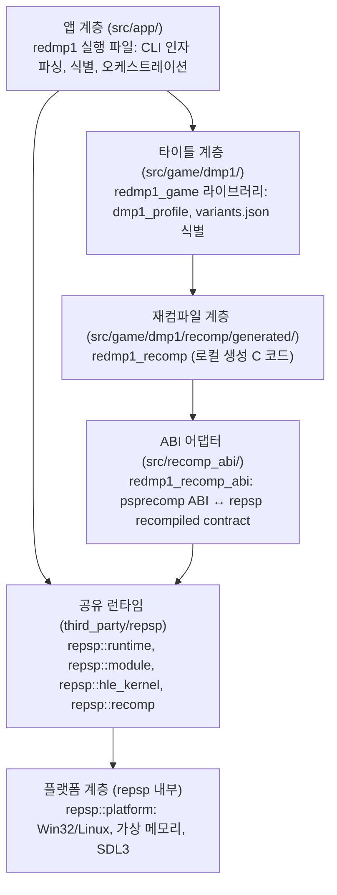
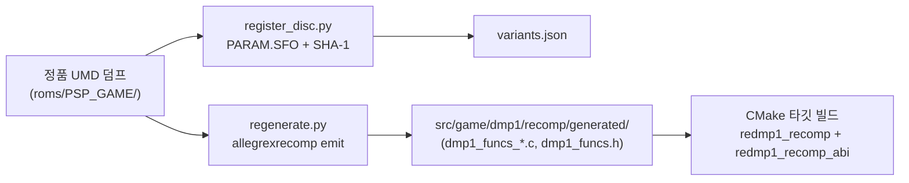
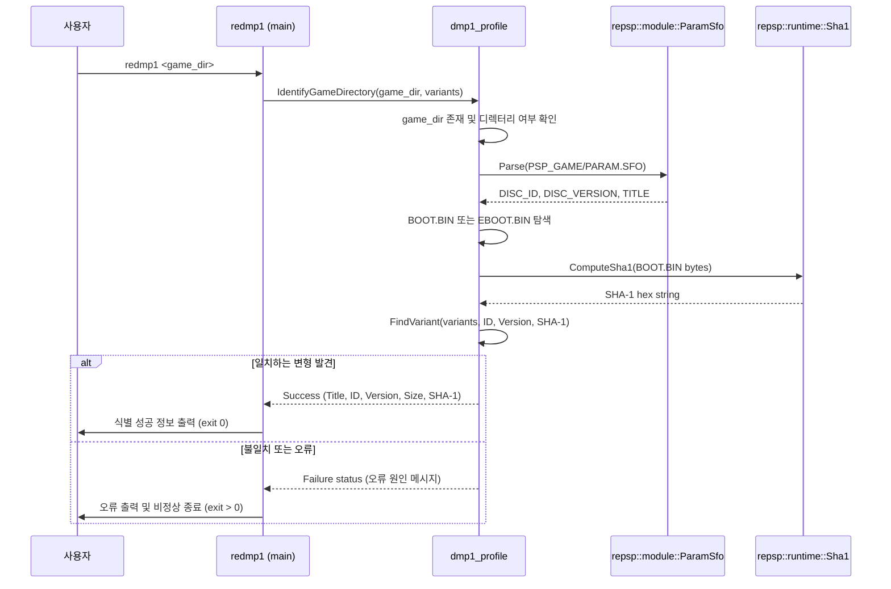

# 아키텍처 (ARCHITECTURE)

이 문서는 reDMP1 프로젝트의 레이어 구조, 컴포넌트 간 의존성, 재컴파일 파이프라인 및 실행 흐름을 정의합니다.

---

## 1. 레이어 구조 및 의존성 규칙

reDMP1은 엄격한 단방향 의존성 계층 구조를 따릅니다. 상위 레이어는 오직 직속 하위 레이어의 공개 인터페이스(public contract)만 참조하며, 하위 레이어는 상위 레이어의 존재나 타이틀 고유 정보를 알지 못합니다.

### 레이어별 역할

1. **`app` (`src/app/`, 타깃 `redmp1`)**:
   * 애플리케이션 진입점(`main.cpp`).
   * 사용자 명령줄 인자(`--variants`, 게임 디렉터리 경로) 파싱 및 옵션 처리.
   * `redmp1_game`의 `IdentifyGameDirectory`를 호출하여 게임 디스크 유효성 검사.
2. **`game/dmp1` (`src/game/dmp1/`, 타깃 `redmp1_game`)**:
   * DJMAX Portable 타이틀 고유 메타데이터와 프로파일 정의(`include/redmp1/dmp1_profile.h`).
   * `variants.json` 파싱 및 디스크 식별 로직.
   * `repsp::module::ParamSfo`를 사용하여 `PSP_GAME/PARAM.SFO`로부터 `DISC_ID`, `DISC_VERSION`, `TITLE` 추출.
   * `repsp::runtime::ComputeSha1`을 사용하여 후보 실행 파일의 SHA-1 해시 검증.
3. **`recomp_abi` (`src/recomp_abi/`, 타깃 `redmp1_recomp_abi`)**:
   * `allegrexrecomp`가 기계적으로 생성한 C 코드가 호출하는 `psprecomp` 심볼(`psp_cpu`, `psp_read32`, `psp_write32`, `psp_hle_call`, VFPU 도우미 등)을 정의.
   * `repsp`의 재컴파일 코드 계약(`include/repsp/recomp/guest_cpu.h`)의 콜백 표(`repsp_guest_cpu_ops`)를 등록하여 repsp 런타임에 바인딩.
   * **`repsp`는 `psprecomp`에 의존하지 않으며**, 어댑터는 reDMP1 내부에 위치함.
4. **`repsp` (`third_party/repsp`, 공유 서브모듈)**:
   * 타이틀 중립적이며 독립적으로 재사용 가능한 PSP 런타임 라이브러리.
   * `GuestMemory`: 512 MiB 가상 주소 공간 예약 및 `0x1FFFFFFF` 미러링 접기 주소 변환.
   * `NidRegistry`: NID 기반 시스템 콜 디스패치 및 통계 수집.
   * `ParamSfo`: PSP `PARAM.SFO` 바이너리 파서.
   * `GuardedRun`: 하드웨어 세그폴트 및 접근 위반 방어 실행.
   * `DisplayBackend`, `InputBackend`, `AudioBackend`: SDL3 기반 하드웨어 백엔드.

---

## 2. 재컴파일 파이프라인

재컴파일 파이프라인은 원본 게임 미디어로부터 네이티브 실행 코드를 빌드하기까지의 흐름을 정의합니다.

1. **`register_disc.py`**:
   * 게임 폴더 내 `PARAM.SFO`에서 디스크 ID(`ULKS46050`)와 버전(`1.02`)을 추출.
   * 평문 실행 파일(`BOOT.BIN`)의 SHA-1 다이제스트를 계산하여 `variants.json`에 등록.
2. **`allegrexrecomp` (호스트 도구)**:
   * `third_party/psprecomp/tools/allegrexrecomp`의 핵심 소스를 psprecomp 런타임 라이브러리 의존성 없이 빌드하여 호스트 실행 파일로 제공.
   * `info`: ELF/PRX 컨테이너 헤더 및 세그먼트 정보 출력.
   * `funcs`: 제어 흐름 분석, 함수 발견, 임포트 NID 통계 출력.
   * `emit`: 발견된 9,159개 함수를 144개 C 소스 파일(`dmp1_funcs_*.c`)로 분할 생성.
3. **`regenerate.py`**:
   * `BOOT.BIN`을 lift 입력으로 자동 선택하여 `allegrexrecomp emit`을 실행하고 `src/game/dmp1/recomp/generated/`에 C 코드를 갱신.

---

## 3. 실행 디렉터리 및 디스크 식별 흐름

---

# Architecture (English)

This document describes reDMP1's layer structure, component dependencies, recompilation pipeline, and runtime flow.

## 1. Layers and Dependency Rules

* **`app` (`src/app/`, target `redmp1`)**: Application entry point, CLI arguments, orchestration.
* **`game/dmp1` (`src/game/dmp1/`, target `redmp1_game`)**: Title profile, variant identification, SFO parsing via repsp, SHA-1 validation.
* **`recomp_abi` (`src/recomp_abi/`, target `redmp1_recomp_abi`)**: Adapter defining psprecomp ABI globals/functions and binding to repsp's recompiled-code contract. repsp does not depend on psprecomp.
* **`repsp` (`third_party/repsp`)**: Shared PSP runtime (GuestMemory, NidRegistry, HLE kernel, platform backends with SDL3).

## 2. Recompilation Pipeline

1. `register_disc.py`: Reads `PARAM.SFO` and computes `BOOT.BIN` SHA-1 to register the disc into `variants.json`.
2. `allegrexrecomp`: Host tool built without psprecomp runtime dependencies.
3. `regenerate.py`: Selects `BOOT.BIN` as plain ELF lift input and invokes `allegrexrecomp emit` into `src/game/dmp1/recomp/generated/`.

## 3. Disc Identification Flow

`redmp1` verifies `PSP_GAME/PARAM.SFO` and `BOOT.BIN` SHA-1 against `variants.json`. If matched, returns success and details; otherwise prints diagnostics and exits with a non-zero code.
