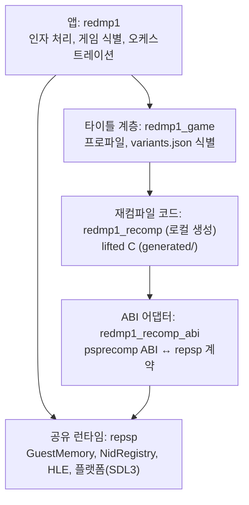

# reDMP1

DJMAX Portable(한국판, `ULKS-46050`, 디스크 버전 1.02)을 에뮬레이터 없이 Win64 및 Linux x64에서 네이티브로 실행하는 정적 재컴파일(static recompilation) 및 디컴파일 오픈소스 프로젝트입니다.

---

## 프로젝트 개요

이 프로젝트는 원본 PSP UMD의 Allegrex MIPS 코드를 C 코드로 정적으로 재컴파일(lift)하고, 사람이 읽을 수 있는 C/C++ 코드로 점진적으로 디컴파일하여 네이티브 바이너리로 실행합니다.

* **재컴파일(Recompilation)**: [sp00nznet/psprecomp](https://github.com/sp00nznet/psprecomp)의 `allegrexrecomp` 도구를 호스트 도구로 빌드하여 원본 ELF의 기계어 코드를 기계적으로 C로 변환합니다.
* **디컴파일(Decompilation)**: 변환된 C 함수를 사람이 유지보수 가능한 C/C++로 하나씩 대체하며 원본 동작과의 동등성을 검증합니다.
* **PSP 런타임 및 플랫폼 백엔드**: 재사용 가능한 공유 PSP 런타임 라이브러리인 [reexec/repsp](https://github.com/reexec/repsp)를 통해 가상 메모리 관리, NID 임포트 디스패치, HLE(시스템 콜/OS 라이브러리), SDL3 기반 플랫폼 계층(창, 입력, 오디오)을 제공받습니다.



> [!IMPORTANT]
> **게임 데이터 미포함 안내**: 이 저장소에는 ISO, `BOOT.BIN`, `EBOOT.BIN`, PRX 모듈, 그래픽/음원 자산 등 일체의 저작권 보호 대상 원본 게임 데이터가 포함되어 있지 않습니다. 사용자는 직접 소유한 정품 UMD 미디어에서 추출한 덤프 디렉터리(`roms/`)를 제공해야 합니다.

---

## 빌드 방법

### 사전 요구사항

* **Windows**:
  * Visual Studio 2022 (v17) C++ 데스크톱 개발 워크로드
  * CMake 3.25 이상
  * Python 3.10 이상
* **Linux (Ubuntu 24.04)**:
  * GCC 13+ 또는 Clang 16+
  * CMake 3.25+, Ninja
  * SDL3 의존 라이브러리 (ALSA, PulseAudio, X11, Wayland, OpenGL/EGL 개발 패키지)

### 서브모듈 초기화

```bash
git submodule update --init --recursive
```

### Windows (Win64) 빌드

CMakePresets를 사용하여 빌드합니다:

```powershell
# Debug 구성
cmake --preset win64-debug
cmake --build build/win64-debug --config Debug
ctest --test-dir build/win64-debug -C Debug --output-on-failure

# 또는 제공되는 빌드 스크립트 사용
.\scripts\build_win64.ps1 -Config Debug
```

### Linux (x64) 빌드

```bash
# Debug 구성
cmake --preset linux-x64-debug
cmake --build build/linux-x64-debug
ctest --test-dir build/linux-x64-debug --output-on-failure

# 또는 제공되는 빌드 스크립트 사용
./scripts/build_linux.sh Debug
```

---

## 실행 및 파이프라인 사용법

### 1. 디스크 덤프 등록

추출한 UMD 파일들이 위치한 디렉터리(기본 `roms/`)를 `variants.json`에 등록합니다:

```powershell
python scripts/recomp/register_disc.py roms
```

### 2. C 코드 재생성 (Lifting)

호스트 도구 `allegrexrecomp`를 통해 실행 파일에서 C 코드를 추출합니다:

```powershell
python scripts/recomp/regenerate.py roms
```

생성된 C 소스 파일들은 `src/game/dmp1/recomp/generated/`에 배치되며, Git 추적에서 자동으로 제외됩니다.

### 3. 게임 실행 및 식별 검증

```powershell
.\build\win64-debug\Debug\redmp1.exe roms
```

---

## 플랫폼 지원 현황

| 플랫폼 | 아키텍처 | 상태 | 비고 |
|---|---|---|---|
| Windows | x64 (Win64) | **지원됨 (개발 완료)** | 1차 개발 플랫폼, Visual Studio 2022 |
| Linux | x64 | **지원됨 (개발 완료)** | Ubuntu 24.04, GCC/Clang + Ninja |
| Windows | x86 (Win32) | 계획됨 | 향후 32비트 포팅 예정 |
| Linux | x86 | 계획됨 | 향후 32비트 포팅 예정 |
| Web | WebAssembly | 계획됨 | Emscripten 및 WebGL 기반 |
| Android | ARM64 | 계획됨 | NDK 및 OpenSL/Vulkan 기반 |

---

## 라이선스 및 상표 고지

* **소스 코드 라이선스**: 이 프로젝트의 자체 소스 코드는 [MIT License](LICENSE)에 따라 배포됩니다.
* **서드파티 라이선스**: 서드파티 오픈소스 의존성에 대한 고지는 [THIRD_PARTY_NOTICES.md](THIRD_PARTY_NOTICES.md)를 참조하십시오.
* **상표권 고지**: `DJMAX`, `DJMAX Portable`, `PENTAVISION` 및 관련 상표, 로고, 저작물은 주식회사 네오위즈(NEOWIZ) 및 관련 권리자의 등록 상표 또는 자산입니다. 이 프로젝트는 순수 오픈소스 리버스 엔지니어링 및 보존 목적의 비공식 연구 프로젝트이며, 네오위즈와 어떠한 제휴나 후원 관계도 없습니다.

---

# reDMP1 (English)

An open-source static recompilation and decompilation project to run DJMAX Portable (Korea build, `ULKS-46050`, disc version 1.02) natively on Win64 and Linux x64 without an emulator.

## Overview

reDMP1 lifts the Allegrex MIPS code from the original PSP UMD into C and incrementally replaces lifted functions with human-readable, verified C/C++ code.

* **Recompilation**: Uses `allegrexrecomp` from [sp00nznet/psprecomp](https://github.com/sp00nznet/psprecomp) as a host tool to mechanically lift MIPS code into C.
* **Decompilation**: Progressively replaces lifted functions with maintainable C/C++ while verifying behavioral equivalence.
* **PSP Runtime & Platform**: Backed by the shared portable PSP runtime [reexec/repsp](https://github.com/reexec/repsp) for memory management, NID dispatch, HLE syscalls, and SDL3 platform backends.

## Game Data Notice

**No copyrighted game data is included.** Users must provide their own dump extracted from legitimate UMD media in `roms/`.

## Building

```bash
# Submodules
git submodule update --init --recursive

# Win64
cmake --preset win64-debug
cmake --build build/win64-debug --config Debug
ctest --test-dir build/win64-debug -C Debug --output-on-failure

# Linux x64
cmake --preset linux-x64-debug
cmake --build build/linux-x64-debug
ctest --test-dir build/linux-x64-debug --output-on-failure
```

## Running

1. Register disc: `python scripts/recomp/register_disc.py roms`
2. Generate lifted C: `python scripts/recomp/regenerate.py roms`
3. Run identifier: `./build/win64-debug/Debug/redmp1 roms`

## License & Trademark Notice

Licensed under the MIT License. See [LICENSE](LICENSE) and [THIRD_PARTY_NOTICES.md](THIRD_PARTY_NOTICES.md). DJMAX Portable is a registered trademark of NEOWIZ. This project is unofficial and not affiliated with NEOWIZ.
