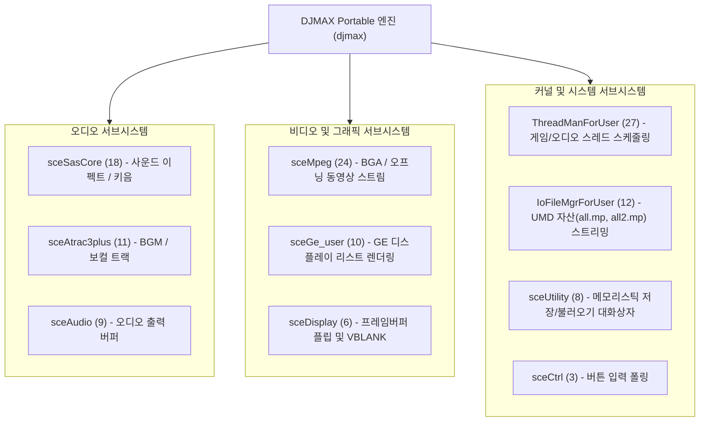

# DJMAX Portable 실행 파일 구조 및 설계 (EXECUTABLE_DESIGN)

이 문서는 DJMAX Portable(한국판 `ULKS-46050`, 1.02)의 원본 실행 파일(`PSP_GAME/SYSDIR/BOOT.BIN` 및 `EBOOT.BIN`)을 분석하여 확인된 프로그램 구조, 메모리 배치, 서브시스템 상호작용 및 설계를 누적 기록합니다.

---

## 1. 모듈 개요

* **모듈 식별자**: `djmax` (버전 1.1)
* **모듈 속성**: `0x0000` (User Mode PRX)
* **엔트리 포인트**: `0x00000128` (`module_start`)
* **GP ($gp) 레지스터 초기값**: `0x00026660`
* **실행 컨테이너**: ELF32 MIPS R4000 Little-Endian (PRX, Relocatable)
* **평문 및 암호화 바이너리 동등성**: `EBOOT.BIN`의 Sony `~PSP` 헤더 태그는 `0xC0CB167C`이며, 복호화 대상 ELF 크기(`1,463,072` 바이트) 및 세그먼트 배치가 평문 `BOOT.BIN`과 100% 동일함이 확인되었습니다.

---

## 2. 메모리 세그먼트 및 런타임 레이아웃

바이너리는 2개의 `PT_LOAD` 세그먼트로 구성되어 있습니다.

| 세그먼트 | 베이스 주소 | 파일 크기 | 메모리 크기 | 플래그 | 설명 |
|---|---|---|---|---|---|
| Segment 0 | `0x00000000` | 1,028,240 바이트 | 1,028,240 바이트 | `rwx` | 코드(`.text`), 읽기 전용 데이터(`.rodata`), 임포트/익스포트 스텁 |
| Segment 1 | `0x00FB090` | 124,516 바이트 | 2,718,852 바이트 | `rw-` | 전역 변수(`.data`), 런타임 제로 초기화 영역(`.bss`, 2,594,336 바이트) |

* 총 런타임 메모리 요구량(BSS 포함): 약 3.75 MiB (`1,028,240 + 2,718,852 = 3,747,092 바이트`).
* PSP 사용자 메모리(User RAM 24 MiB)의 `0x08800000` 상단에 배치되어 실행됩니다.

---

## 3. 서브시스템 및 임포트 펌웨어 라이브러리 구조

게임은 총 20개 라이브러리에서 144개의 고유한 시스템 함수를 임포트합니다.

### 3.1. 오디오 파이프라인
* `sceSasCore` (18개 함수): 게임 내 키음, 효과음, 메뉴 사운드 합성에 사용됩니다.
* `sceAtrac3plus` (11개 함수): 곡 배경음악(BGM) 디코딩에 사용됩니다.
* `sceAudio` (9개 함수): 최종 PCM 스트림을 하드웨어 채널로 출력합니다.

### 3.2. 비디오 파이프라인
* `sceMpeg` (24개 함수): PMF 동영상(H.264 비디오 + ATRAC3plus 오디오) 디코딩을 담당합니다.
* `sceGe_user` (10개 함수): PSP Graphic Engine에 디스플레이 리스트를 제출하여 2D 스프라이트, 노트, 3D 배경을 렌더링합니다.
* `sceDisplay` (6개 함수): 480x272 해상도 화면 버퍼를 VBLANK 주기에 맞추어 전환합니다.

---

## 4. 제어 흐름 및 함수 분석

* 발견된 함수 수: 9,159개
* 코드 커버리지: `.text` 섹션의 92.4% (761,108 / 823,684 바이트 도달)
* VFPU 명령어 비율: 208개 (전체 명령어의 0.11%), 67개 함수에서 사용됨.
* 간접 점프 테이블: 212개 점프 테이블(총 5,264개 분기 타깃)이 완벽히 식별되었으며, 미해결 간접 점프는 0개입니다.

상세 분석 수치와 통계는 [docs/analysis/executable.md](analysis/executable.md)를 참조하십시오.
