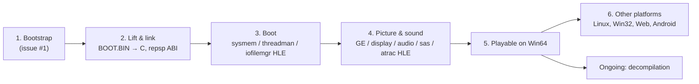

# 프로젝트 헌장

## 목적

reDMP1은 PSP 게임 DJMAX Portable을 정적 재컴파일과 디컴파일로 Win64, Linux x64, Win32, Linux x86, Web, Android에서 네이티브로 실행되게 만든다.

게임 로직은 원본 Allegrex 코드에서 기계적으로 옮긴 코드가 담당하고, 디컴파일은 그 코드를 같은 동작의 읽을 수 있는 코드로 바꿔 간다. lift는 [psprecomp](https://github.com/sp00nznet/psprecomp)의 `allegrexrecomp`가 맡는다. PSP 펌웨어, GE, 오디오, 입력을 대신하는 HLE와 호스트 플랫폼 서비스는 PSP 타이틀 프로젝트들이 공유하는 런타임 [repsp](https://github.com/reexec/repsp)가 맡고, 이 저장소는 타이틀 계층과 앱에 집중한다.

## Purpose

reDMP1 makes the PSP game DJMAX Portable run natively on Win64, Linux x64, Win32, Linux x86, the web and Android through static recompilation and decompilation.

Game logic is carried by code mechanically lifted from the original Allegrex code, and decompilation gradually turns that code into readable code of the same behavior. Lifting is done by `allegrexrecomp` from [psprecomp](https://github.com/sp00nznet/psprecomp). The HLE that stands in for the PSP firmware, the GE, audio and input, and the host platform services, are the runtime [repsp](https://github.com/reexec/repsp) shared by PSP title projects; this repository focuses on the title layer and the app.

## 현재 1차 목표

* 1차 타깃은 한국판 `ULKS-46050`(디스크 버전 1.02, `PSP_SYSTEM_VER` 2.00)이다. 원본 디스크의 신원과 구성은 [docs/analysis/disc-image.md](analysis/disc-image.md)에 있다. 다른 지역판·버전은 식별만 한다(발견되면).
* 1차 호스트는 Win64(MSVC x64)다. 이어서 Linux x64, 그 뒤 Win32, Linux x86, Web, Android로 넓힌다.
* 표시·입력·오디오 백엔드는 SDL3 + OpenGL이다(repsp).
* lifter는 psprecomp의 `allegrexrecomp`이며, 이 저장소가 고정하고 실행한다. psprecomp ABI를 repsp의 lifter 중립 계약에 잇는 어댑터도 이 저장소에 있다(repsp는 psprecomp에 의존하지 않는다).

## Current First Target

* The first target is the Korea build `ULKS-46050` (disc version 1.02, `PSP_SYSTEM_VER` 2.00). The original disc's identity and layout are in [docs/analysis/disc-image.md](analysis/disc-image.md). Other regions and versions are recognized only (when found).
* The first host is Win64 (MSVC x64), then Linux x64, then Win32, Linux x86, the web and Android.
* The display, input and audio backends are SDL3 + OpenGL (repsp).
* The lifter is psprecomp's `allegrexrecomp`, pinned and run by this repository, which also holds the adapter connecting the psprecomp ABI to repsp's lifter-neutral contract (repsp does not depend on psprecomp).

## 방향성

* 재컴파일된 원본 코드를 기준 구현으로 취급한다.
* 에뮬레이터(PPSSPP 등)를 통합하지 않는다. 동작 비교의 기준으로만 쓴다.
* 재사용 가능한 PSP 런타임 `repsp`와 타이틀 코드 `redmp1`을 분리한다. repsp에 필요한 변경은 repsp 저장소에서 한다.
* HLE는 API 경계(펌웨어 NID export, 시스템 콜)에서 하고, 하드웨어 수준 처리(GE 디스플레이 리스트)는 필요한 지점에만 둔다.
* 게임 데이터와 그것에서 생성한 코드는 저장소에 넣지 않는다. 사용자가 자기 덤프로 만든다.
* 라이선스는 MIT이며, 전염성 라이선스 코드는 빌드에 넣지 않는다.
* 코드 변경 전에는 설계와 작업 계획을 문서화한다.
* 프로젝트 버전은 `VERSION` 파일의 `major.minor.patch` 형식으로 관리한다.

## Direction

* Treat the recompiled original code as the reference implementation.
* Do not integrate an emulator (PPSSPP, ...); use one only as a reference for comparing behavior.
* Keep the reusable PSP runtime `repsp` separate from the title code `redmp1`; changes repsp needs are made in its repository.
* Do HLE at API boundaries (firmware NID exports, syscalls), with hardware-level processing (GE display lists) only where needed.
* Keep game data and code generated from it out of the repository; users build it from their own dump.
* The license is MIT, and copyleft code is not built in.
* Document design and work plans before changing code.
* Manage the project version in the `VERSION` file using `major.minor.patch`.

## 단계

1. 부트스트랩: 규칙, 레이어, repsp·psprecomp submodule, Win64 빌드 골격, 디스크 신원 등록, lifter 실행(게임 코드 링크 없이).
2. lift한 C를 repsp의 ABI 어댑터와 함께 Win64에서 링크한다.
3. 펌웨어 HLE(sysmem, threadman, iofilemgr, modulemgr, utility)로 진입점부터 부팅한다.
4. GE, display, audio, sasCore, ATRAC3plus, MPEG(PMF 동영상), ctrl HLE로 화면·소리·입력을 낸다.
5. Win64에서 플레이 가능.
6. Linux, Win32, Web, Android로 확장한다. 디컴파일은 2단계 이후 계속 진행한다.

## Stages

1. Bootstrap: rules, layers, the repsp and psprecomp submodules, a Win64 build skeleton, the disc identity registered, the lifter run (without linking game code).
2. Link the lifted C with repsp's ABI adapter on Win64.
3. Boot from the entry point on firmware HLE (sysmem, threadman, iofilemgr, modulemgr, utility).
4. Picture, sound and input through GE, display, audio, sasCore, ATRAC3plus, MPEG (PMF movies) and ctrl HLE.
5. Playable on Win64.
6. Widen to Linux, Win32, the web and Android. Decompilation proceeds continuously from stage 2 on.
