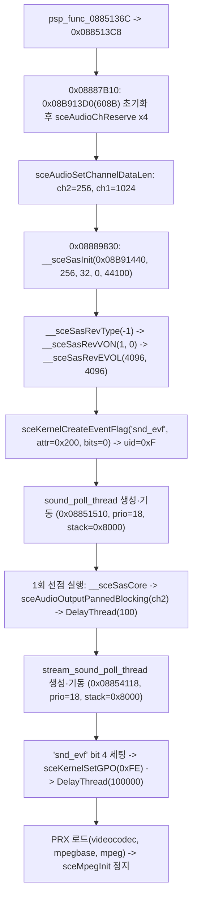
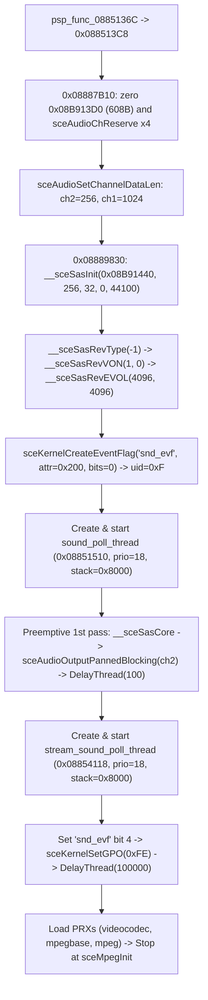

# 오디오·SAS·ATRAC3plus 서브시스템 분석 (`ULKS-46050`, `BOOT.BIN`)

> 상태 기준: **확인됨**(`BOOT.BIN` 재컴파일 코드·3회 연속 `REPSP_HLE_TRACE=1` 실행·로더 상태 검증), **추정**(외부 참고 [PSPSDK](https://github.com/pspdev/pspsdk) `pspaudio.h` / `pspsascore.h` / `pspatrac3.h` 기준 상수·모드 해석), **미확정**(실제 1차 부팅 정지 이후 스트리밍·효과음 런타임 재생 파라미터).

## 1. 오디오 초기화 및 스레드 기동 흐름 (**확인됨**)

* 진입 함수 `0x0885136C` / `0x088513C8`은 `0x08887AB8` → `0x08887B10`을 통해 오디오 관리 구조체(`0x08B913D0`, 608바이트)를 0으로 초기화한 뒤 `sceAudioChReserve(-1, samples, 0)`으로 스테레오 채널 4개를 순서대로 예약한다.
* 이어 `0x08888354`를 통해 채널 2(SAS 슬롯 `1`)의 길이를 `256`으로, 채널 1(스트림 슬롯 `0`)의 길이를 `1024`로 맞춘 뒤 `__sceSasInit`과 리버브 설정을 완료한다.
* `"snd_evf"` 이벤트 플래그(`0x088F4530`, `attr=0x200`)를 생성한 다음 `sound_poll_thread`(`uid=0x11`)와 `stream_sound_poll_thread`(`uid=0x13`)를 순서대로 생성·시작한다. 두 스레드 모두 우선순위 `18`로 호출 스레드(`user_main`, 우선순위 `32`)보다 높으므로 `sceKernelStartThread` 즉시 선점 실행되어 초기 대기 루프에 들어간다.

## 2. `sceAudio` 4채널 배치 (`0x08B913D0`) (**확인됨**)

| 논리 채널 | 구조체 주소 / 슬롯 | 예약 샘플 | 런타임 재설정 | 용도 및 호출 경로 |
| --- | --- | --- | --- | --- |
| `ch0` | `0x08B913D4` (`libwave` 내부) | `448` (`0x1C0`) | — | `libwave` 내부 출력 경로(`0x08888914`..`0x08888984` → `sceAudioOutputBlocking`, `sceMpegInit` 정지 시점까지 호출 `0`회) |
| `ch1` | `0x08B913E4` (슬롯 `0`) | `256` (`0x100`) | `0x088513E0`에서 `1024`로 변경(`0x08888354(0, 1024)`), 동영상 구간(`0x08856F40`)은 `2048`로 변경 | `stream_sound_poll_thread`(`0x08853D18`, `0x08853F74`, `0x08853FA8`) 및 PMF/MPEG 오디오(`0x088577D0`) 출력 |
| `ch2` | `0x08B913E8` (슬롯 `1`) | `256` (`0x100`) | `0x088513D4`에서 `256` 유지(`0x08888354(1, 256)`) | `sound_poll_thread`(`0x0885178C` → `0x08888494` → `sceAudioOutputPannedBlocking(2, 0x8000, 0x8000, buf)`) |
| `ch3` | `0x08B913EC` (슬롯 `2`) | `256` (`0x100`) | — | 세 번째 사용자 슬롯으로 예약되며 초기 부팅 구간에서는 미사용 |

* 4개 채널 모두 포맷 인자 `0`(스테레오 `S16`, PSPSDK `PSP_AUDIO_FORMAT_STEREO`, **추정**)으로 예약된다.
* `0x08887BD4`..`0x08887C18`에서 채널 `0`..`3`의 핸들을 기록하고, `0x088513D4`/`0x088513E0`에서 슬롯 `1`→`ch2(256)` 및 슬롯 `0`→`ch1(1024)`에 대해 `sceAudioSetChannelDataLen`을 호출한다.

## 3. `sceSasCore` 초기화와 `sound_poll_thread` (**확인됨**)

* **SAS 초기화 시퀀스 (`0x08889830`, `0x088513F0`..`0x08851408`)**:
  * `__sceSasInit(0x08B91440, 256, 32, 0, 44100)` → `0`.
  * `__sceSasRevType(0x08B91440, -1)` (`0xFFFFFFFF`, PSPSDK `PSP_SAS_EFFECT_TYPE_OFF`, **추정**) → `0`.
  * `__sceSasRevVON(0x08B91440, 1, 0)` → `0`.
  * `__sceSasRevEVOL(0x08B91440, 4096, 4096)` → `0`.
* **원본 바이너리의 첫 초기화 루프 특이점 (`0x0888988C`..`0x088898B0`)**:
  * `0x08889830` 내부에는 32개 보이스를 순회하며 피치·ADSR·볼륨을 초기화하는 루프(`0x0888988C`)가 존재하지만, 각 반복에서 `*(uint32_t*)0x08B91400 != 0`인지 먼저 검사한 뒤에만 보이스 설정 함수를 호출한다.
  * 그런데 초기화 완료 플래그인 `*(uint32_t*)0x08B91400 = 1` 기록이 루프 **이후**인 `0x088898B0`에 위치하므로, 최초 부팅 시 `__sceSasInit` 직후에는 32보이스 초기 루프가 건너뛰어져 trace 상 `__sceSasSetPitch`/`__sceSasSetADSR`/`__sceSasSetVolume` 호출이 `0`회로 관측된다.
* **`sound_poll_thread` (`0x08851510`, `0x08851724` → `0x08851738`)**:
  * `"snd_evf"`(`uid=0xF`) 비트 `2`를 통해 스트림 스레드 생성 전 동기화(`0x08853228`)를 수행한다.
  * 루프에서는 더블 버퍼 `0x0896EA00`과 `0x0896EE00`(`0x0896EA00 + (idx << 10)`)을 번갈아 사용하며 `__sceSasCore(0x08B91440, buf)`를 호출한 뒤 슬롯 `1`(`ch2`)로 좌우 볼륨 `0x8000`의 `sceAudioOutputPannedBlocking`을 실행하고 `idx ^= 1` 전환 후 `sceKernelDelayThread(100)`을 대기한다.
* **SAS VAG 보이스 재생 경로 (`0x0885215C`..`0x088523E8`)**:
  * 정지 시점(`sceMpegInit`)까지는 아직 키온되지 않으나(`keyOn=0`), 코드 분석 상 효과음 보이스 재생 시 `__sceSasSetKeyOff` → `__sceSasSetVoice(voice, addr, size, loop=1)` → `__sceSasSetPitch(4096)` → `__sceSasSetADSR(15, 0x40000000, 100, 100, 0x10000000)` → `__sceSasSetVolume` → `__sceSasSetKeyOn` 순으로 구동함이 확인된다.

## 4. `sceAtrac3plus`와 `stream_sound_poll_thread` (**확인됨**)

* **`stream_sound_poll_thread` (`0x08854118`, `prio=18`, `stack=0x8000`, `arglen=164`, `argp=0x0896E948`)**:
  * 시작 직후 `0x0885415C` → `0x088538C4`를 통해 `"snd_evf"` 비트 `4`를 세팅하고, `0x08854164`(점프 테이블 `0x088F4970`) 상태 머신을 반복 실행한다.
  * 활성 스트리밍·디코딩 상태에서는 `sceKernelDelayThread(10000)`을 대기하고, 유휴 상태에서는 `sceKernelSetGPO(0xFE)`/`(0xFF)` 기록과 함께 `sceKernelDelayThread(100000)`(`0x186A0`)을 대기한다.
* **스트림 열기(`0x08853AE0`) 및 리필·출력(`0x08853D50`) 경로**:
  * 이미 열려 있는 아카이브 `disc0:/PSP_GAME/USRDIR/all.mp`(`fd=3`, 오프셋 `172356`)와 `all2.mp`(`fd=4`, 오프셋 `66796`)의 엔트리 테이블(`0x0896E7A0`)로부터 가상 항목을 열어 초기 `0x10000`(64 KiB)을 `0x0896F200`에 읽는다.
  * 이후 `sceAtracSetDataAndGetID`, `sceAtracGetSoundSample`, `sceAtracGetRemainFrame`(리필 임계값 `= remain / 2`)을 호출하고 채널 `1` 길이를 `1024`로 맞춘다.
  * 디코딩 루프(`0x08853D50`)는 링 버퍼 `0x0898F240`으로 `sceAtracDecodeData`를 수행하고 `sceAtracGetStreamDataInfo` + 비동기 읽기(최대 `0x20000`, 128 KiB) + `sceAtracAddStreamData`로 보충하며 `1024` 이상(64의 배수 정렬) 샘플을 채널 `1`에 출력한다. 루프/시크 제어(`0x08854224`, `0x08854370`, `0x08854470`)는 `sceAtracSetLoopNum`과 `sceAtracResetPlayPosition`을 사용한다.
  * `sceMpegInit` 정지 시점까지는 아직 스트림 재생 명령이 투입되지 않아 `sceAtrac3plus` 호출 횟수는 `0`회다.

## 5. 메뉴·플레이 화면 오디오 경로 (**확인됨**)

* 타이틀 → 모드 선택 → 곡 선택 → 플레이 화면(`--max-vblanks 2100`)까지 `Audio: output_calls=3862 frames_written=1695744`, `ch1(1024)=774 calls (905216 frames)`, `ch2(256)=3088 calls (790528 frames)`, `ch0/ch3=0 calls`로 역할이 분리됩니다.
* **BGM (`sceAtrac3plus` → `ch1`)**: 화면 전환(타이틀 → 곡 선택 → 플레이)마다 이전 스트림을 해제하고 새 스트림을 여는 패턴(`active=1 created=3 released=2`, `frames=664`, `samples=679936`, `streamAdded=229296`)으로 `all2.mp` 내 ATRAC3+ 트랙을 재생합니다.
* **효과음·키음 (`sceSasCore` → `ch2`)**: 메뉴 이동/결정 및 플레이 중 `__sceSasSetVoice`/`SetPitch`/`SetADSR`/`SetVolume`/`SetKeyOn` `7`회, `SetKeyOff` `48`회가 호출되어 256샘플 단위로 `ch2`에 믹싱됩니다.

## 6. 미확정 사항 (**미확정**)

* 실제 BGM(`AT3`/`AT3+`) 트랙별 루프 구간, 음량 밸런스 및 개별 키음 파형 품질은 실제 ATRAC3plus 디코더 통합 이후 청취 검증이 필요하다.

---

# Audio, SAS, and ATRAC3plus Subsystem Analysis (`ULKS-46050`, `BOOT.BIN`)

> Status key: **Confirmed** (verified via lifted `BOOT.BIN` functions, 3 consecutive `REPSP_HLE_TRACE=1` runs, and loader state inspection), **Inferred** (constant names/modes interpreted from external [PSPSDK](https://github.com/pspdev/pspsdk) `pspaudio.h` / `pspsascore.h` / `pspatrac3.h`), **Unresolved** (runtime streaming and SFX playback parameters beyond the current stop point).

## 1. Audio Initialization and Thread Startup Flow (**Confirmed**)

* Entry functions `0x0885136C` / `0x088513C8` call `0x08887AB8` → `0x08887B10`, zero-initializing the 608-byte audio state block at `0x08B913D0` and reserving four stereo channels via `sceAudioChReserve(-1, samples, 0)`.
* `0x08888354` then configures channel lengths (`256` on logical slot `1` = `ch2`, `1024` on logical slot `0` = `ch1`), followed by `__sceSasInit` and reverb initialization.
* After creating event flag `"snd_evf"` (`0x088F4530`, `attr=0x200`), `BOOT.BIN` creates and starts `sound_poll_thread` (`uid=0x11`) and `stream_sound_poll_thread` (`uid=0x13`). Both run at priority `18`, higher than `user_main` (`prio=32`), so `sceKernelStartThread` immediately preempts `user_main` and lets each audio thread complete its initial pass before returning.

## 2. `sceAudio` 4-Channel Layout (`0x08B913D0`) (**Confirmed**)

| Channel | Struct Field / Slot | Reserved Samples | Runtime Resize | Usage and Call Sites |
| --- | --- | --- | --- | --- |
| `ch0` | `0x08B913D4` (internal `libwave`) | `448` (`0x1C0`) | — | Internal `libwave` output path (`0x08888914`..`0x08888984` → `sceAudioOutputBlocking`, 0 calls before stop) |
| `ch1` | `0x08B913E4` (slot `0`) | `256` (`0x100`) | Resized to `1024` at `0x088513E0` (`0x08888354(0, 1024)`); resized to `2048` by PMF/MPEG at `0x08856F40` | `stream_sound_poll_thread` (`0x08853D18`, `0x08853F74`, `0x08853FA8`) and PMF/MPEG audio output (`0x088577D0`) |
| `ch2` | `0x08B913E8` (slot `1`) | `256` (`0x100`) | `256` confirmed at `0x088513D4` (`0x08888354(1, 256)`) | `sound_poll_thread` (`0x0885178C` → `0x08888494` → `sceAudioOutputPannedBlocking(2, 0x8000, 0x8000, buf)`) |
| `ch3` | `0x08B913EC` (slot `2`) | `256` (`0x100`) | — | Third user slot reserved during init; unused before stop |

* All four channels are reserved with format `0` (stereo `S16`, PSPSDK `PSP_AUDIO_FORMAT_STEREO`, **Inferred**).

## 3. `sceSasCore` Initialization and `sound_poll_thread` (**Confirmed**)

* **SAS init sequence (`0x08889830`, `0x088513F0`..`0x08851408`)**:
  * `__sceSasInit(0x08B91440, 256, 32, 0, 44100)` → `0`.
  * `__sceSasRevType(0x08B91440, -1)` (`0xFFFFFFFF`, PSPSDK `PSP_SAS_EFFECT_TYPE_OFF`, **Inferred**) → `0`.
  * `__sceSasRevVON(0x08B91440, 1, 0)` → `0`.
  * `__sceSasRevEVOL(0x08B91440, 4096, 4096)` → `0`.
* **Confirmed original binary quirk (`0x0888988C`..`0x088898B0`)**:
  * Inside `0x08889830`, the 32-voice setup loop at `0x0888988C` checks `*(uint32_t*)0x08B91400 != 0` before calling `__sceSasSetPitch`/`__sceSasSetADSR`/`__sceSasSetVolume`.
  * Because `*(uint32_t*)0x08B91400 = 1` is written *after* the loop at `0x088898B0`, the 32-voice configuration loop is skipped on first initialization, matching the observed `0` voice-setter calls in boot traces.
* **`sound_poll_thread` (`0x08851510`, `0x08851724` → `0x08851738`)**:
  * Synchronizes on `"snd_evf"` bit `2` (`0x08853228`) before `stream_sound_poll_thread` is started.
  * Alternates double buffers `0x0896EA00` and `0x0896EE00` (`0x0896EA00 + (idx << 10)`), calls `__sceSasCore(0x08B91440, buf)`, outputs via `sceAudioOutputPannedBlocking(2, 0x8000, 0x8000, buf)`, flips `idx ^= 1`, and sleeps `sceKernelDelayThread(100)`.
* **SAS VAG voice playback path (`0x0885215C`..`0x088523E8`)**:
  * Although not triggered before `sceMpegInit` (`keyOn=0`), the playback helpers issue `__sceSasSetKeyOff`, `__sceSasSetVoice(voice, addr, size, loop=1)`, `__sceSasSetPitch(4096)`, `__sceSasSetADSR(15, 0x40000000, 100, 100, 0x10000000)`, `__sceSasSetVolume`, and `__sceSasSetKeyOn`.

## 4. `sceAtrac3plus` and `stream_sound_poll_thread` (**Confirmed**)

* **`stream_sound_poll_thread` (`0x08854118`, `prio=18`, `stack=0x8000`, `arglen=164`, `argp=0x0896E948`)**:
  * Sets `"snd_evf"` bit `4` (`0x0885415C` → `0x088538C4`) and runs a state machine at `0x08854164` (jump table `0x088F4970`).
  * Delays `sceKernelDelayThread(10000)` while actively streaming/decoding, or logs `sceKernelSetGPO(0xFE)`/`(0xFF)` and sleeps `sceKernelDelayThread(100000)` (`0x186A0`) while idle.
* **Stream open (`0x08853AE0`) and refill/output (`0x08853D50`) paths**:
  * Opens virtual stream entries from the `.mp` archive table at `0x0896E7A0` (backed by open archives `disc0:/PSP_GAME/USRDIR/all.mp` at offset `172356` and `all2.mp` at offset `66796`), reads the initial `0x10000` (64 KiB) into `0x0896F200`, calls `sceAtracSetDataAndGetID`, `sceAtracGetSoundSample`, and `sceAtracGetRemainFrame` (refill threshold `= remain / 2`), and keeps channel `1` length at `1024`.
  * The decode loop (`0x08853D50`) decodes via `sceAtracDecodeData` into ring buffer `0x0898F240`, refills up to `0x20000` (128 KiB) via `sceAtracGetStreamDataInfo` + async read + `sceAtracAddStreamData`, and outputs `>= 1024` 64-aligned samples to channel `1`. Loop and seek handlers (`0x08854224`, `0x08854370`, `0x08854470`) invoke `sceAtracSetLoopNum` and `sceAtracResetPlayPosition`. No stream commands are queued before `sceMpegInit` (`0` `sceAtrac3plus` calls).

## 5. Menu and Gameplay Audio Paths (**Confirmed**)

* Running from Title through Mode Select and Song Select into Gameplay (`--max-vblanks 2100`) yields `Audio: output_calls=3862 frames_written=1695744`, `ch1(1024)=774 calls (905216 frames)`, `ch2(256)=3088 calls (790528 frames)`, and `0` calls on `ch0`/`ch3`.
* **BGM (`sceAtrac3plus` → `ch1`)**: Each scene transition (Title → Song Select → Gameplay) releases the previous stream and opens the next (`active=1 created=3 released=2`, `frames=664`, `samples=679936`, `streamAdded=229296`), streaming ATRAC3+ tracks from `all2.mp`.
* **SFX and keysounds (`sceSasCore` → `ch2`)**: Menu confirmation and gameplay trigger `7` `SetVoice`/`SetPitch`/`SetADSR`/`SetVolume`/`SetKeyOn` sequences and `48` `SetKeyOff` calls, mixed in 256-sample blocks to `ch2`.

## 6. Unresolved Items (**Unresolved**)

* Per-track `AT3`/`AT3+` loop points, mix balance, and audible keysound playback quality remain to be verified once a real ATRAC3plus decoder is integrated.
