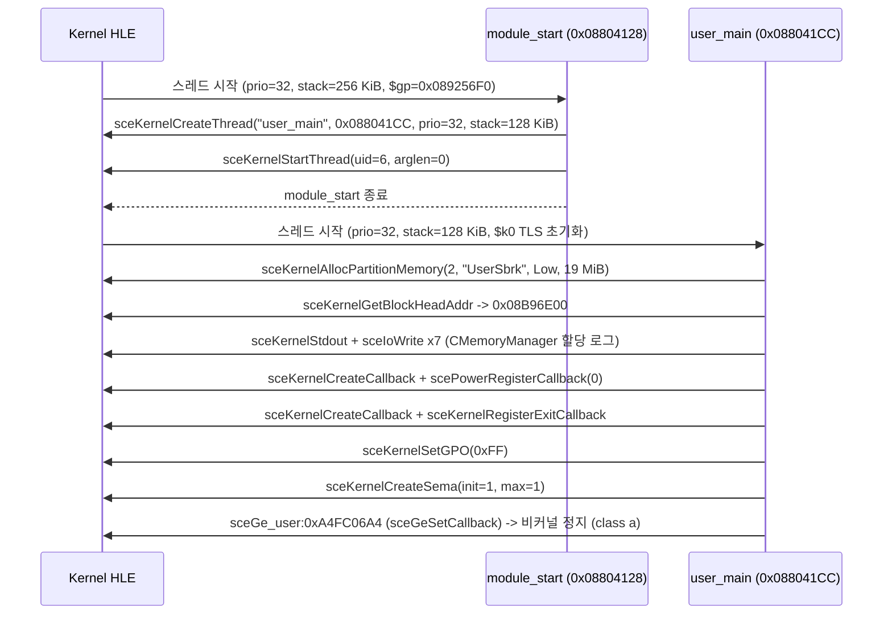

# 부팅 분석: DJMAX Portable (`ULKS-46050`)

이 문서는 `BOOT.BIN`을 커널·UMD HLE 위에서 첫 비커널 정지 지점까지 실행해 확인한 초기 부팅 동작을 기록한다.

---

## 1. 초기 부팅 흐름 (**확인됨**)

---

## 2. 확인된 커널 객체 및 자원

### 2.1 스레드

| 스레드 이름 | 엔트리 | 우선순위 | 스택 크기 | 비고 |
|---|---|---|---|---|
| `module_start` | `0x08804128` | 32 (`0x20`) | `0x40000` (256 KiB) | `user_main` 생성 및 시작 후 종료 |
| `user_main` | `0x088041CC` | 32 (`0x20`) | `0x20000` (128 KiB) | `newlib` `_reent` 초기화 후 게임 초기화 진행 |

* **확인됨**: `user_main`은 진입 직후 `$k0 + 4`에 스택 상의 스레드 로컬 구조체 포인터를 기록하며, 미초기화 스택 영역(`892($s1)`)을 참조하므로 PSP `ThreadMan`의 기본 `0xFF` 스택 채우기 및 `$k0` TLS 블록 설정이 필요하다.

### 2.2 사용자 파티션 메모리 블록

| 블록 이름 | 주소 범위 | 크기 | 속성 |
|---|---|---|---|
| `kernel_reserved_gap` | `0x08800000`–`0x08804000` | 16,384 B | 예약됨 |
| `module_image` | `0x08804000`–`0x08B96D14` | 3,747,092 B | 예약됨 (코드/데이터/BSS) |
| `stack:module_start` | `0x09FC0000`–`0x0A000000` | 262,144 B | 스레드 스택 |
| `stack:user_main` | `0x09FA0000`–`0x09FC0000` | 131,072 B | 스레드 스택 |
| `UserSbrk` | `0x08B96E00`–`0x09E96E00` | 19,922,944 B (19 MiB) | `sceKernelAllocPartitionMemory` |

* **확인됨**: 게임은 `UserSbrk` 19 MiB 할당 직후 `stdout`(`sceKernelStdout` + `sceIoWrite` 7회)으로 내부 `CMemoryManager` 풀 크기를 출력한다.
  * `CMemoryManager(GLOBAL) Alloc  size 2560 kb`
  * `CMemoryManager(VOLATILE) Alloc  size 14848 kb`
  * `CMemoryManager(SECOND VOLATILE) Alloc  size 0 kb`
  * `CMemoryManager(TEMP) Alloc  size 64 kb`
  * `CMemoryManager(COMMON RESOURCE) Alloc  size 128 kb`
  * `CMemoryManager(Gallery Manager) Alloc  size 0 kb`
  * `CMemoryManager(BGA Manager) Alloc  size 0 kb`

### 2.3 동기화 객체, 콜백, 파일

* **확인됨**: 콜백 2개(`scePowerRegisterCallback`, `sceKernelRegisterExitCallback`)와 세마포어 1개(`init=1, max=1`)를 생성한다.
* **확인됨**: 첫 `sceGe_user` 호출 시점까지 `disc0:` 또는 `ms0:` 파일을 연 기록은 0건이다.

---

## 3. HLE 호출 집계 및 첫 비커널 정지 지점

| 라이브러리 | 함수 / NID | 호출 수 |
|---|---|---|
| `Kernel_Library` | `sceKernelCpuSuspendIntr` | 86 |
| `Kernel_Library` | `sceKernelCpuResumeIntr` | 86 |
| `StdioForUser` | `sceKernelStdout` | 7 |
| `IoFileMgrForUser` | `sceIoWrite` | 7 |
| `ThreadManForUser` | `sceKernelCreateCallback` | 2 |
| `ThreadManForUser` | `sceKernelCreateThread` | 1 |
| `ThreadManForUser` | `sceKernelStartThread` | 1 |
| `ThreadManForUser` | `sceKernelCreateSema` | 1 |
| `SysMemUserForUser` | `sceKernelAllocPartitionMemory` | 1 |
| `SysMemUserForUser` | `sceKernelGetBlockHeadAddr` | 1 |
| `scePower` | `scePowerRegisterCallback` | 1 |
| `LoadExecForUser` | `sceKernelRegisterExitCallback` | 1 |
| `UtilsForUser` | `sceKernelSetGPO` | 1 |

* **확인됨**: 첫 비커널 정지 지점은 `sceGe_user`의 NID `0xA4FC06A4`(`sceGeSetCallback`)이다. 이름은 NID = SHA-1(이름)의 앞 4바이트로 **확인됨**(`sceGeEdramGetAddr`는 `0xE47E40E4`로 별개의 import다). 처음 기록에 적힌 `sceGeEdramGetAddr`는 잘못된 이름이었다.
* **확인됨**: 3회 연속 실행에서 HLE 호출 순서, 호출 수, 정지 지점이 모두 동일했다.

---

# Boot Analysis: DJMAX Portable (`ULKS-46050`)

This document records the initial boot behavior of `BOOT.BIN` observed up to the first non-kernel HLE stop under the kernel/UMD HLE layer.

## 1. Initial Boot Flow (**Confirmed**)

* `module_start` (`0x08804128`, priority 32, 256 KiB stack) creates and starts `user_main` (`0x088041CC`, priority 32, 128 KiB stack) and exits.
* `user_main` writes its stack-allocated `_reent` structure pointer to `$k0 + 4` and accesses `892($s1)` before full initialization, which requires PSP `ThreadMan`'s `$k0` TLS block and default `0xFF` stack fill.
* `user_main` allocates a 19 MiB `UserSbrk` block (`0x08B96E00`–`0x09E96E00`), logs `CMemoryManager` pool sizes to `stdout` (`GLOBAL` 2560 KiB, `VOLATILE` 14848 KiB, `SECOND VOLATILE` 0 KiB, `TEMP` 64 KiB, `COMMON RESOURCE` 128 KiB, `Gallery Manager` 0 KiB, `BGA Manager` 0 KiB), registers power and exit callbacks, calls `sceKernelSetGPO(0xFF)`, creates 1 semaphore, and stops at `sceGe_user:0xA4FC06A4`.

## 2. Kernel Objects & Resources (**Confirmed**)

* **Threads**: `module_start` (`0x08804128`), `user_main` (`0x088041CC`).
* **User Partition Blocks**: `kernel_reserved_gap` (16 KiB), `module_image` (3,747,092 B), `stack:module_start` (256 KiB), `stack:user_main` (128 KiB), `UserSbrk` (19 MiB).
* **Sync & Callbacks**: 2 callbacks (`scePowerRegisterCallback`, `sceKernelRegisterExitCallback`), 1 semaphore (`init=1, max=1`).
* **Open Files**: 0 files opened prior to the first `sceGe_user` call.

## 3. HLE Call Summary & First Non-Kernel Stop (**Confirmed**)

* Total HLE calls before stopping: `sceKernelCpuSuspendIntr` (86), `sceKernelCpuResumeIntr` (86), `sceKernelStdout` (7), `sceIoWrite` (7), `sceKernelCreateCallback` (2), `sceKernelCreateThread` (1), `sceKernelStartThread` (1), `sceKernelCreateSema` (1), `sceKernelAllocPartitionMemory` (1), `sceKernelGetBlockHeadAddr` (1), `scePowerRegisterCallback` (1), `sceKernelRegisterExitCallback` (1), `sceKernelSetGPO` (1).
* **First non-kernel stop**: `sceGe_user` NID `0xA4FC06A4` (`sceGeSetCallback`, **confirmed**: NID = the first four bytes of SHA-1(name); `sceGeEdramGetAddr` is the separate import `0xE47E40E4`). The name first recorded, `sceGeEdramGetAddr`, was wrong.
* **Determinism**: 3 consecutive runs produced identical HLE call sequences, counts, and stop reports.
