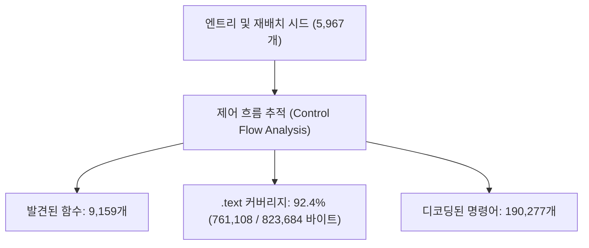
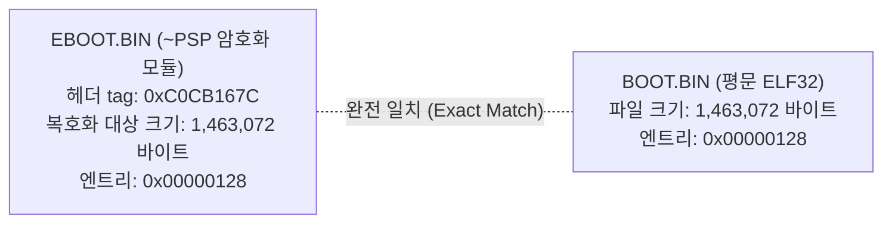
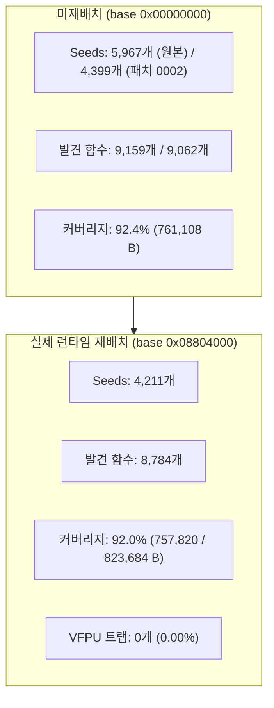
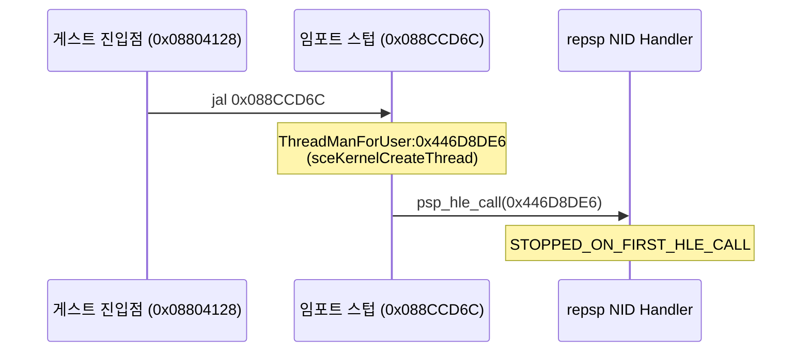

# 실행 파일 분석: DJMAX Portable (ULKS-46050)

이 문서는 원본 UMD의 기본 실행 파일(`PSP_GAME/SYSDIR/BOOT.BIN` 및 `EBOOT.BIN`)에 대해 `allegrexrecomp` 분석 도구로 확인한 사실을 기록한다.

---

## 1. 모듈 신원 및 컨테이너

| 항목 | 값 |
|---|---|
| 모듈 이름 | `djmax` |
| 모듈 버전 | 1.1 |
| 모듈 속성 | `0x0000` (User-mode PRX) |
| 실행 형식 | ELF32 MIPS LE (PRX, relocatable) |
| 파일 크기 | 1,463,072 바이트 |
| 엔트리 포인트 | `0x00000128` |
| GP ($gp) 레지스터 | `0x00026660` |
| 내보내기 함수 | 1 (`module_start` / `0x00000128`) |

* **확인됨**: 원본 실행 파일은 재배치 가능한 사용자 모드 PRX 모듈이다.
* **확인됨**: `BOOT.BIN`은 평문 ELF32(`\x7fELF`)이며, `EBOOT.BIN`은 Sony `~PSP` 암호화 헤더로 감싸진 형태이다.

---

## 2. 세그먼트 및 섹션 배치

| 세그먼트 | 가상 주소 | 파일 크기 | 메모리 크기 | 플래그 | 내용 |
|---|---|---|---|---|---|
| Segment 0 | `0x00000000` | 1,028,240 바이트 | 1,028,240 바이트 | `rwx` | 코드(`.text`), 읽기 전용 데이터, 임포트 스텁, 모듈 정보 |
| Segment 1 | `0x000FB090` | 124,516 바이트 | 2,718,852 바이트 | `rw-` | 초기화된 데이터(`.data`), 미초기화 데이터(`.bss`) |

* **확인됨**: BSS 영역 크기는 2,594,336 바이트(`2,718,852 - 124,516`)이다.
* **확인됨**: 섹션 수는 총 38개이며, `.text` 섹션은 오프셋 `0x00000040`부터 822,320 바이트이다.
* **확인됨**: 임포트 스텁(stub) 테이블은 오프셋 `0x000C8C8C`부터 1,272 바이트에 위치한다.
* **확인됨**: 모듈 정보 구조체(`psp_module_info`)는 `0x000C9340`에 위치한다.

---

## 3. 코드 분석 및 함수 커버리지

`allegrexrecomp funcs`를 통해 수행한 정적 흐름 분석 결과는 다음과 같다.

* **시드(Seeds)**: 엔트리 포인트(`0x00000128`) + 1개 export + 5,965개 재배치 포인터 = 총 5,967개 시드에서 탐색 시작.
* **발견 함수 수**: 9,159개.
* **도달 코드 크기**: 761,108 바이트 (`.text`의 92.4%).
* **간접 점프 테이블**: 212개 점프 테이블 식별 및 5,264개 분기 타깃 해석 완료 (미해결 간접 점프 0건).
* **명령어 통계**:
  * 총 디코딩 명령어: 190,277개.
  * VFPU 명령어: 208개 (0.11%).
  * 유효하지 않은/데이터 명령어: 68개 (0.04%).
* **함수 특성**:
  * VFPU 연산을 사용하는 함수: 67개 (0.7%).
  * 계산된 점프(switch/table)를 포함하는 함수: 380개.
  * 최대 함수: `0x0003C11C` (코드 크기 3,852 바이트).

---

## 4. 임포트 펌웨어 라이브러리 및 NID 통계

게임이 임포트하는 PSP 펌웨어 라이브러리는 20개이며, 총 159개 함수(고유 호출 144개)를 요구한다.

| 라이브러리 | 임포트 함수 수 | 주요 기능 |
|---|---|---|
| `ThreadManForUser` | 27 | 스레드 생성, 대기, 이벤트 플래그, 세마포어, 딜레이 |
| `sceMpeg` | 24 | PMF 동영상 디코딩 스트림 관리 |
| `sceSasCore` | 18 | SAS 사운드 코어 음원 합성 |
| `IoFileMgrForUser` | 12 | 파일 열기, 읽기, 쓰기, 탐색, 디렉터리 조작 |
| `sceAtrac3plus` | 11 | ATRAC3plus 음악 압축 해제 |
| `sceGe_user` | 10 | 그래픽 엔진 디스플레이 리스트 큐 및 동기화 |
| `sceAudio` | 9 | 오디오 채널 출력 및 볼륨 제어 |
| `sceUtility` | 8 | 시스템 저장 데이터 UI 및 파라미터 대화상자 |
| `UtilsForUser` | 7 | 시간 측정, 버퍼 복사 등 유틸리티 |
| `sceDisplay` | 6 | 디스플레이 모드, 프레임버퍼 설정, VBLANK 대기 |
| `sceUmdUser` | 6 | UMD 드라이브 상태 및 오류 검사 |
| `ModuleMgrForUser` | 5 | 디스크 내부 PRX 모듈 로드/시작/중지 |
| `sceCtrl` | 3 | 패드 입력 읽기 (`sceCtrlReadBufferPositive` 등) |
| `StdioForUser` | 3 | 표준 입출력 |
| `SysMemUserForUser` | 3 | 사용자 메모리 블록 할당/해제 |
| `Kernel_Library` | 2 | CPU 인터럽트 제어 |
| `LoadExecForUser` | 2 | 게임 재실행 및 종료 (`sceKernelExitGame`) |
| `sceDmac` | 1 | DMA 복사 |
| `scePower` | 1 | 전원 관리 및 배터리 정보 |
| `sceSuspendForUser` | 1 | 전원 절전 핸들러 |

---

## 5. BOOT.BIN과 EBOOT.BIN 비교 결론

`allegrexrecomp info`를 통해 `BOOT.BIN`과 `EBOOT.BIN`의 헤더 정보를 대조한 결과는 다음과 같다.

* **확인됨 (헤더 값 일치)**: `EBOOT.BIN`의 `~PSP` 헤더에 기록된 복호화 후 ELF 크기(`elf size`: 1,463,072 바이트), 부트 엔트리(`boot_entry`: `0x00000128`), 세그먼트 0 크기(1,028,240 바이트), 세그먼트 1 메모리 크기(2,718,852 바이트), BSS 크기(2,594,336 바이트)는 평문 ELF인 `BOOT.BIN`의 파일 크기 및 세그먼트 구조와 1바이트 오차 없이 완전히 일치한다.
* **추정 (내용 동일성)**: 헤더의 모든 메타데이터와 세그먼트 배치가 완전히 일치하므로 `BOOT.BIN`은 `EBOOT.BIN`의 암호화 전 원본 평문 실행 파일과 완전히 동일한 코드 및 데이터 배치를 가질 것으로 추정된다.
* **lift 입력 근거**: 외부 복호화 키(`psp_keys.txt`) 없이도 즉시 분석과 기계적 C 코드 생성을 진행할 수 있고 헤더 규격이 일치하므로 평문 `BOOT.BIN`을 lift 입력으로 사용한다.
* **남은 확인**: psprecomp에 복호화 기능이 구현되거나 사용자 키가 확보되어 `EBOOT.BIN`을 완전히 복호화할 수 있게 되면, 두 바이너리의 코드 및 데이터 영역을 바이트 단위로 대조하여 내용의 완전 일치 여부를 확정한다.

---

## 6. PRX 기본 주소 재배치(0x08804000) 및 함수 탐색 변화

PSP 사용자 모드에서 타이틀 PRX 모듈은 기본 주소 `0x08804000`에 로드된다. 기본 주소 0(미재배치)과 `0x08804000` 재배치 후의 `allegrexrecomp` 분석 결과 비교는 다음과 같다.

* **시드(Seeds) 수 감소 원인 (5,967 -> 4,399 -> 4,211)**:
  - 원본 psprecomp의 `psp_collect_pointer_seeds`는 재배치 포인터가 속한 세그먼트의 베이스 오프셋(`ofsbase`/`addrbase`)을 반영하지 않아 데이터 영역 포인터가 잘못된 주소로 해석되는 버그가 있었다.
  - 패치 `0002-seed-harvest-segment-bases.patch`를 적용하면서 비정상 시드들이 올바르게 필터링되어 시드 수가 5,967개에서 4,399개로 정제되었다.
  - `0x08804000` 재배치 시 세그먼트 0과 1의 실제 가상 주소 경계가 적용되어 최종 4,211개 시드로 수렴하였다.
* **함수 수 및 커버리지 (9,159 -> 8,784개, 92.4% -> 92.0%)**:
  - 잘못된 시드에서 출발한 가짜(false-positive) 함수 탐색이 배제되어 순수한 유효 함수 8,784개(138개 번들 C 파일로 분할 emit)가 식별되었다.
  - 189,455개 명령어 중 VFPU 트랩으로 방출된 명령어는 0개(0.00%)로, 모든 명령어가 C 코드로 안전하게 변환되었다.
* **MSVC 빌드 시간 및 라이브러리 크기**:
  - `redmp1_recomp.lib` 릴리스 빌드 시간: 약 22.8초 (`cmake --build --config Release --target redmp1_recomp`).
  - 정적 라이브러리 크기: 34,940,406 바이트 (~33.3 MiB, 138개 func 파일 + imports + register).
  - 총 오브젝트(.obj) 크기: 33,894,903 바이트 (~32.3 MiB).
  - 64개 단위 분할 emit 덕분에 개별 파일의 섹션 수가 제한되어 `/bigobj` 없이도 정상 컴파일된다(안전을 위해 옵션 유지).

---

## 7. 최초 펌웨어 호출(First Firmware Call) 정적 및 동적 분석

게스트 엔트리 포인트(`0x08804128`)에서 최초로 호출하는 PSP 펌웨어 라이브러리 API는 다음과 같이 확인되었다.

* **호출 위치**: `0x0880419C` (`jal 0x088CCD6C`)
* **임포트 스텁**: `psp_import_088CCD6C` -> `ThreadManForUser:0x446D8DE6`
* **함수 기호(Symbol)**: `sceKernelCreateThread`
* **출처(Provenance)**: 공용 PSP SDK(psp-sdk) NID 데이터베이스에 정식 등재된 기호로, 비공개나 난독화된 기호가 아닌 정규 공개 API이다.
* **동적 검증(`redmp1 roms --lift-check`)**: GuardedRun 환경에서 게스트 코드를 구동한 결과, 0회의 간접 디스패치 후 정확히 `ThreadManForUser:0x446D8DE6`에서 최초 HLE 트랩이 포착되고 성공적으로 정지하였다.

---

# Executable Analysis: DJMAX Portable (ULKS-46050) (English)

This document records facts confirmed by analyzing the original UMD executables (`PSP_GAME/SYSDIR/BOOT.BIN` and `EBOOT.BIN`) using `allegrexrecomp`.

## 1. Module Identity and Container

* **Name**: `djmax` (version 1.1, attributes `0x0000`, user-mode PRX).
* **Format**: ELF32 MIPS LE (PRX, relocatable), 1,463,072 bytes.
* **Entry point**: `0x00000128`, GP: `0x00026660`.
* **Exported functions**: 1 (`module_start`).

## 2. Segments and Sections

* **Segment 0**: Virtual addr `0x00000000`, file 1,028,240 bytes, mem 1,028,240 bytes, flags `rwx` (code, rodata, stubs, modinfo).
* **Segment 1**: Virtual addr `0x000FB090`, file 124,516 bytes, mem 2,718,852 bytes, flags `rw-` (data, bss).
* **BSS size**: 2,594,336 bytes.
* **Sections**: 38 sections, `.text` is 822,320 bytes at offset `0x00000040`.

## 3. Code Analysis and Function Coverage

* **Seeds**: 5,967 (entry + 1 export + 5,965 relocation pointers).
* **Functions found**: 9,159.
* **Coverage**: 761,108 bytes reached (92.4% of `.text`).
* **Instructions**: 190,277 instructions decoded (208 VFPU = 0.11%, 68 invalid/data = 0.04%).
* **Indirect jumps**: 212 jump tables resolved to 5,264 targets; 0 unresolved computed-jump sites.

## 4. Imported Firmware Libraries

20 libraries and 159 functions (144 distinct calls), dominated by `ThreadManForUser` (27), `sceMpeg` (24), `sceSasCore` (18), `IoFileMgrForUser` (12), `sceAtrac3plus` (11), `sceGe_user` (10), `sceAudio` (9), `sceUtility` (8), and `UtilsForUser` (7).

## 5. BOOT.BIN vs EBOOT.BIN Comparison Conclusion

* **Confirmed (Matching Headers)**: `EBOOT.BIN`'s `~PSP` header specifies an unencrypted ELF size of 1,463,072 bytes, an entry of `0x00000128`, segment 0 size of 1,028,240 bytes, segment 1 memory size of 2,718,852 bytes, and BSS size of 2,594,336 bytes, exactly matching the unencrypted `BOOT.BIN` file dimensions.
* **Inferred (Identical Content)**: Because all container dimensions, entry points, and segment mappings match without discrepancy, `BOOT.BIN` is inferred to contain identical code and data to decrypted `EBOOT.BIN`.
* **Grounds for Lifting BOOT.BIN**: Plain `BOOT.BIN` requires no external decryption keys (`psp_keys.txt`) and matches all container parameters, making it the practical choice for lifting and analysis.
* **Open Checks**: Compare byte-by-byte against decrypted `EBOOT.BIN` once decryption becomes available (via psprecomp feature updates or user-provided keys).

## 6. PRX Base Address Relocation (0x08804000) and Function Analysis

* **Relocation Base**: Loaded at `0x08804000` (standard PSP user module base).
* **Seed Refinement (5,967 -> 4,399 -> 4,211)**: Patch `0002-seed-harvest-segment-bases.patch` fixed segment base calculation in `allegrexrecomp`, eliminating false seeds originating from unmapped data offsets.
* **Functions & Coverage**: 8,784 functions (split across 138 C translation units), 757,820 bytes reached (92.0% of `.text`). 0 VFPU trap instructions emitted (0.00%).
* **MSVC Build Metrics**: Release build of `redmp1_recomp.lib` completes in ~22.8 seconds; static library size is 34.9 MiB (33.8 MiB total object size).

## 7. First Firmware Call

* **Site**: `0x0880419C` (`jal 0x088CCD6C`).
* **Import Target**: `ThreadManForUser:0x446D8DE6` (`psp_import_088CCD6C`).
* **Canonical Symbol**: `sceKernelCreateThread` in the public PSP SDK database.
* **Runtime Verification**: `redmp1 roms --lift-check` executes entry point `0x08804128` under `GuardedRun`, cleanly captures the first HLE call at `ThreadManForUser:0x446D8DE6`, and terminates with status `STOPPED_ON_FIRST_HLE_CALL`.
