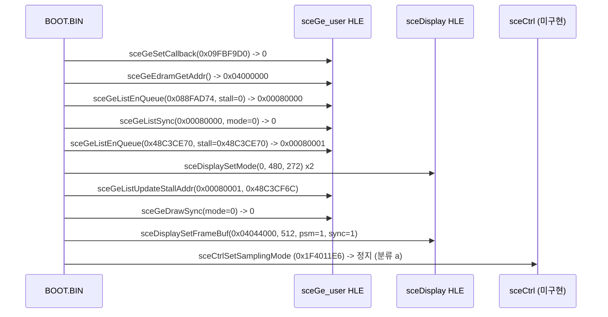

# GE 초기화와 첫 프레임 직전 정지 분석 (`ULKS-46050`, `BOOT.BIN`)

> 상태 구분: **확인됨**(`redmp1 roms --headless` 3회 실행 및 `REPSP_HLE_TRACE=1` 출력 기준)

## 1. GE 및 디스플레이 HLE 호출 흐름 (**확인됨**)

issue #5의 정지 지점이었던 `sceGeSetCallback` 이후 `BOOT.BIN`이 다음 미구현 NID에 도달할 때까지의 그래픽·디스플레이 초기화 순서는 다음과 같습니다.

## 2. GE 명령 및 프레임버퍼 상태 (**확인됨**)

* **GE 실행 통계**:
  * `2 lists, 282 commands, 0 signals, 2 finishes`
  * `framebuffer 0x00000000 stride 512 psm 1 (ABGR1555), vertex type 0x000000`
  * `vertices submitted: 0`, `pixels written: 0`
  * 초기 하드웨어 상태 설정 명령 중 `105 commands not individually decoded` (`0x15`, `0x16`, `0x1C`..`0xF2`).
* **디스플레이 상태**:
  * `sceDisplaySetMode(0, 480, 272)`를 두 번 호출하고, `sceDisplaySetFrameBuf(0x04044000, stride=512, fmt=1, sync=1)`를 한 번 호출했습니다.
  * `sync == 1` (`PSP_DISPLAY_SETBUF_NEXTFRAME`)로 예약되었으나, 다음 VBlank 승격(latch) 및 실제 그리기(`PRIM`) 이전에 `sceCtrlSetSamplingMode`에서 정지하므로 `presented=0`, `dumped=0`, `fb=0x00000000` 상태로 종료합니다.

## 3. 다음 정지 지점과 결정성 (**확인됨**)

* **정지 분류**: `(a) Unimplemented non-kernel NID` (`Exit code: 0`)
* **라이브러리 / NID**: `sceCtrl:sceCtrlSetSamplingMode (0x1F4011E6)`
* **3회 실행 결정성**: `REPSP_HLE_TRACE=1`로 3회 연속 실행한 결과, 실시간 VBlank 카운트(`vblanks=0..2`)를 제외한 모든 HLE 호출 인자·반환값, GE 통계, 정지 지점이 100% 일치했습니다.

---

# GE Initialization and Pre-First-Frame Stop Analysis (`ULKS-46050`, `BOOT.BIN`)

> Status: **Confirmed** (observed across 3 runs of `redmp1 roms --headless` with `REPSP_HLE_TRACE=1`)

## 1. GE and Display HLE Call Flow (**Confirmed**)

After passing the issue #5 stop (`sceGeSetCallback`), `BOOT.BIN` performs the following sequence:

1. `sceGeSetCallback(0x09FBF9D0)` → `0`, `sceGeEdramGetAddr()` → `0x04000000`.
2. `sceGeListEnQueue(0x088FAD74, stall=0)` → `0x00080000`, followed by `sceGeListSync(0x00080000, 0)`.
3. `sceGeListEnQueue(0x48C3CE70, stall=0x48C3CE70)` (uncached address) → `0x00080001`.
4. `sceDisplaySetMode(0, 480, 272)` twice, `sceGeListUpdateStallAddr(0x00080001, 0x48C3CF6C)`, and `sceGeDrawSync(0)`.
5. `sceDisplaySetFrameBuf(0x04044000, stride=512, fmt=1 [ABGR1555], sync=1 [NEXTFRAME])`.
6. Stops at `sceCtrl:sceCtrlSetSamplingMode (0x1F4011E6)`.

## 2. GE and Display State (**Confirmed**)

* **GE stats**: `2 lists, 282 commands, 0 signals, 2 finishes`, `framebuffer 0x00000000 stride 512 psm 1, vertex type 0x000000`, `vertices submitted: 0`, `pixels written: 0`, `105 commands not individually decoded`.
* **Display stats**: `mode=0 480x272 fb=0x00000000 stride=0 fmt=3 presented=0 dumped=0` (because `SetFrameBuf` used `sync=1` and execution stopped at `sceCtrlSetSamplingMode` before the next VBlank latched the pending framebuffer).

## 3. Next Stop Point and Determinism (**Confirmed**)

* **Class**: `(a) Unimplemented non-kernel NID` (`Exit code: 0`), `sceCtrl:sceCtrlSetSamplingMode (0x1F4011E6)`.
* **Determinism**: All 3 consecutive runs produced identical HLE call traces, GE statistics, and stop points (only wall-clock `vblanks` varied between `0` and `2`).
