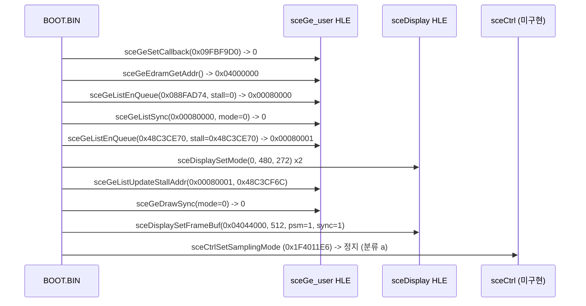
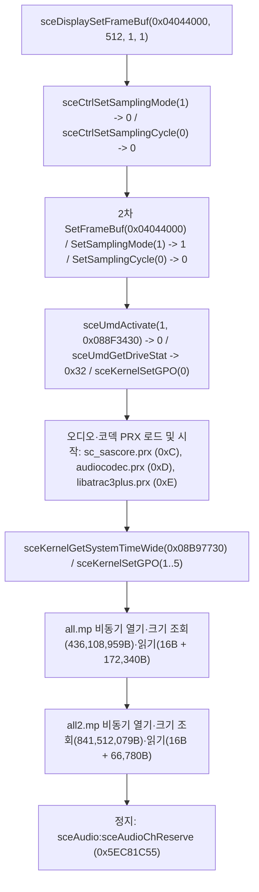
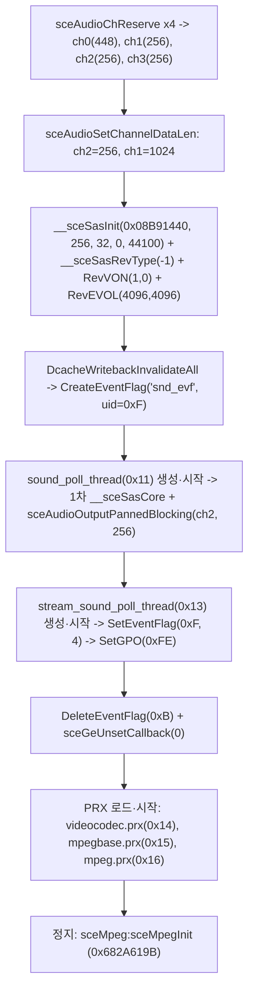
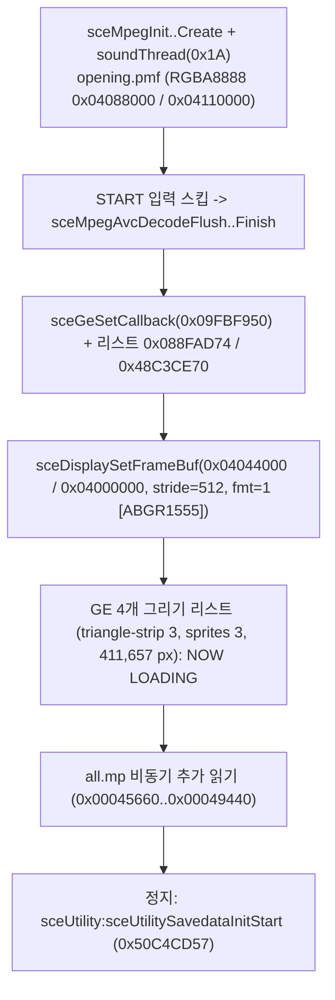
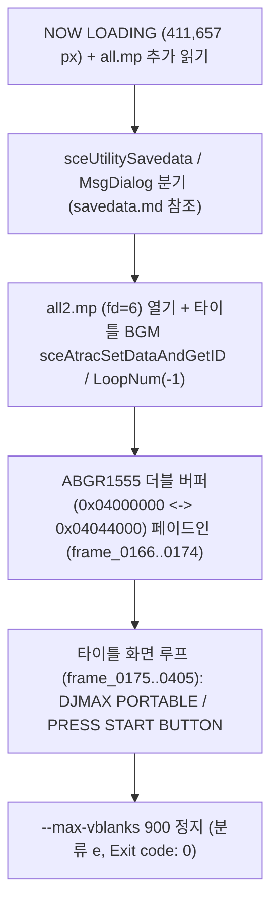
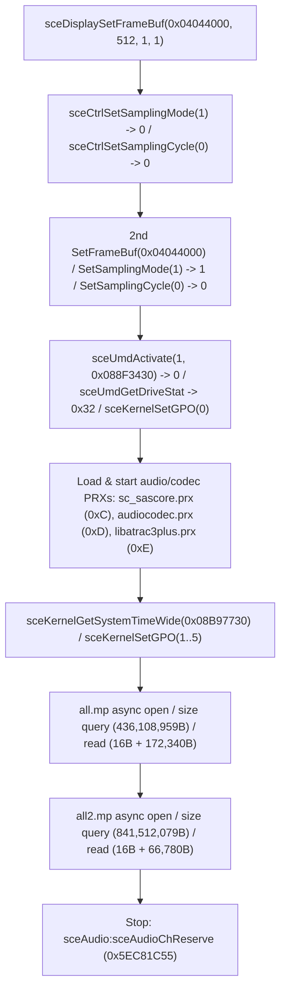
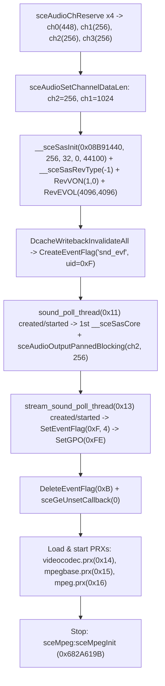

# GE 초기화와 첫 프레임 직전 정지 분석 (`ULKS-46050`, `BOOT.BIN`)

> 상태 구분: **확인됨**(`redmp1 roms --headless` 3회 실행, `REPSP_HLE_TRACE=1` 출력 및 게스트 리스트 메모리 검사 기준). 공개 GE 명령 이름은 [PSPSDK](https://github.com/pspdev/pspsdk) (`pspgu.h` / `pspge.h`, 참고 출처)를 따릅니다.

## 1. GE 및 디스플레이 HLE 호출 흐름 (**확인됨**)

issue #5의 정지 지점이었던 `sceGeSetCallback` 이후 `BOOT.BIN`이 다음 미구현 NID에 도달할 때까지의 그래픽·디스플레이 초기화 순서는 다음과 같습니다.

* **둘째 리스트의 uncached 주소**: 두 번째 `sceGeListEnQueue`의 리스트 주소와 초기 stall 주소(`0x48C3CE70`), 그리고 `sceGeListUpdateStallAddr`의 갱신 주소(`0x48C3CF6C`)는 메인 RAM 주소(`0x08C3CE70`..`0x08C3CF6C`)에 PSP **uncached 비트(`0x40000000`)**가 붙은 주소입니다.

## 2. 프레임버퍼(더블 버퍼링) 및 GE 실행 상태 (**확인됨**)

* **더블 버퍼링**:
  * **그리기 버퍼**: GE 리스트 2가 설정하는 `FBP`는 `0` (VRAM `0x04000000`), `FBW` stride는 `512` (`0x200`), 픽셀 형식 `PSM`은 `1` (`ABGR1555`)입니다.
  * **표시 버퍼**: `sceDisplaySetFrameBuf`가 지정하는 표시 버퍼는 VRAM `0x04044000` (stride `512`, `fmt=1`, `sync=1`)으로, 그리기 버퍼(`0x04000000`)와 다른 영역을 가리킵니다(더블 버퍼링).
  * `sync == 1` (`PSP_DISPLAY_SETBUF_NEXTFRAME`)로 예약되었으나, 다음 VBlank 승격(latch) 및 첫 `PRIM` 이전에 `sceCtrlSetSamplingMode`에서 정지하므로 `presented=0`, `dumped=0`, `fb=0x00000000` 상태로 종료합니다.
* **GE 실행 통계**:
  * `2 lists, 282 commands, 0 signals, 2 finishes`
  * `framebuffer 0x00000000 stride 512 psm 1, vertex type 0x000000`
  * `vertices submitted: 0`, `pixels written: 0`
  * 첫 번째 리스트(`0x088FAD74`, `221`워드)와 두 번째 리스트(`0x48C3CE70..0x48C3CF6C`, `63`워드) 모두 `0x0F FINISH` 뒤에 `0x0C END`가 따라오며, `FINISH`에서 슬롯이 끝나므로 실제 실행된 명령은 `220 + 62 = 282`개입니다. 이 중 `177`개는 `repsp::gpu::GeInterpreter`가 개별 해독하고, `105`개(고유 명령 `90`종)는 아직 개별 해독하지 않습니다.

### GE 명령어 번호·횟수 표 (**확인됨**)

| 번호 | 명령 이름(공개 자료) | 리스트 1 | 리스트 2 | 실행 합계 | `GeInterpreter` 해독 |
| --- | --- | ---: | ---: | ---: | --- |
| `0x01` | `VADDR` | 1 | 0 | 1 | 예 |
| `0x02` | `IADDR` | 1 | 0 | 1 | 예 |
| `0x0C` | `END` | 1 | 1 | 0 (FINISH 뒤 미실행) | 예 |
| `0x0F` | `FINISH` | 1 | 1 | 2 | 예 |
| `0x10` | `BASE` | 1 | 0 | 1 | 예 |
| `0x12` | `VTYPE` | 1 | 0 | 1 | 예 |
| `0x13` | `OFFSETADDR` | 1 | 0 | 1 | 예 |
| `0x15` | `REGION1` | 1 | 1 | 2 | 아니오(미해독) |
| `0x16` | `REGION2` | 1 | 1 | 2 | 아니오(미해독) |
| `0x17` | `LTE` | 1 | 2 | 3 | 예 |
| `0x18` | `LTE0` | 1 | 0 | 1 | 예 |
| `0x19` | `LTE1` | 1 | 0 | 1 | 예 |
| `0x1A` | `LTE2` | 1 | 0 | 1 | 예 |
| `0x1B` | `LTE3` | 1 | 0 | 1 | 예 |
| `0x1C` | `CPE` | 1 | 0 | 1 | 아니오(미해독) |
| `0x1D` | `BCE` | 1 | 0 | 1 | 아니오(미해독) |
| `0x1E` | `TME` | 1 | 2 | 3 | 예 |
| `0x1F` | `FGE` | 1 | 1 | 2 | 아니오(미해독) |
| `0x20` | `DTE` | 1 | 2 | 3 | 아니오(미해독) |
| `0x21` | `ABE` | 1 | 3 | 4 | 예 |
| `0x22` | `ATE` | 1 | 1 | 2 | 예 |
| `0x23` | `ZTE` | 1 | 2 | 3 | 예 |
| `0x24` | `STE` | 1 | 0 | 1 | 아니오(미해독) |
| `0x25` | `AAE` | 1 | 0 | 1 | 아니오(미해독) |
| `0x26` | `PCE` | 1 | 0 | 1 | 아니오(미해독) |
| `0x27` | `CTE` | 1 | 0 | 1 | 아니오(미해독) |
| `0x28` | `LOE` | 1 | 0 | 1 | 아니오(미해독) |
| `0x2A` | `BOFS` | 1 | 0 | 1 | 아니오(미해독) |
| `0x2B` | `BONE` | 1 | 0 | 1 | 아니오(미해독) |
| `0x2C` | `MW0` | 1 | 0 | 1 | 아니오(미해독) |
| `0x2D` | `MW1` | 1 | 0 | 1 | 아니오(미해독) |
| `0x2E` | `MW2` | 1 | 0 | 1 | 아니오(미해독) |
| `0x2F` | `MW3` | 1 | 0 | 1 | 아니오(미해독) |
| `0x30` | `MW4` | 1 | 0 | 1 | 아니오(미해독) |
| `0x31` | `MW5` | 1 | 0 | 1 | 아니오(미해독) |
| `0x32` | `MW6` | 1 | 0 | 1 | 아니오(미해독) |
| `0x33` | `MW7` | 1 | 0 | 1 | 아니오(미해독) |
| `0x36` | `PSUB` | 1 | 1 | 2 | 아니오(미해독) |
| `0x37` | `PPRIM` | 1 | 0 | 1 | 아니오(미해독) |
| `0x38` | `PFACE` | 1 | 0 | 1 | 아니오(미해독) |
| `0x3A` | `WMS` | 1 | 0 | 1 | 예 |
| `0x3B` | `WORLD` | 1 | 0 | 1 | 예 |
| `0x3C` | `VMS` | 1 | 0 | 1 | 예 |
| `0x3D` | `VIEW` | 1 | 0 | 1 | 예 |
| `0x3E` | `PMS` | 1 | 0 | 1 | 예 |
| `0x3F` | `PROJ` | 1 | 0 | 1 | 예 |
| `0x40` | `TMS` | 1 | 0 | 1 | 아니오(미해독) |
| `0x41` | `TMATRIX` | 1 | 0 | 1 | 아니오(미해독) |
| `0x42` | `XSCALE` | 1 | 1 | 2 | 예 |
| `0x43` | `YSCALE` | 1 | 1 | 2 | 예 |
| `0x44` | `ZSCALE` | 1 | 1 | 2 | 예 |
| `0x45` | `XPOS` | 1 | 1 | 2 | 예 |
| `0x46` | `YPOS` | 1 | 1 | 2 | 예 |
| `0x47` | `ZPOS` | 1 | 1 | 2 | 예 |
| `0x48` | `USCALE` | 1 | 1 | 2 | 예 |
| `0x49` | `VSCALE` | 1 | 1 | 2 | 예 |
| `0x4A` | `UOFFSET` | 1 | 0 | 1 | 예 |
| `0x4B` | `VOFFSET` | 1 | 0 | 1 | 예 |
| `0x4C` | `OFFSETX` | 1 | 1 | 2 | 예 |
| `0x4D` | `OFFSETY` | 1 | 1 | 2 | 예 |
| `0x50` | `SHADE` | 1 | 2 | 3 | 예 |
| `0x51` | `RNORM` | 1 | 0 | 1 | 예 |
| `0x53` | `CMAT` | 1 | 1 | 2 | 예 |
| `0x54` | `EMC` | 1 | 0 | 1 | 예 |
| `0x55` | `AMC` | 1 | 1 | 2 | 예 |
| `0x56` | `DMC` | 1 | 0 | 1 | 예 |
| `0x57` | `SMC` | 1 | 0 | 1 | 예 |
| `0x58` | `AMA` | 1 | 1 | 2 | 예 |
| `0x5B` | `SPOW` | 1 | 1 | 2 | 예 |
| `0x5C` | `ALC` | 1 | 0 | 1 | 예 |
| `0x5D` | `ALA` | 1 | 0 | 1 | 예 |
| `0x5E` | `LMODE` | 1 | 0 | 1 | 아니오(미해독) |
| `0x5F` | `LT0` | 1 | 0 | 1 | 예 |
| `0x60` | `LT1` | 1 | 0 | 1 | 예 |
| `0x61` | `LT2` | 1 | 0 | 1 | 예 |
| `0x62` | `LT3` | 1 | 0 | 1 | 예 |
| `0x63` | `LXP0` | 1 | 0 | 1 | 예 |
| `0x64` | `LYP0` | 1 | 0 | 1 | 예 |
| `0x65` | `LZP0` | 1 | 0 | 1 | 예 |
| `0x66` | `LXP1` | 1 | 0 | 1 | 예 |
| `0x67` | `LYP1` | 1 | 0 | 1 | 예 |
| `0x68` | `LZP1` | 1 | 0 | 1 | 예 |
| `0x69` | `LXP2` | 1 | 0 | 1 | 예 |
| `0x6A` | `LYP2` | 1 | 0 | 1 | 예 |
| `0x6B` | `LZP2` | 1 | 0 | 1 | 예 |
| `0x6C` | `LXP3` | 1 | 0 | 1 | 예 |
| `0x6D` | `LYP3` | 1 | 0 | 1 | 예 |
| `0x6E` | `LZP3` | 1 | 0 | 1 | 예 |
| `0x6F` | `LXD0` | 1 | 0 | 1 | 예 |
| `0x70` | `LYD0` | 1 | 0 | 1 | 예 |
| `0x71` | `LZD0` | 1 | 0 | 1 | 예 |
| `0x72` | `LXD1` | 1 | 0 | 1 | 예 |
| `0x73` | `LYD1` | 1 | 0 | 1 | 예 |
| `0x74` | `LZD1` | 1 | 0 | 1 | 예 |
| `0x75` | `LXD2` | 1 | 0 | 1 | 예 |
| `0x76` | `LYD2` | 1 | 0 | 1 | 예 |
| `0x77` | `LZD2` | 1 | 0 | 1 | 예 |
| `0x78` | `LXD3` | 1 | 0 | 1 | 예 |
| `0x79` | `LYD3` | 1 | 0 | 1 | 예 |
| `0x7A` | `LZD3` | 1 | 0 | 1 | 예 |
| `0x7B` | `LCA0` | 1 | 0 | 1 | 예 |
| `0x7C` | `LLA0` | 1 | 0 | 1 | 예 |
| `0x7D` | `LQA0` | 1 | 0 | 1 | 예 |
| `0x7E` | `LCA1` | 1 | 0 | 1 | 예 |
| `0x7F` | `LLA1` | 1 | 0 | 1 | 예 |
| `0x80` | `LQA1` | 1 | 0 | 1 | 예 |
| `0x81` | `LCA2` | 1 | 0 | 1 | 예 |
| `0x82` | `LLA2` | 1 | 0 | 1 | 예 |
| `0x83` | `LQA2` | 1 | 0 | 1 | 예 |
| `0x84` | `LCA3` | 1 | 0 | 1 | 예 |
| `0x85` | `LLA3` | 1 | 0 | 1 | 예 |
| `0x86` | `LQA3` | 1 | 0 | 1 | 예 |
| `0x87` | `SPOTEXP0` | 1 | 0 | 1 | 예 |
| `0x88` | `SPOTEXP1` | 1 | 0 | 1 | 예 |
| `0x89` | `SPOTEXP2` | 1 | 0 | 1 | 예 |
| `0x8A` | `SPOTEXP3` | 1 | 0 | 1 | 예 |
| `0x8B` | `SPOTCUT0` | 1 | 0 | 1 | 예 |
| `0x8C` | `SPOTCUT1` | 1 | 0 | 1 | 예 |
| `0x8D` | `SPOTCUT2` | 1 | 0 | 1 | 예 |
| `0x8E` | `SPOTCUT3` | 1 | 0 | 1 | 예 |
| `0x8F` | `ALC0` | 1 | 0 | 1 | 예 |
| `0x90` | `DLC0` | 1 | 0 | 1 | 예 |
| `0x91` | `SLC0` | 1 | 0 | 1 | 예 |
| `0x92` | `ALC1` | 1 | 0 | 1 | 예 |
| `0x93` | `DLC1` | 1 | 0 | 1 | 예 |
| `0x94` | `SLC1` | 1 | 0 | 1 | 예 |
| `0x95` | `ALC2` | 1 | 0 | 1 | 예 |
| `0x96` | `DLC2` | 1 | 0 | 1 | 예 |
| `0x97` | `SLC2` | 1 | 0 | 1 | 예 |
| `0x98` | `ALC3` | 1 | 0 | 1 | 예 |
| `0x99` | `DLC3` | 1 | 0 | 1 | 예 |
| `0x9A` | `SLC3` | 1 | 0 | 1 | 예 |
| `0x9B` | `FFACE` | 1 | 1 | 2 | 아니오(미해독) |
| `0x9C` | `FBP` | 1 | 2 | 3 | 예 |
| `0x9D` | `FBW` | 1 | 2 | 3 | 예 |
| `0x9E` | `ZBP` | 1 | 2 | 3 | 예 |
| `0x9F` | `ZBW` | 1 | 2 | 3 | 예 |
| `0xA0` | `TBP0` | 1 | 0 | 1 | 예 |
| `0xA1` | `TBP1` | 1 | 0 | 1 | 아니오(미해독) |
| `0xA2` | `TBP2` | 1 | 0 | 1 | 아니오(미해독) |
| `0xA3` | `TBP3` | 1 | 0 | 1 | 아니오(미해독) |
| `0xA4` | `TBP4` | 1 | 0 | 1 | 아니오(미해독) |
| `0xA5` | `TBP5` | 1 | 0 | 1 | 아니오(미해독) |
| `0xA6` | `TBP6` | 1 | 0 | 1 | 아니오(미해독) |
| `0xA7` | `TBP7` | 1 | 0 | 1 | 아니오(미해독) |
| `0xA8` | `TBW0` | 1 | 0 | 1 | 예 |
| `0xA9` | `TBW1` | 1 | 0 | 1 | 아니오(미해독) |
| `0xAA` | `TBW2` | 1 | 0 | 1 | 아니오(미해독) |
| `0xAB` | `TBW3` | 1 | 0 | 1 | 아니오(미해독) |
| `0xAC` | `TBW4` | 1 | 0 | 1 | 아니오(미해독) |
| `0xAD` | `TBW5` | 1 | 0 | 1 | 아니오(미해독) |
| `0xAE` | `TBW6` | 1 | 0 | 1 | 아니오(미해독) |
| `0xAF` | `TBW7` | 1 | 0 | 1 | 아니오(미해독) |
| `0xB0` | `CBP` | 1 | 0 | 1 | 예 |
| `0xB1` | `CBPH` | 1 | 0 | 1 | 예 |
| `0xB2` | `TRXSBP` | 1 | 0 | 1 | 아니오(미해독) |
| `0xB3` | `TRXSBW` | 1 | 0 | 1 | 아니오(미해독) |
| `0xB4` | `TRXDBP` | 1 | 0 | 1 | 아니오(미해독) |
| `0xB5` | `TRXDBW` | 1 | 0 | 1 | 아니오(미해독) |
| `0xB8` | `TSIZE0` | 1 | 0 | 1 | 예 |
| `0xB9` | `TSIZE1` | 1 | 0 | 1 | 아니오(미해독) |
| `0xBA` | `TSIZE2` | 1 | 0 | 1 | 아니오(미해독) |
| `0xBB` | `TSIZE3` | 1 | 0 | 1 | 아니오(미해독) |
| `0xBC` | `TSIZE4` | 1 | 0 | 1 | 아니오(미해독) |
| `0xBD` | `TSIZE5` | 1 | 0 | 1 | 아니오(미해독) |
| `0xBE` | `TSIZE6` | 1 | 0 | 1 | 아니오(미해독) |
| `0xBF` | `TSIZE7` | 1 | 0 | 1 | 아니오(미해독) |
| `0xC0` | `TMAP` | 1 | 0 | 1 | 아니오(미해독) |
| `0xC1` | `TEXTURE_ENV_MAP_MATRIX` | 1 | 0 | 1 | 아니오(미해독) |
| `0xC2` | `TMODE` | 1 | 1 | 2 | 예 |
| `0xC3` | `TPSM` | 1 | 1 | 2 | 예 |
| `0xC4` | `CLOAD` | 1 | 0 | 1 | 예 |
| `0xC5` | `CMODE` | 1 | 0 | 1 | 예 |
| `0xC6` | `TFLT` | 1 | 1 | 2 | 아니오(미해독) |
| `0xC7` | `TWRAP` | 1 | 1 | 2 | 예 |
| `0xC8` | `TBIAS` | 1 | 0 | 1 | 아니오(미해독) |
| `0xC9` | `TFUNC` | 1 | 1 | 2 | 예 |
| `0xCA` | `TEC` | 1 | 0 | 1 | 예 |
| `0xCB` | `TFLUSH` | 1 | 1 | 2 | 아니오(미해독) |
| `0xCC` | `TSYNC` | 1 | 0 | 1 | 아니오(미해독) |
| `0xCD` | `FFAR` | 1 | 0 | 1 | 아니오(미해독) |
| `0xCE` | `FDIST` | 1 | 0 | 1 | 아니오(미해독) |
| `0xCF` | `FCOL` | 1 | 0 | 1 | 아니오(미해독) |
| `0xD0` | `TSLOPE` | 1 | 0 | 1 | 아니오(미해독) |
| `0xD2` | `PSM` | 1 | 1 | 2 | 예 |
| `0xD3` | `CLEAR` | 1 | 0 | 1 | 예 |
| `0xD4` | `SCISSOR1` | 1 | 1 | 2 | 예 |
| `0xD5` | `SCISSOR2` | 1 | 1 | 2 | 예 |
| `0xD6` | `NEARZ` | 1 | 1 | 2 | 아니오(미해독) |
| `0xD7` | `FARZ` | 1 | 1 | 2 | 아니오(미해독) |
| `0xD8` | `CTST` | 1 | 0 | 1 | 아니오(미해독) |
| `0xD9` | `CREF` | 1 | 0 | 1 | 아니오(미해독) |
| `0xDA` | `CMSK` | 1 | 0 | 1 | 아니오(미해독) |
| `0xDB` | `ATST` | 1 | 0 | 1 | 예 |
| `0xDC` | `STST` | 1 | 0 | 1 | 아니오(미해독) |
| `0xDD` | `SOP` | 1 | 0 | 1 | 아니오(미해독) |
| `0xDE` | `ZTST` | 1 | 2 | 3 | 예 |
| `0xDF` | `ALPHA` | 1 | 1 | 2 | 예 |
| `0xE0` | `SFIX` | 1 | 1 | 2 | 예 |
| `0xE1` | `DFIX` | 1 | 1 | 2 | 예 |
| `0xE2` | `DTH0` | 1 | 1 | 2 | 아니오(미해독) |
| `0xE3` | `DTH1` | 1 | 1 | 2 | 아니오(미해독) |
| `0xE4` | `DTH2` | 1 | 1 | 2 | 아니오(미해독) |
| `0xE5` | `DTH3` | 1 | 1 | 2 | 아니오(미해독) |
| `0xE6` | `LOP` | 1 | 0 | 1 | 아니오(미해독) |
| `0xE7` | `ZMSK` | 1 | 0 | 1 | 예 |
| `0xE8` | `PMSKC` | 1 | 0 | 1 | 아니오(미해독) |
| `0xE9` | `PMSKA` | 1 | 0 | 1 | 아니오(미해독) |
| `0xEB` | `TRXPOS` | 1 | 0 | 1 | 아니오(미해독) |
| `0xEC` | `TRXDPOS` | 1 | 0 | 1 | 아니오(미해독) |
| `0xEE` | `TRXSIZE` | 1 | 0 | 1 | 아니오(미해독) |
| `0xF0` | `VSCX` | 1 | 0 | 1 | 아니오(미해독) |
| `0xF1` | `VSCY` | 1 | 0 | 1 | 아니오(미해독) |
| `0xF2` | `VSCZ` | 1 | 0 | 1 | 아니오(미해독) |
| `0xF3` | `VTCS` | 1 | 0 | 1 | 아니오(미해독) |
| `0xF4` | `VTCT` | 1 | 0 | 1 | 아니오(미해독) |
| `0xF5` | `VTCQ` | 1 | 0 | 1 | 아니오(미해독) |
| `0xF6` | `VCV` | 1 | 0 | 1 | 아니오(미해독) |
| `0xF7` | `VAP` | 1 | 0 | 1 | 아니오(미해독) |
| `0xF8` | `VFC` | 1 | 0 | 1 | 아니오(미해독) |
| `0xF9` | `VSCV` | 1 | 0 | 1 | 아니오(미해독) |

## 3. 다음 정지 지점과 결정성 (**확인됨**)

* **정지 분류**: `(a) Unimplemented non-kernel NID` (`Exit code: 0`)
* **라이브러리 / NID**: `sceCtrl:sceCtrlSetSamplingMode (0x1F4011E6)`
* **3회 실행 결정성**: `REPSP_HLE_TRACE=1`로 3회 연속 실행한 결과, 실시간 VBlank 카운트(`vblanks=0..2`)를 제외한 모든 HLE 호출 인자·반환값, GE 통계, 정지 지점이 100% 일치했습니다.

## 4. 입력 설정 이후 진행 및 다음 정지 지점 (**확인됨**)

* **`sceCtrl` 및 두 번째 프레임버퍼 설정**:
  * 첫 번째 `sceDisplaySetFrameBuf(0x04044000, 512, 1, 1)` 직후 `sceCtrlSetSamplingMode(1)`(반환 `0`, 이전 모드)과 `sceCtrlSetSamplingCycle(0)`(반환 `0`)을 호출하고, 이어서 같은 인자로 두 번째 `sceDisplaySetFrameBuf`·`sceCtrlSetSamplingMode(1)`(반환 `1`, 직전 설정 모드)·`sceCtrlSetSamplingCycle(0)`(반환 `0`)을 호출한다.
  * 정지 시점까지 `sceCtrlReadBufferPositive`와 `sceDmacMemcpy` 호출 횟수는 모두 `0`이다.
* **UMD 활성화 및 오디오 PRX 로드**:
  * `sceUmdActivate(1, 0x088F3430)` → `0`, `sceUmdGetDriveStat` → `0x32`, `sceKernelSetGPO(0x00)`을 호출한 뒤 `ModuleMgrForUser`로 PRX 3종(`sc_sascore.prx` [`0x088F34E4`, `uid=0xC`], `audiocodec.prx` [`0x088F3514`, `uid=0xD`], `libatrac3plus.prx` [`0x088F3544`, `uid=0xE`])을 순서대로 `sceKernelLoadModule`/`sceKernelStartModule` 한다.
  * 이어서 `sceKernelGetSystemTimeWide(0x08B97730)`를 1회 호출하고 `sceKernelSetGPO(1)`..`sceKernelSetGPO(5)`를 순차 기록한다.
* **아카이브(`all.mp`, `all2.mp`) 비동기 초기화 I/O**:
  * 각 I/O 단계 전후를 세마포어(`uid=0xA`, `sceKernelWaitSema`/`sceKernelSignalSema`)와 `sceIoWaitAsyncCB`로 동기화한다.
  * `disc0:/PSP_GAME/USRDIR/all.mp`(`fd=3`): `sceIoOpenAsync(..., flags=1)` → `sceIoLseekAsync(SEEK_END)` 결과 `436,108,959`바이트 → `sceIoLseek(SEEK_SET, 0)` → `sceIoReadAsync` `16`바이트(`0x0896E7AC`) + `172,340`바이트(`0x2A134`, `0x09ACD9F0`), 최종 오프셋 `172,356`.
  * `disc0:/PSP_GAME/USRDIR/all2.mp`(`fd=4`): `sceIoOpenAsync(..., flags=1)` → `sceIoLseekAsync(SEEK_END)` 결과 `841,512,079`바이트 → `sceIoLseek(SEEK_SET, 0)` → `sceIoReadAsync` `16`바이트(`0x0896E7F4`) + `66,780`바이트(`0x104DC`, `0x09AF7B30`), 최종 오프셋 `66,796`.
* **프레임버퍼·GE·다음 정지 지점과 결정성**:
  * GE 통계는 `2 lists, 282 commands, 0 signals, 2 finishes`, `vertices submitted: 0`, `pixels written: 0`으로 issue #7과 동일하다. VBlank 경과로 `sceDisplaySetFrameBuf`의 `0x04044000`(`480x272`, `stride=512`, `fmt=1`) 버퍼가 1회 래치(`presented=1`)되었으나 드로잉 프리미티브가 없어 검은 화면(0이 아닌 RGB 화소 `0`개)이다.
  * **다음 정지 지점**: 분류 `(a) Unimplemented non-kernel NID` (`Exit code: 0`), `sceAudio:sceAudioChReserve (0x5EC81C55)`.
  * **3회 연속 실행 일치**: 3회 모두 `Class (a)` 정지 NID, 124건의 비 `CpuSuspendIntr`/`CpuResumeIntr` HLE·I/O·ModuleMgr 호출 순서와 인자, GE·스레드·열린 파일 상태가 100% 일치했다. 실시간 경과에 따라 `sceKernelGetSystemTimeWide` 반환값(`0x0000109D`/`0x00000FDB`/`0x00001038`)과 `vblanks`/`Ctrl: produced` 수(`2`/`2`/`3`)만 달라졌다.

## 5. 오디오 초기화 이후 진행 및 다음 정지 지점 (**확인됨**)

* **오디오 채널·SAS·스레드 기동(세부 분석: [audio.md](audio.md))**:
  * `sceAudioChReserve` 4회로 `ch0=0(448)`, `ch1=1(256)`, `ch2=2(256)`, `ch3=3(256)`을 예약하고, `sceAudioSetChannelDataLen`으로 `ch2=256`, `ch1=1024`를 설정했다.
  * `__sceSasInit(0x08B91440, 256, 32, 0, 44100)`, `__sceSasRevType(0x08B91440, 0xFFFFFFFF [-1])`, `__sceSasRevVON(0x08B91440, 1, 0)`, `__sceSasRevEVOL(0x08B91440, 4096, 4096)`이 모두 `0`으로 성공했다.
  * `sound_poll_thread`(`uid=0x11`, `prio=18`, `stack=0x8000`)와 `stream_sound_poll_thread`(`uid=0x13`, `prio=18`, `stack=0x8000`)가 순서대로 시작되었고, `sound_poll_thread`가 `__sceSasCore`로 256프레임(무음)을 합성해 `ch2`에 `sceAudioOutputPannedBlocking(2, 0x8000, 0x8000, 0x0896EA00)` 1회를 완료했다.
* **영상 PRX 로드 및 다음 정지 지점**:
  * `sceKernelDeleteEventFlag(0xB)`와 `sceGeUnsetCallback(0)` 호출 뒤 `videocodec.prx` (`uid=0x14`), `mpegbase.prx` (`uid=0x15`), `mpeg.prx` (`uid=0x16`)를 순서대로 로드·시작하고, `sceMpeg:sceMpegInit (0x682A619B)`에서 정지했다.
  * **정지 분류**: `(a) Unimplemented non-kernel NID` (`Exit code: 0`).
* **화면·GE·컨트롤러·오디오 통계 및 3회 실행 일치**:
  * Display·GE는 `mode=0 480x272 fb=0x04044000 stride=512 fmt=1 vblanks=2 presented=1 dumped=1`, `2 lists, 282 commands, 0 signals, 2 finishes`, `vertices submitted: 0`, `pixels written: 0`이며, 덤프된 첫 프레임(`480x272` 32bpp)은 아직 드로잉 프리미티브가 없어 0이 아닌 RGB 화소가 `0`개인 검은 화면이다.
  * `Ctrl: cycle=0 mode=1 produced=2 read=0`, `Audio: reserved=4 output_calls=1 frames_written=256 frames_pulled=2048 underruns=0` (`ch2 calls=1 frames=256 rest=0`), `SAS: instances=1 calls=1 frames=256 keyOn=0 keyOff=0 activeVoices=0 revType=-1 reverb=dry only (not mixed)`, `ATRAC decode: silent | active=0 created=0 released=0 frames=0 samples=0 streamAdded=0 resets=0`.
  * **3회 연속 실행 일치**: 3회 모두 정지 지점(`sceMpegInit`), GE/Display/Ctrl/Audio/SAS/ATRAC 통계, HLE 호출 횟수 표(`115`항목, `CpuSuspendIntr`/`CpuResumeIntr` 각 `1831`회), 4개 게스트 스레드, 열린 파일 2개(`all.mp`, `all2.mp`), 7개 사용자 파티션 블록이 100% 일치했고, `120`건의 비 `CpuSuspendIntr`/`CpuResumeIntr` 추적 중 실시간 경과를 반영한 `sceKernelGetSystemTimeWide` 반환값(`0x00000DA8`/`0x00000CFA`/`0x00000D47`) 1건만 달랐다.

## 6. 동영상 재생·스킵 이후 화면과 다음 정지 지점 (**확인됨**)

* **동영상 재생 구간(세부 분석: [video.md](video.md))**:
  * `sceMpeg` 24개 NID를 통해 `disc0:/PSP_GAME/USRDIR/movie/opening.pmf`(`PSMF0014`, `480x272`)를 `RGBA8888`(`fmt=3`) 더블 버퍼 `0x04088000`/`0x04110000`에 디코딩한다. 무입력 300 VBlank 실행 시 `BlankAvcDecoder`/`SilentDecoder` 기준 `avcAu=153/153`, `atracAu=118/118`, `presented=147`(약 29.97 fps), 출력 화면은 모두 불투명 검은 프레임(`0xFF000000`)이다.
* **스킵 이후 첫 비검정 그래픽 화면**:
  * 스크립트 `START` 입력으로 오프닝을 건너뛰면(`sceMpegFinish` 완료) GE 콜백과 `ABGR1555`(`fmt=1`, `0x04000000` ↔ `0x04044000`)를 재설정하고 `8`개 GE 리스트(`749` 명령, `vertices=18`, `triangle-strip=3`, `sprites=3`, **`pixels written=411,657`**)를 실행해 검은 배경 오른쪽에 흰 테두리와 음파 아이콘이 들어간 **`"NOW LOADING"`** 배너 화면을 그린다.
* **다음 정지 지점과 3회 실행 일치**:
  * `all.mp` 추가 비동기 읽기 후 **`sceUtility:sceUtilitySavedataInitStart (0x50C4CD57)`** 에서 분류 `(a)` (`Exit code: 0`)로 정지한다.
  * 무입력 `--max-vblanks 300` 3회는 출력 전체가 바이트 단위 100% 일치했고, `--input-script` 3회는 정지 NID·GE `411,657` 화소·AVC `143`/ATRAC `111` AU·스레드(4개)·열린 파일(2개)이 모두 일치했으며 호스트 오디오 스레드 타이밍에 따른 `frames_pulled`/`sceAudioGetChannelRestLength`(`±4`회)·`vblanks`(`313`/`314`)만 미세하게 달랐다.

## 7. 세이브 데이터 이후 진행과 타이틀 화면 (`--max-vblanks 900`, **확인됨**)

* **세이브 데이터 이후 HLE 진행(세부 분석: [savedata.md](savedata.md))**:
  * `sceUtilitySavedata*` 및 `sceUtilityMsgDialog*` 절차를 통과하면 `disc0:/PSP_GAME/USRDIR/all2.mp`(`fd=6`)를 추가로 열어 타이틀 화면 BGM(`sceAtracSetDataAndGetID`, `sceAtracSetLoopNum(-1)`)과 UI 리소스를 로드한다.
* **그래픽·프리미티브 통계 및 화면 서술**:
  * 빈 세이브 디렉터리 + `--dialog-answer yes` + `--max-vblanks 900` 실행 기준 `Display: mode=0 480x272 fb=0x04000000 stride=512 fmt=1 (ABGR1555) vblanks=900 presented=406`, `GE: 272 lists, 87,451 commands, 0 signals, 272 finishes`, `framebuffer 0x00044000 stride 512 psm 1, vertex type 0x00019F`, `vertices submitted: 17,134`, `triangle-strip: 4,150`, `sprites: 267`, **`pixels written: 136,925,016`**.
  * 프레임 덤프 상에서 `frame_0000..0139`은 검은 화면(동영상 무효 디코더), `frame_0140..0164`는 `"NOW LOADING"` 배너(`1,951` 비검정 화소), `frame_0165`는 전환용 검은 화면, `frame_0166..0174`는 페이드인, `frame_0175..0405`는 타이틀 화면 본체(`129,909` 비검정 화소)다.
  * 타이틀 화면은 푸른색 스피커 스택 배경 중앙에 `"DJMAX EMOTIONAL SENSE P"` 은색 원형 엠블럼, 하단에 크롬 질감의 `"PORTABLE"` 로고와 좌우 삼각형 화살표, `"PRESS START BUTTON"` 문구, 최하단 파란색 띠 위의 `"© 2004, 2006 PENTAVISION. ALL RIGHTS RESERVED."` 저작권 표기를 그린다. (i015 당시 남아 있던 1픽셀 폭 `#FF00FF` 마젠타 경계선 169화소는 `repsp` `SwTri`에 픽셀 중심 + top-left fill rule을 적용한 issue #17/#18 수정 이후 `0`화소로 해소됨).
* **3회 연속 실행 일치**:
  * 동일한 초기 상태(빈 세이브 디렉터리)에서 `--max-vblanks 900` 3회를 실행한 결과 모두 분류 `(e)`(`Exit code: 0`), `Utility` 상태(`savedata_init=2, msgdialog_init=1, written=6284 B`), `Dialog[0]`(`btn=1`), 스레드 4개, 열린 파일 3개, 파티션 7개가 100% 일치했고, 호스트 실측 시간 기반 VBlank/더미 오디오 타이밍 차이로 `presented`(`415`/`413`/`415`), `GE`(`281`/`279`/`281` lists), `Audio`/`SAS`/`ATRAC` 프레임 수만 미세하게 달랐다.

---

# GE Initialization and Pre-First-Frame Stop Analysis (`ULKS-46050`, `BOOT.BIN`)

> Status: **Confirmed** (observed across 3 runs of `redmp1 roms --headless`, `REPSP_HLE_TRACE=1`, and guest list inspection). Public GE command names follow [PSPSDK](https://github.com/pspdev/pspsdk) (`pspgu.h` / `pspge.h`, external reference).

## 1. GE and Display HLE Call Flow (**Confirmed**)

After passing the issue #5 stop (`sceGeSetCallback`), `BOOT.BIN` performs the following sequence:

1. `sceGeSetCallback(0x09FBF9D0)` → `0`, `sceGeEdramGetAddr()` → `0x04000000`.
2. `sceGeListEnQueue(0x088FAD74, stall=0)` → `0x00080000`, followed by `sceGeListSync(0x00080000, 0)`.
3. `sceGeListEnQueue(0x48C3CE70, stall=0x48C3CE70)` → `0x00080001`.
4. `sceDisplaySetMode(0, 480, 272)` twice, `sceGeListUpdateStallAddr(0x00080001, 0x48C3CF6C)`, and `sceGeDrawSync(0)`.
5. `sceDisplaySetFrameBuf(0x04044000, stride=512, fmt=1 [ABGR1555], sync=1 [NEXTFRAME])`.
6. Stops at `sceCtrl:sceCtrlSetSamplingMode (0x1F4011E6)`.

* **Uncached address on the second list**: The second `sceGeListEnQueue` list and initial stall address (`0x48C3CE70`) and the updated stall address (`0x48C3CF6C`) carry the PSP **uncached bit (`0x40000000`)** on top of main RAM `0x08C3CE70`..`0x08C3CF6C`.

## 2. Framebuffer (Double Buffering) and GE State (**Confirmed**)

* **Double buffering**:
  * **Draw buffer**: GE list 2 sets `FBP` = `0` (VRAM `0x04000000`), `FBW` stride = `512` (`0x200`), pixel format `PSM` = `1` (`ABGR1555`).
  * **Displayed buffer**: `sceDisplaySetFrameBuf` schedules VRAM `0x04044000` (stride `512`, `fmt=1`, `sync=1`), which is a different buffer from the draw buffer (`0x04000000`), i.e. double buffering.
  * Because `SetFrameBuf` uses `sync=1` (`PSP_DISPLAY_SETBUF_NEXTFRAME`) and execution stops at `sceCtrlSetSamplingMode` before the next VBlank latches the pending buffer or any `PRIM` is issued, display stats end at `mode=0 480x272 fb=0x00000000 stride=0 fmt=3 presented=0 dumped=0`.
* **GE stats**: `2 lists, 282 commands, 0 signals, 2 finishes`, `framebuffer 0x00000000 stride 512 psm 1, vertex type 0x000000`, `vertices submitted: 0`, `pixels written: 0`. Both list 1 (`0x088FAD74`, `221` words) and list 2 (`0x48C3CE70..0x48C3CF6C`, `63` words) place `0x0F FINISH` before `0x0C END`, so `220 + 62 = 282` commands execute (`177` decoded by `repsp::gpu::GeInterpreter`, `105` across `90` unique opcodes not individually decoded).

### GE Command Opcode and Count Table (**Confirmed**)

The complete opcode-and-count table for both lists is given in the Korean section above (`GE 명령어 번호·횟수 표`), covering all 221 opcodes (`0x01`–`0xF9`, `220 + 62 = 282` executed, `177` decoded, `105` undecoded).

## 3. Next Stop Point and Determinism (**Confirmed**)

* **Class**: `(a) Unimplemented non-kernel NID` (`Exit code: 0`), `sceCtrl:sceCtrlSetSamplingMode (0x1F4011E6)`.
* **Determinism**: All 3 consecutive runs produced identical HLE call traces, GE statistics, and stop points (only wall-clock `vblanks` varied between `0` and `2`).

## 4. Post-Input Progression and Next Stop Point (**Confirmed**)

* **`sceCtrl` and second framebuffer setup**:
  * Immediately after the first `sceDisplaySetFrameBuf(0x04044000, 512, 1, 1)`, `BOOT.BIN` calls `sceCtrlSetSamplingMode(1)` (returns `0`, previous mode) and `sceCtrlSetSamplingCycle(0)` (returns `0`), then repeats `sceDisplaySetFrameBuf`, `sceCtrlSetSamplingMode(1)` (returns `1`), and `sceCtrlSetSamplingCycle(0)` (returns `0`) with identical arguments.
  * Up to the stop point, both `sceCtrlReadBufferPositive` and `sceDmacMemcpy` have `0` calls.
* **UMD activation and audio PRX loads**:
  * Calls `sceUmdActivate(1, 0x088F3430)` → `0`, `sceUmdGetDriveStat` → `0x32`, and `sceKernelSetGPO(0x00)`, then loads and starts 3 PRX modules sequentially via `ModuleMgrForUser` (`sceKernelLoadModule` / `sceKernelStartModule`): `sc_sascore.prx` (`0x088F34E4`, `uid=0xC`), `audiocodec.prx` (`0x088F3514`, `uid=0xD`), and `libatrac3plus.prx` (`0x088F3544`, `uid=0xE`).
  * Calls `sceKernelGetSystemTimeWide(0x08B97730)` once and logs `sceKernelSetGPO(1)`..`sceKernelSetGPO(5)`.
* **Asynchronous archive initialization I/O (`all.mp`, `all2.mp`)**:
  * Synchronizes each I/O step around semaphore `uid=0xA` (`sceKernelWaitSema`/`sceKernelSignalSema`) and `sceIoWaitAsyncCB`.
  * `disc0:/PSP_GAME/USRDIR/all.mp` (`fd=3`): `sceIoOpenAsync(..., flags=1)` → `sceIoLseekAsync(SEEK_END)` = `436,108,959` bytes → `sceIoLseek(SEEK_SET, 0)` → `sceIoReadAsync` `16` bytes (`0x0896E7AC`) + `172,340` bytes (`0x2A134`, `0x09ACD9F0`), ending at offset `172,356`.
  * `disc0:/PSP_GAME/USRDIR/all2.mp` (`fd=4`): `sceIoOpenAsync(..., flags=1)` → `sceIoLseekAsync(SEEK_END)` = `841,512,079` bytes → `sceIoLseek(SEEK_SET, 0)` → `sceIoReadAsync` `16` bytes (`0x0896E7F4`) + `66,780` bytes (`0x104DC`, `0x09AF7B30`), ending at offset `66,796`.
* **Framebuffer, GE state, next stop point, and determinism**:
  * GE statistics remain `2 lists, 282 commands, 0 signals, 2 finishes`, `vertices submitted: 0`, `pixels written: 0` (same as issue #7). One VBlank latched `0x04044000` (`480x272`, `stride=512`, `fmt=1`, `presented=1`), producing an all-black frame (`0` non-zero RGB pixels) because no draw primitives were issued.
  * **Next stop point**: Class `(a) Unimplemented non-kernel NID` (`Exit code: 0`), `sceAudio:sceAudioChReserve (0x5EC81C55)`.
  * **3-run determinism**: Across 3 consecutive runs, all 124 non-`CpuSuspendIntr`/`CpuResumeIntr` HLE/I/O/ModuleMgr call sequences and arguments, GE/thread/open-file states, and the Class `(a)` stop point matched 100%; only wall-clock-dependent `sceKernelGetSystemTimeWide` return values (`0x0000109D`/`0x00000FDB`/`0x00001038`) and `vblanks`/`Ctrl: produced` counts (`2`/`2`/`3`) varied.

## 5. Post-Audio Progression and Next Stop Point (**Confirmed**)

* **Audio channels, SAS init, and thread startup (details in [audio.md](audio.md))**:
  * `sceAudioChReserve` reserves 4 channels (`ch0=0` `448`, `ch1=1` `256`, `ch2=2` `256`, `ch3=3` `256`), and `sceAudioSetChannelDataLen` sets `ch2=256` and `ch1=1024`.
  * `__sceSasInit(0x08B91440, 256, 32, 0, 44100)`, `__sceSasRevType(0x08B91440, 0xFFFFFFFF [-1])`, `__sceSasRevVON(0x08B91440, 1, 0)`, and `__sceSasRevEVOL(0x08B91440, 4096, 4096)` all return `0`.
  * `sound_poll_thread` (`uid=0x11`, `prio=18`, `stack=0x8000`) and `stream_sound_poll_thread` (`uid=0x13`, `prio=18`, `stack=0x8000`) start sequentially, and `sound_poll_thread` completes the first 256-frame `__sceSasCore` mix and `sceAudioOutputPannedBlocking(2, 0x8000, 0x8000, 0x0896EA00)` call.
* **Video PRX loading and next stop point**:
  * After `sceKernelDeleteEventFlag(0xB)` and `sceGeUnsetCallback(0)`, `BOOT.BIN` loads and starts `videocodec.prx` (`uid=0x14`), `mpegbase.prx` (`uid=0x15`), and `mpeg.prx` (`uid=0x16`), stopping at `sceMpeg:sceMpegInit (0x682A619B)`.
  * **Stop class**: `(a) Unimplemented non-kernel NID` (`Exit code: 0`).
* **Display, GE, controller, audio stats, and 3-run determinism**:
  * Display/GE stats are `mode=0 480x272 fb=0x04044000 stride=512 fmt=1 vblanks=2 presented=1 dumped=1`, `2 lists, 282 commands, 0 signals, 2 finishes`, `vertices submitted: 0`, `pixels written: 0`; the dumped frame (`480x272`, 32bpp) is solid black (`0` non-zero RGB pixels) as no drawing primitives are emitted yet.
  * `Ctrl: cycle=0 mode=1 produced=2 read=0`, `Audio: reserved=4 output_calls=1 frames_written=256 frames_pulled=2048 underruns=0` (`ch2 calls=1 frames=256 rest=0`), `SAS: instances=1 calls=1 frames=256 keyOn=0 keyOff=0 activeVoices=0 revType=-1 reverb=dry only (not mixed)`, `ATRAC decode: silent | active=0 created=0 released=0 frames=0 samples=0 streamAdded=0 resets=0`.
  * **3-run determinism**: Across all 3 runs, the stop NID (`sceMpegInit`), Display/Ctrl/GE/Audio/SAS/ATRAC stats, the `115`-entry HLE call-count table (`1831` `CpuSuspendIntr`/`CpuResumeIntr`), all 4 guest threads, both open files (`all.mp`, `all2.mp`), and all 7 user partition blocks matched 100%; out of `120` non-`CpuSuspendIntr`/`CpuResumeIntr` traces, only the wall-clock `sceKernelGetSystemTimeWide` return value (`0x00000DA8`/`0x00000CFA`/`0x00000D47`) varied.

## 6. Post-Movie Screen and Next Stop Point (**Confirmed**)

* **Movie segment (details in [video.md](video.md))**: `BOOT.BIN` opens `disc0:/PSP_GAME/USRDIR/movie/opening.pmf` (`PSMF0014`, `480x272`) and alternates `RGBA8888` (`fmt=3`) framebuffers `0x04088000` ↔ `0x04110000`. At `--max-vblanks 300`, HLE yields `avcAu=153/153`, `atracAu=118/118`, and `presented=147` (~29.97 fps, opaque black `0xFF000000` frames).
* **Post-skip rendered screen**: Pressing `START` tears down `sceMpeg`, re-initializes GE and `ABGR1555` double buffers (`0x04000000` ↔ `0x04044000`), executes `8` GE lists (`749` commands, `18` vertices, `3` triangle-strips, `3` sprites, **`411,657` pixels written**), and displays a black screen with a right-aligned white-outlined sound-wave **`"NOW LOADING"`** banner.
* **Next stop point and 3-run determinism**: After additional `all.mp` async reads, execution stops at **`sceUtility:sceUtilitySavedataInitStart (0x50C4CD57)`** (`Class (a)`, `Exit code: 0`). Three consecutive `--max-vblanks 300` runs were 100% byte-identical; three consecutive `--input-script` runs matched identically on stop NID, GE `411,657` px, `143` AVC / `111` ATRAC AUs, 4 threads, and 2 open files, differing only in host-timed `frames_pulled`, `sceAudioGetChannelRestLength` (`±4`), and `vblanks` (`313`/`314`).

## 7. Post-Savedata Progression and Title Screen (`--max-vblanks 900`, **Confirmed**)

* **Post-savedata HLE progression (details in [savedata.md](savedata.md))**: After passing `sceUtilitySavedata*` / `sceUtilityMsgDialog*`, `BOOT.BIN` opens `disc0:/PSP_GAME/USRDIR/all2.mp` (`fd=6`), starts the title-screen ATRAC3+ BGM (`sceAtracSetDataAndGetID`, `sceAtracSetLoopNum(-1)`), and loops on the title screen.
* **Graphics stats and visual description**: Under empty save dir + `--dialog-answer yes` + `--max-vblanks 900`, `Display: mode=0 480x272 fb=0x04000000 stride=512 fmt=1 (ABGR1555) vblanks=900 presented=406`, `GE: 272 lists, 87,451 commands, 0 signals, 272 finishes`, `framebuffer 0x00044000 stride 512 psm 1, vertex type 0x00019F`, `vertices submitted: 17,134`, `triangle-strip: 4,150`, `sprites: 267`, **`pixels written: 136,925,016`**.
  * Dumped frames show: `frame_0000..0139` black (`opening.pmf`), `frame_0140..0164` `"NOW LOADING"` (`1,951` nonzero pixels), `frame_0165` black transition, `frame_0166..0174` fade-in, and `frame_0175..0405` the full title screen (`129,909` nonzero pixels): blue speaker-stack background, central silver `"DJMAX EMOTIONAL SENSE P"` emblem, chrome `"PORTABLE"` wordmark with left/right arrows, `"PRESS START BUTTON"`, and bottom blue footer `"© 2004, 2006 PENTAVISION. ALL RIGHTS RESERVED."` (the 169 pixels of 1px `#FF00FF` magenta border present in i015 are reduced to `0` pixels after the `repsp` `SwTri` pixel-center + top-left fill rule fix in issues #17/#18).
* **3-run determinism**: Across 3 identical runs from an empty save dir (`--max-vblanks 900`), all 3 reached `Class (e)` (`Exit code: 0`) with identical `Utility` (`savedata_init=2, msgdialog_init=1, written=6284 B`), `Dialog[0]` (`btn=1`), 4 threads, 3 open files, and 7 user partition blocks; only host wall-clock-coupled `presented` (`415`/`413`/`415`), `GE` (`281`/`279`/`281` lists), and `Audio`/`SAS`/`ATRAC` frame counts differed slightly.
