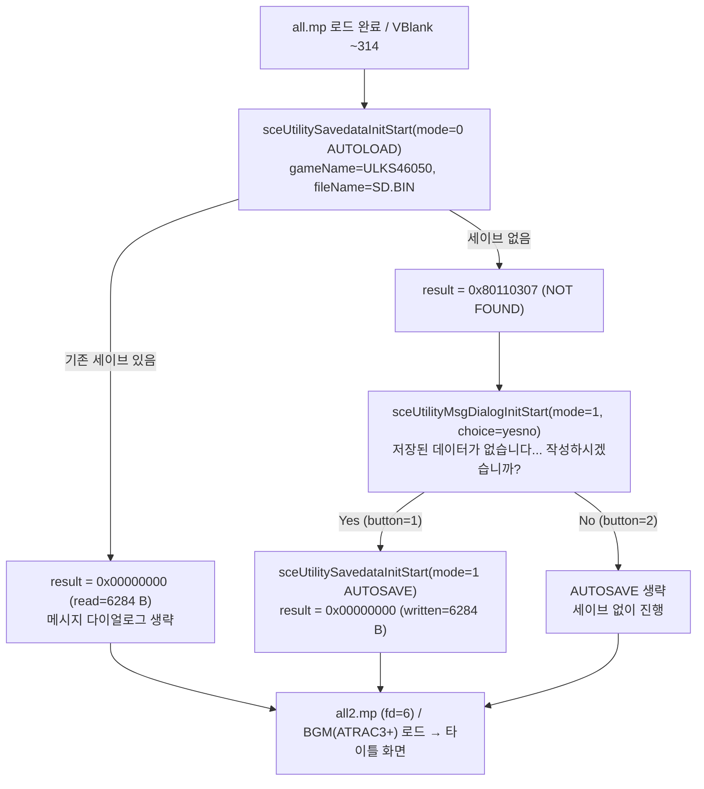
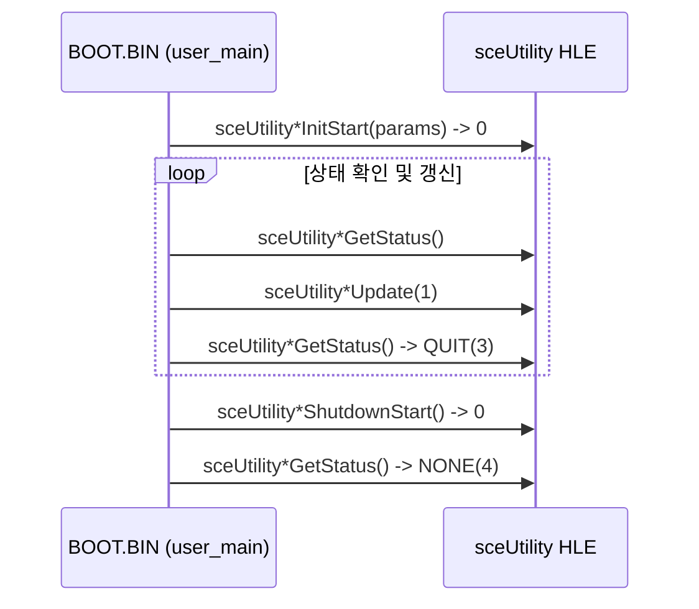

# 세이브 데이터와 메시지 다이얼로그 분석 (`ULKS-46050`, `BOOT.BIN`)

> 상태: **확인됨** (`redmp1 roms --headless --input-script ... --save-dir ... --dialog-answer <yes|no>`의 3가지 분기 실행 및 생성된 `PARAM.SFO`·파일 크기 확인).

---

## 1. 호출 시점과 분기 흐름 (**확인됨**)

오프닝 동영상(`opening.pmf`)을 건너뛰고 `"NOW LOADING"` 화면과 초기 메모리 관리자·데이터 아카이브(`all.mp`) 로드를 마친 뒤, 메인 스레드(`user_main`, `uid=0x6`)는 타이틀 화면 진입 전에 `sceUtility` 세이브 데이터 확인 절차를 실행한다.

1. **초기 로드 시도 (`AUTOLOAD`)**:
   * `sceUtilitySavedataInitStart`를 `mode = 0` (`PSP_UTILITY_SAVEDATA_TYPE_AUTOLOAD`), `gameName = "ULKS46050"`, `saveName = ""`, `fileName = "SD.BIN"`으로 호출한다.
   * **기존 세이브가 있는 경우**: `result = 0x00000000`으로 `SD.BIN` 6,284바이트를 읽고, 메시지 다이얼로그를 호출하지 않은 채 다음 단계로 진행한다.
   * **세이브가 없는 경우**: `result = 0x80110307`을 받고 메시지 다이얼로그 분기로 진입한다.
2. **확인 다이얼로그 (`sceUtilityMsgDialog`)**:
   * `sceUtilityMsgDialogInitStart`를 `mode = 1` (텍스트 메시지 모드), `options = Yes/No` 선택지(`choice=yesno`)로 호출한다.
   * 메시지 본문(원문 UTF-8):
     `"저장된 데이터가 없습니다. 이 Memory Stick™에 세이브 데이터를 작성하시겠습니까?"`
   * 선택지 결과(`buttonResult`):
     * `Yes` (`button = 1`): 이어서 `mode = 1` (`AUTOSAVE`)로 세이브 데이터를 새로 작성한다.
     * `No` (`button = 2`): `AUTOSAVE`를 호출하지 않고 세이브 데이터 없이 타이틀 화면으로 진행한다.
3. **신규 저장 (`AUTOSAVE`)**:
   * `Yes` 선택 시 `sceUtilitySavedataInitStart`를 `mode = 1` (`PSP_UTILITY_SAVEDATA_TYPE_AUTOSAVE`)로 호출하여 `ULKS46050` 디렉터리에 6,284바이트 `SD.BIN`과 `PARAM.SFO`·아이콘·배경 이미지를 기록한다(`result = 0x00000000`).

---

## 2. 세이브 데이터 구성과 `PARAM.SFO` 내용 (**확인됨**)

| 항목 | 값 / 크기 | 비고 |
|---|---|---|
| `gameName` (`SAVEDATA_DIRECTORY`) | `ULKS46050` | 디스크 ID와 동일 |
| `saveName` | `""` (빈 문자열) | 단일 슬롯(`ULKS46050/`) |
| `fileName` | `SD.BIN` | 실제 게임 세이브 데이터 |
| `SD.BIN` | `6,284` bytes | `read` / `written` 바이트 수 일치 |
| `PARAM.SFO` | `3,660` bytes | 아래 8개 엔트리 포함 |
| `ICON0.PNG` | `25,155` bytes | 세이브 목록 아이콘 |
| `PIC1.PNG` | `93,967` bytes | 세이브 배경 이미지 |

`PARAM.SFO`에 기록되는 주요 메타데이터:

* `CATEGORY`: `"MS"`
* `PARENTAL_LEVEL`: `5`
* `TITLE`: `"DJMAX PORTABLE"`
* `SAVEDATA_TITLE`: `"DJMAX PORTABLE SAVEDATA"`
* `SAVEDATA_DETAIL`: `"YOUR CLASS : BEGINNER\nRATE : 0.0 % \n"`
* `SAVEDATA_DIRECTORY`: `"ULKS46050"`

---

## 3. 상태 전이 및 폴링 순서 (**확인됨**)

세이브 데이터(`Savedata`)와 메시지 다이얼로그(`MsgDialog`) 모두 동일한 5단계 상태 폴링 패턴을 사용한다(각 호출 횟수는 `AUTOLOAD` 1회 + `AUTOSAVE` 1회 기준 `InitStart: 2`, `Update: 2`, `ShutdownStart: 2`, `GetStatus: 10`, `MsgDialog` 1회 기준 `InitStart: 1`, `Update: 1`, `ShutdownStart: 1`, `GetStatus: 5`).

---

# Save Data and Message Dialog Analysis (`ULKS-46050`, `BOOT.BIN`)

> Status: **Confirmed** (observed across all 3 branch runs of `redmp1 roms --headless --input-script ... --save-dir ... --dialog-answer <yes|no>` and inspection of the generated `PARAM.SFO` and save files).

## 1. Call Timing and Branch Flow (**Confirmed**)

After skipping `opening.pmf`, displaying `"NOW LOADING"`, initializing the memory managers, and reading from `all.mp`, `user_main` (`uid=0x6`) runs the `sceUtility` save-data check before entering the title screen:

1. **Initial load (`AUTOLOAD`)**: Calls `sceUtilitySavedataInitStart` with `mode = 0` (`AUTOLOAD`), `gameName = "ULKS46050"`, `saveName = ""`, and `fileName = "SD.BIN"`.
   * **Save exists**: Returns `0x00000000`, reads `6,284` bytes from `SD.BIN`, skips `MsgDialog`, and proceeds to title-screen asset loading.
   * **No save**: Returns `0x80110307` and opens a Yes/No message dialog.
2. **Confirmation dialog (`sceUtilityMsgDialog`)**: Calls `sceUtilityMsgDialogInitStart` (`mode = 1`, `choice = yesno`) with text:
   `"저장된 데이터가 없습니다. 이 Memory Stick™에 세이브 데이터를 작성하시겠습니까?"`
   * **Yes (`button = 1`)**: Calls `sceUtilitySavedataInitStart` (`mode = 1`, `AUTOSAVE`) to create the save slot (`written = 6284 B`, `result = 0x00000000`).
   * **No (`button = 2`)**: Skips `AUTOSAVE` and proceeds to the title screen without saving.

## 2. Save Data Layout and `PARAM.SFO` Fields (**Confirmed**)

* Directory / `gameName`: `ULKS46050` (`saveName = ""`), `fileName = SD.BIN` (`6,284` bytes).
* Accompanying files written on `AUTOSAVE`: `PARAM.SFO` (`3,660` bytes), `ICON0.PNG` (`25,155` bytes), `PIC1.PNG` (`93,967` bytes).
* `PARAM.SFO` text entries: `TITLE = "DJMAX PORTABLE"`, `SAVEDATA_TITLE = "DJMAX PORTABLE SAVEDATA"`, `SAVEDATA_DETAIL = "YOUR CLASS : BEGINNER\nRATE : 0.0 % \n"`, `CATEGORY = "MS"`, `PARENTAL_LEVEL = 5`, `SAVEDATA_DIRECTORY = "ULKS46050"`.

## 3. Status Polling Sequence (**Confirmed**)

Both `sceUtilitySavedata*` and `sceUtilityMsgDialog*` follow the same lifecycle: `InitStart` → `GetStatus` / `Update(1)` loop until `QUIT (3)` → `ShutdownStart` → `GetStatus` until `NONE (4)` (`5` `GetStatus` calls per `InitStart`/`Update`/`ShutdownStart` cycle).
