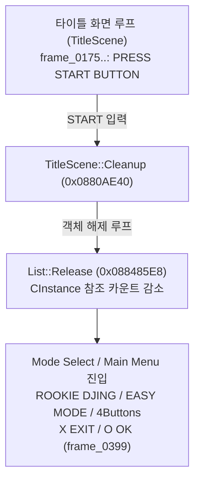

# 타이틀 화면 이후 메뉴 진입 및 `Instance.cpp:37` 단언 실패 분석 (`ULKS-46050`, `BOOT.BIN`)

> 표기 기준: **확인됨**(실행·디스어셈블리·덤프·프레임 확인), **추정**(정적 분석 또는 공개 자료 기반 가설)

---

## 1. 타이틀 이후 장면 전환 흐름 (**확인됨**)

* `--input-script`로 오프닝(`280 START`)과 타이틀(`400 START`)을 통과하면 `TitleScene::Cleanup`(`0x0880AE40`)이 리소스를 해제한 뒤 메인 메뉴(Mode Select: `ROOKIE DJING / EASY MODE / 4Buttons`, `X EXIT / O OK`) 화면으로 전환됩니다.
* `--max-vblanks 900` 실행에서 분류 `(e) VBlank limit reached` (`Exit code: 0`)로 종료되며, `Display: mode=0 480x272 fb=0x04000000 stride=512 fmt=1 vblanks=900 presented=400 dumped=400`, `GE: 266 lists, 82050 commands, 0 signals, 266 finishes`를 기록했습니다.

---

## 2. `Instance.cpp:37` (`assertion "m_referenceCount" failed`) 원인 확정 (**확인됨**)

* **증상**: 기존 구현에서는 타이틀 화면에서 `START`를 누른 직후 게스트 `__assert("Instance.cpp", 37, "m_referenceCount")`로 정지했습니다.
* **리프터 근본 원인 (`third_party/psprecomp/tools/allegrexrecomp/emit.c:791`)**:
  * `emit.c`의 `last_terminal = in.is_return || in.is_indirect || (in.is_jump && !in.is_call);` 판정이 간접 호출 명령어인 `jalr` (`in.is_indirect == 1`, `in.is_call == 1`)을 `jr`과 똑같이 종단(terminal) 명령어로 취급했습니다.
  * 이 때문에 `0x0885197C`의 `jalr $ra, $v0`으로 끝나는 분할 본문 `psp_body_08851930` 뒤에 이어지는 에필로그 블록 `psp_func_08851984()`로의 폴스루(fall-through) 호출이 누락되었습니다.
  * 그 결과 `TitleScene::Cleanup` (`0x0880AE40`)으로 복귀할 때 `$sp`와 `$fp`가 32바이트 낮게(`0x09FBF930` 대신 `0x09FBF950`이어야 함) 유지되었고, `0x0880AED0`이 `0($fp)`에서 `0x08B97774` 대신 `0x09D8CFB0`을 읽어 `List::Release(0x08C4D520, 0)`(`0x088485E8`)에 `0x00000000`을 넘겼습니다.
  * `List::Release`가 이미 초기화된 객체 `0x09B08080` (`m_referenceCount == 0`)과 매칭되면서 `Instance.cpp:37` 단언이 발동했습니다.
* **수정 (`patches/psprecomp/0003-jalr-fallthrough.patch`)**:
  * 간접 **비호출**(`in.is_indirect && !in.is_call`, 즉 `jr`)만 종단으로 취급하도록 패치하고 `BOOT.BIN`을 재리프트(`8785 functions, 17215 interior entries, 0.00% VFPU traps`)하여 원인을 해결했습니다.

---

# Post-Title Menu Entry and `Instance.cpp:37` Assertion Analysis (`ULKS-46050`, `BOOT.BIN`)

> Status labels: **Confirmed** (verified by runtime execution, disassembly, trace, and frame dump), **Inferred** (static analysis or external reference)

## 1. Post-Title Scene Transition Flow (**Confirmed**)

* Passing the opening (`280 START`) and title (`400 START`) prompts via `--input-script` runs `TitleScene::Cleanup` (`0x0880AE40`) and transitions cleanly into the Main Menu / Mode Select screen (`ROOKIE DJING / EASY MODE / 4Buttons`, `X EXIT / O OK`), verified visually in `frame_0399.png`.
* Running to `--max-vblanks 900` finishes cleanly with Class `(e) VBlank limit reached` (`Exit code: 0`), `Display: mode=0 480x272 fb=0x04000000 stride=512 fmt=1 vblanks=900 presented=400 dumped=400`, and `GE: 266 lists, 82050 commands, 0 signals, 266 finishes`.

## 2. Root Cause of `Instance.cpp:37` (`assertion "m_referenceCount" failed`) (**Confirmed**)

* **Symptom**: Immediately after pressing `START` on the title screen, guest execution aborted in `__assert("Instance.cpp", 37, "m_referenceCount")`.
* **Root cause in lifter (`third_party/psprecomp/tools/allegrexrecomp/emit.c:791`)**:
  * `last_terminal = in.is_return || in.is_indirect || (in.is_jump && !in.is_call);` treated `jalr` (`in.is_indirect == 1`, `in.is_call == 1`) as a terminal instruction just like `jr`.
  * Consequently, `psp_body_08851930` (ending with `0x0885197C jalr $ra, $v0`) omitted the fall-through call `psp_func_08851984();` to its split epilogue.
  * Returning to `TitleScene::Cleanup` (`0x0880AE40`) left `$sp` and `$fp` 32 bytes too low (`0x09FBF930` instead of `0x09FBF950`), so `0x0880AED0` loaded `0x09D8CFB0` instead of `0x08B97774` from `0($fp)` and passed `0x00000000` into `List::Release(0x08C4D520, 0)` (`0x088485E8`), hitting reset object `0x09B08080` (`m_referenceCount == 0`).
* **Fix (`patches/psprecomp/0003-jalr-fallthrough.patch`)**:
  * Changed the terminal check to `(in.is_indirect && !in.is_call)` and re-lifted `BOOT.BIN` (`8785 functions, 17215 interior entries, 0.00% VFPU traps`), resolving the crash.
