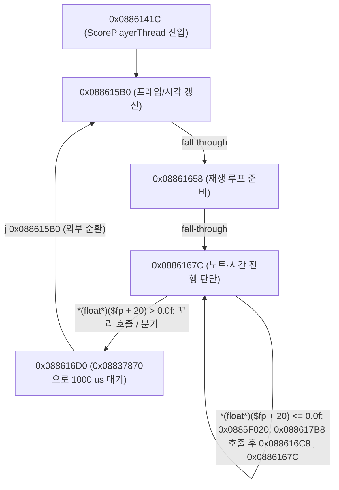
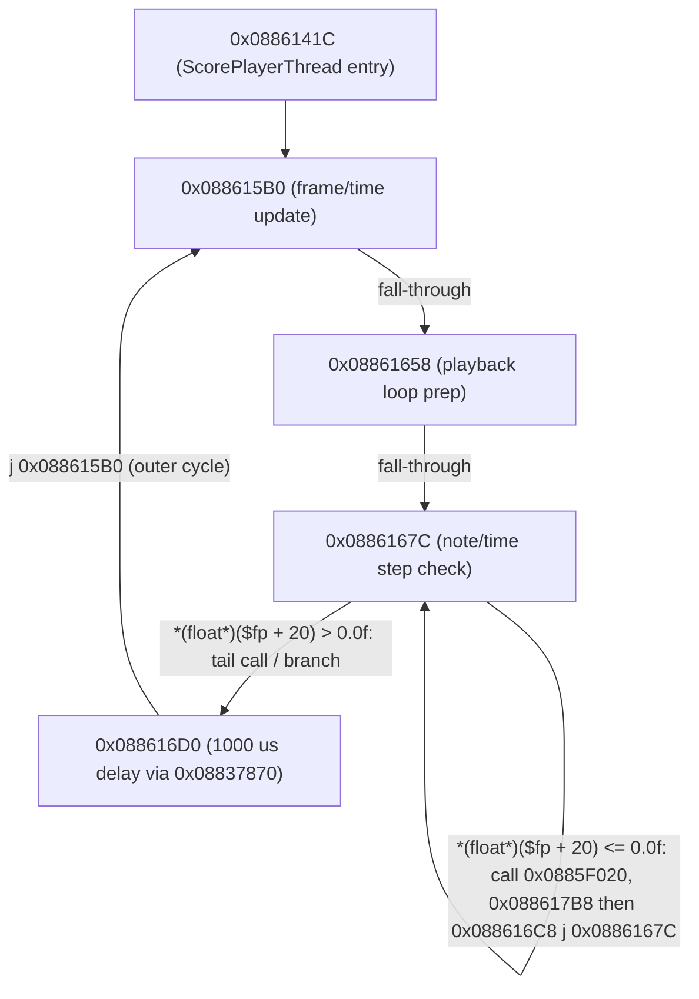

# 악보 재생 스레드(`ScorePlayerThread`) 분석

`ULKS-46050`(디스크 버전 1.02)의 `BOOT.BIN`에서 확인한 악보 재생 스레드(`ScorePlayerThread`)와 타이밍 루프 구조입니다.

## 요약

* **확인됨**: `ScorePlayerThread`의 진입 함수는 `0x0886141C`입니다(게스트 스레드 속성 `name="ScorePlayerThread"`).
* **확인됨**: 타이밍·지연 루프는 `0x088615B0`, `0x08861658`, `0x0886167C`, `0x088616D0` 네 본문으로 이루어진 순환 구조를 가집니다.
* **확인됨**: `0x0886167C` 내부의 `0x088616C8: j 0x0886167C`는 같은 본문이 소유한 진입점으로 돌아가는 루프입니다. 패치 전 `allegrexrecomp`가 이를 자기 재귀 호출로 옮겨 매 반복마다 호스트 스택 프레임이 누적되었고, `0x088616D0`의 `j 0x088615B0` 역시 교차 함수 꼬리 호출 순환을 형성합니다.

## 제어 흐름

## 세부 동작

1. **`0x088615B0` → `0x08861658` → `0x0886167C` (fall-through)**:
   `0x088615B0`과 `0x08861658`은 끝에서 다음 함수로 fall-through하며 `0x0886167C`로 진입합니다.
2. **`0x0886167C` (내부 타이밍 루프, `0x088616C8: j 0x0886167C`)**:
   `*(float*)($fp + 20) <= 0.0f`인 동안 `0x0885F020`과 `0x088617B8`을 호출해 이벤트를 처리하고, 반환값(`$f0`)을 `*(float*)($fp + 20)`에 더한 뒤 `0x088616C8`의 `j 0x0886167C`로 다시 자기 시작 주소로 점프합니다.
   * 패치 전 `allegrexrecomp`는 `0x0886167C`가 함수 테이블에 등록된 진입점이라는 이유(`!is_function`)로 `goto L_0886167C` 대신 `sub_0886167C(...)` 재귀 호출을 생성했습니다.
   * 로컬 패치 `0004-j-owned-target-goto.patch` 적용 후에는 같은 본문이 소유한 대상이므로 `PSP_LOOP(0x0886167Cu); goto L_0886167C;`로 변환되어 호스트 스택이 누적되지 않습니다.
3. **`0x088616D0` (`j 0x088615B0` 외부 순환)**:
   `*(float*)($fp + 20) > 0.0f`이면 `0x088616D0`으로 분기해 `0x08837870`(인자 `1000` us 대기)을 호출한 뒤 `j 0x088615B0`으로 외부 루프의 처음으로 돌아갑니다.
   * 이 경로는 서로 다른 네 본문(`0x088615B0` → `0x08861658` → `0x0886167C` → `0x088616D0` → `0x088615B0`)을 거치는 교차 함수 꼬리 호출·fall-through 순환이며, `0x0886167C` 내부 루프만 `goto`로 고쳐진 상태에서도 `1000` us(= 1 ms) 간격으로 호출 깊이가 쌓일 수 있습니다.
   * **미확정**: 교차 함수 꼬리 호출 순환(`148`개 SCC 및 이 4-본문 fall-through 포함 순환)을 본문 병합, 트램폴린 루프, 또는 64 MiB 게스트 호스트 스택 유지 중 어떤 방식으로 해소할지는 설계 검토 대상입니다.

---

# Score Playback Thread (`ScorePlayerThread`) Analysis

This document describes the `ScorePlayerThread` and its timing loop structure confirmed in `BOOT.BIN` of `ULKS-46050` (disc version 1.02).

## Summary

* **Confirmed**: The entry function of `ScorePlayerThread` is `0x0886141C` (guest thread `name="ScorePlayerThread"`).
* **Confirmed**: The timing/delay loop forms a four-body cycle across `0x088615B0`, `0x08861658`, `0x0886167C`, and `0x088616D0`.
* **Confirmed**: `0x088616C8: j 0x0886167C` inside `0x0886167C` jumps back to the entry address owned by the same lifted body. Before the patch, `allegrexrecomp` lowered this as a self-recursive call, accumulating host stack frames on every iteration; `0x088616D0`'s `j 0x088615B0` also forms a cross-function tail-call cycle.

## Control Flow

## Detailed Behavior

1. **`0x088615B0` → `0x08861658` → `0x0886167C` (fall-through)**:
   `0x088615B0` and `0x08861658` fall through into the next function at their ends, entering `0x0886167C`.
2. **`0x0886167C` (inner timing loop, `0x088616C8: j 0x0886167C`)**:
   While `*(float*)($fp + 20) <= 0.0f`, it calls `0x0885F020` and `0x088617B8` to process events, adds the return value (`$f0`) to `*(float*)($fp + 20)`, and jumps back to its own start via `0x088616C8: j 0x0886167C`.
   * Before the patch, `allegrexrecomp` emitted a recursive call `sub_0886167C(...)` instead of `goto L_0886167C` because `0x0886167C` is registered in the function table (`!is_function`).
   * With local patch `0004-j-owned-target-goto.patch`, because the target is owned by the same body, it lowers to `PSP_LOOP(0x0886167Cu); goto L_0886167C;`, preventing host stack growth on the inner loop.
3. **`0x088616D0` (`j 0x088615B0` outer cycle)**:
   When `*(float*)($fp + 20) > 0.0f`, execution branches to `0x088616D0`, calls `0x08837870` (delay of `1000` us), and jumps back to `0x088615B0` (`j 0x088615B0`).
   * This forms a cross-function tail-call/fall-through cycle (`0x088615B0` → `0x08861658` → `0x0886167C` → `0x088616D0` → `0x088615B0`) that can still grow host stack depth at `1000` us (1 ms) intervals even after fixing the `0x0886167C` self-loop.
   * **Unresolved**: How to resolve cross-function tail-call cycles (`148` SCCs plus this 4-body fall-through cycle) — merging bodies vs. trampoline loop vs. keeping the 64 MiB guest host stack — remains an open design decision.
