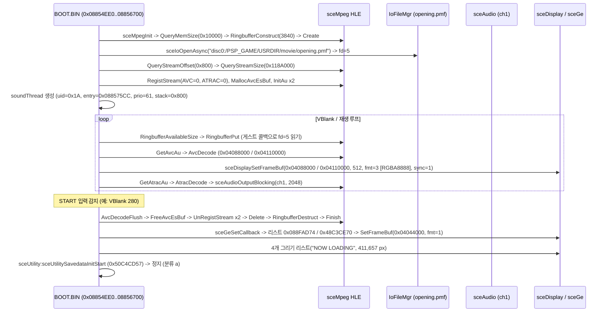

# 동영상 재생(`sceMpeg`) 및 오프닝 무비 스킵 분석 (`ULKS-46050`, `BOOT.BIN`)

> 상태 구분: **확인됨**(`BOOT.BIN` 임포트·함수 분석, `opening.pmf` 컨테이너·ES 검사, `REPSP_HLE_TRACE=1` 실행 결과 기준), **미확정**(무입력으로 127.63초 오프닝 끝까지 완주 시 분기).

---

## 1. 전체 재생·스킵·전환 흐름 (**확인됨**)

---

## 2. `BOOT.BIN` 동영상 모듈 구조와 초기화 인자 (**확인됨**)

* **관련 PRX**: audio 초기화 직후 `videocodec.prx`(`uid=0x14`), `mpegbase.prx`(`uid=0x15`), `mpeg.prx`(`uid=0x16`)를 순서대로 로드·시작한다.
* **`BOOT.BIN` 호출 함수 분포**: 임포트 스텁(`0x088CCFB4`~`0x088CD06C`)을 통해 `sceMpeg` 24개 NID를 모두 임포트하며, 초기화·스트림 제어·디코딩 루프는 `0x08854EE0`~`0x08856700` 범위에 배치되어 있다.
* **메모리·링 버퍼 구성**:
  * `sceMpegQueryMemSize(0)`은 `0x10000`(64 KiB)을 반환하며 작업 버퍼 `0x0942F1E0`에 전달된다.
  * `sceMpegRingbufferConstruct(0x09FBF9C0, packets=0x0F00 [3840], data=0x08C4D9E0, size=0x007E1800, cb, cookie)`로 **3,840팩(`8,263,680`바이트 = `3840 * (2048 + 104)`)** 크기 링 버퍼를 구성한다.
  * `sceMpegRegistStream(..., 0, 0)`(AVC)과 `sceMpegRegistStream(..., 1, 0)`(ATRAC)을 등록하고, `sceMpegInitAu`로 AVC ES 핸들 `1` 및 ATRAC ES 버퍼 `0x0943F200`을 초기화한다.
* **스레드 및 오디오 채널**:
  * 재생용 보조 스레드 `"soundThread"`(`uid=0x1A`, `entry=0x088575CC`, `prio=61`, `stack=0x800`)가 추가로 생성된다.
  * 동영상 PCM 출력에는 `sceAudio` `ch1`(`2048`샘플, 스테레오)이 사용되며, 무입력 300 VBlank 재생 시 `ch1` 107회(`219,136`프레임) + `sound_poll_thread` `ch2` 1회(`256`프레임) = `219,392`프레임(`underruns=0`)을 기록한다.
* **화면 형식**: 동영상 재생 중 `sceDisplaySetFrameBuf`는 **`fmt=3`(RGBA8888, `stride=512`)**으로 `0x04088000` ↔ `0x04110000` 더블 버퍼를 전환한다.

---

## 3. `disc0:/PSP_GAME/USRDIR/movie/opening.pmf` 컨테이너 및 ES 구성 (**확인됨**)

| 항목 | 확인된 값 | 비고 |
|---|---|---|
| 파일 경로 / 전체 크기 | `disc0:/PSP_GAME/USRDIR/movie/opening.pmf` / `18,393,088` B | `8,981` 섹터(헤더 `0x800` B + 본문 `8,980`팩) |
| PSMF 버전 / 해상도 | `PSMF0014` / `480 x 272` | `0x8E=30`, `0x8F=17` (매크로블록 ×16) |
| 본문 오프셋 / 크기 | `0x00000800` / `0x0118A000` (`18,391,040` B) | `18,391,040 / 2048 = 8,980` 팩 |
| 90 kHz PTS 범위 | `90000` .. `11576475` | 총 길이 `11,486,475` 틱 ≈ `127.63`초 |
| 비디오 PES (`0xE0`) | `7,953` PES 패킷(PTS 포함 `271`개) / **H.264 AUD `3,825`개** | `00 00 00 01 09` 구분, 약 `29.97 fps`, 틱 간격 `3003`, 첫 AU `pts=90000, dts=86997` |
| 오디오 PES (`0xBD`) | `1,027` PES 패킷(substream `0x00`, 4바이트 오프셋 헤더) | 프레임 헤더 `0x0F 0xD0 0x28 0x5C 0x00 0x00 0x00 0x00`, 고정 AU 길이 `752` B (`8 + 744`), 첫 `pts=85069`, 간격 `~4179.59` 틱 (`2048 @ 44.1 kHz`) |

* 하나의 `0xE0` PES 패킷 안에 최대 십수 개의 H.264 AUD(`00 00 00 01 09`)가 포함되며 일부 AUD는 PES 경계에 걸쳐 분할되어 있다. 마찬가지로 `0xBD` PES는 `[2..3]` 빅엔디안 오프셋 뒤에 완성 ATRAC3+ AU(`752`B)의 시작 위치를 둔다.

---

## 4. 스킵 입력과 `sceUtilitySavedataInitStart` 전환 (**확인됨 / 미확정**)

* **START 입력 스킵 (확인됨)**: `BlankAvcDecoder`/`SilentDecoder` 상태에서 무입력으로는 300 VBlank 동안 `avcAu=153/153`, `atracAu=118/118`, `presented=147`(약 29.97 fps)으로 계속 재생된다. VBlank `280`에서 `START` 입력이 들어가면 루프를 탈출해 `sceMpegAvcDecodeFlush` → `sceMpegFreeAvcEsBuf` → `sceMpegUnRegistStream`×2 → `sceMpegDelete` → `sceMpegRingbufferDestruct` → `sceMpegFinish` 순으로 자원을 해제하고 `fd=5`(`opening.pmf`)를 닫는다.
* **후속 화면 및 정지 지점 (확인됨)**: 종료 직후 GE 콜백(`0x09FBF950`)과 `ABGR1555`(`fmt=1`, `0x04000000`/`0x04044000`) 디스플레이를 다시 설정하고, 오른쪽 `"NOW LOADING"` 배너를 포함한 4개 리스트(`411,657`화소)를 그린 뒤 `all.mp` 비동기 읽기를 거쳐 `sceUtility:sceUtilitySavedataInitStart (0x50C4CD57)`(호출처 후보 `0x0882E874`/`0x0882EA08`/`0x0882F76C`)에서 분류 `(a)`로 정지한다.
* **미확정**: `opening.pmf`를 스킵하지 않고 127.63초(약 7,658 VBlank) 끝까지 완주했을 때도 동일한 `"NOW LOADING"` → `sceUtilitySavedataInitStart` 경로로 들어가는지는 아직 측정하지 않았다.

---

# Video Playback (`sceMpeg`) and Opening Movie Skip Analysis (`ULKS-46050`, `BOOT.BIN`)

> Status: **Confirmed** (from `BOOT.BIN` imports/callsites, `opening.pmf` container/ES inspection, and `REPSP_HLE_TRACE=1` runs), **Unresolved** (branch when letting the full 127.63 s movie run to natural EOF without button input).

## 1. Playback, Skip, and Transition Flow (**Confirmed**)

See the Mermaid diagram above. After loading `videocodec.prx` (`0x14`), `mpegbase.prx` (`0x15`), and `mpeg.prx` (`0x16`), `BOOT.BIN` (`0x08854EE0`–`0x08856700`) initializes a `3,840`-packet ring buffer (`8,263,680` bytes at `0x08C4D9E0`), opens `disc0:/PSP_GAME/USRDIR/movie/opening.pmf` (`fd=5`), spawns `soundThread` (`uid=0x1A`, `entry=0x088575CC`, `prio=61`, `stack=0x800`), decodes video/audio AUs while alternating `RGBA8888` display framebuffers `0x04088000` ↔ `0x04110000`, and pushes `2048`-sample frames to `sceAudio` `ch1`.

## 2. `BOOT.BIN` Movie Module Layout (**Confirmed**)

* Imports all 24 `sceMpeg` NIDs at `0x088CCFB4`–`0x088CD06C`.
* Passes `sceMpegQueryMemSize(0) = 0x10000` (work buffer `0x0942F1E0`), registers AVC stream `0` and ATRAC stream `0`, allocates AVC ES handle `1`, and uses ATRAC ES buffer `0x0943F200`.

## 3. `opening.pmf` Container and Elementary-Stream Facts (**Confirmed**)

* File size `18,393,088` bytes (`PSMF0014`, `480x272`, `stream_offset=0x800`, `stream_size=0x118A000` = `8,980` 2 KiB PS packs, 90 kHz PTS `90000..11576475` ≈ `127.63 s`).
* Video (`0xE0`): `7,953` PES packets (`271` with PTS), **`3,825` H.264 Access Unit Delimiters** (`00 00 00 01 09`, ~`29.97 fps`, `3003` ticks/frame, split across multiple AUs per PES and across PES boundaries).
* Audio (`0xBD`, substream `0x00`): `1,027` PES packets with a 4-byte subheader where `[2..3]` (big-endian) gives the byte offset to the first complete `752`-byte PSP ATRAC3+ frame (`0x0F 0xD0 0x28 0x5C 0x00 0x00 0x00 0x00` + `744`-byte payload, first `pts=85069`, ~`4179.59` ticks per `2048`-sample @ `44.1 kHz` frame).

## 4. Movie Skip and Transition to `sceUtilitySavedataInitStart` (**Confirmed / Unresolved**)

* Pressing `START` (observed at VBlank `280`) tears down `sceMpeg` cleanly (`AvcDecodeFlush` → `FreeAvcEsBuf` → `UnRegistStream`×2 → `Delete` → `RingbufferDestruct` → `Finish`), closes `opening.pmf`, re-initializes GE and `ABGR1555` double buffering (`0x04000000`/`0x04044000`), renders `411,657` pixels showing the right-aligned `"NOW LOADING"` pill banner, reads `all.mp` chunks, and stops at `sceUtility:sceUtilitySavedataInitStart (0x50C4CD57)` (`(a)`).
* **Unresolved**: Natural completion at 127.63 s without input has not yet been measured end-to-end.
