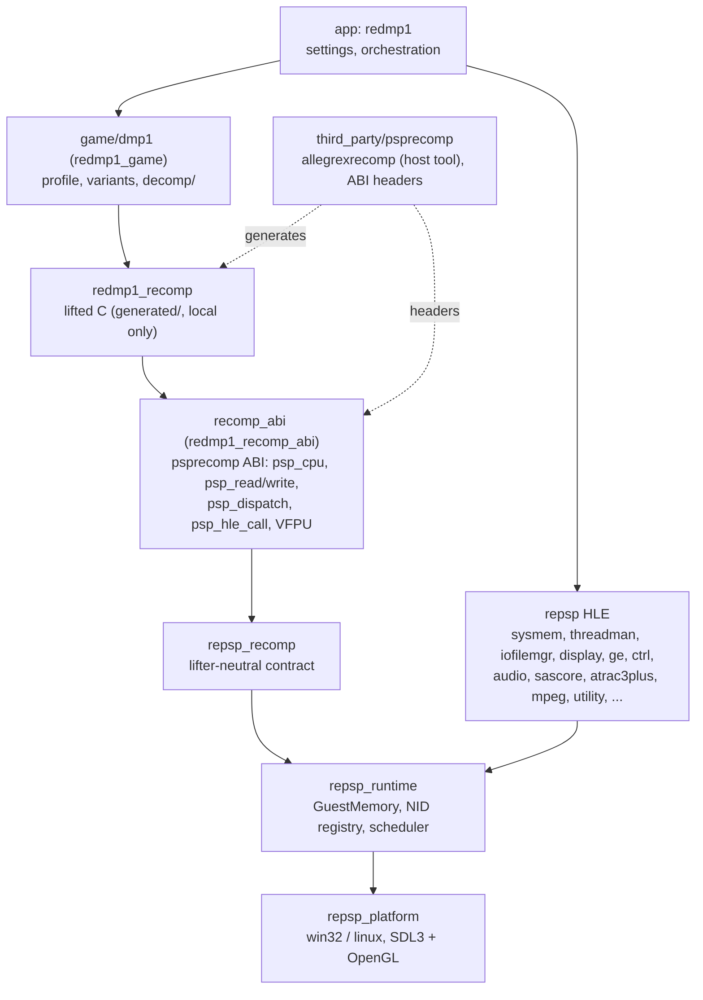
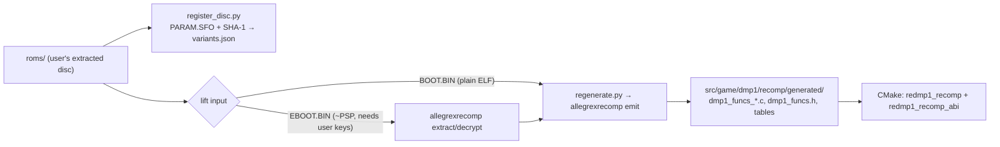

# 설계: 프로젝트 부트스트랩과 공유 repsp 위의 레이어 구조 (issue #1)

## 1. 요구사항

* PSP 게임 DJMAX Portable(한국판 `ULKS-46050`, 1.02)을 reCT3와 같은 방법(정적 재컴파일 + 디컴파일 + HLE)으로 포팅하는 프로젝트를 만든다. 원격 저장소는 `reexec/reDMP1`.
* 저장소 구조와 작업 규칙은 [reexec/reCT3](https://github.com/reexec/reCT3)를 따른다.
* lift와 디컴파일 보조 도구는 [sp00nznet/psprecomp](https://github.com/sp00nznet/psprecomp)를 쓴다.
* 플랫폼 백엔드와 PSP 런타임은 재사용할 수 있도록 별도 저장소 `reexec/repsp`로 만든다([repsp 설계 i001](https://github.com/reexec/repsp/blob/i001-runtime-bootstrap/docs/design/20261111-i001-runtime-bootstrap.md)). reCT3에서 rexbox가 하는 역할이다.
* 사용자 결정(issue #1): repsp가 런타임(메모리, 스케줄러, HLE, GE, 플랫폼)을 소유하고 psprecomp는 lifter와 ABI 헤더로만 쓴다. **repsp는 psprecomp에 의존하지 않는다.** 1차 호스트는 Win64. 백엔드는 SDL3 + OpenGL.

## 2. reCT3에서 가져오는 것과 바뀌는 것

| reCT3 | reDMP1 | 판단 |
|---|---|---|
| `AGENTS.md`, `CLAUDE.md`, `docs/CODING_STYLE.md`, `docs/PROJECT_CHARTER.md` | 같은 규칙, PSP·repsp·psprecomp에 맞게 | 규칙 동일 |
| `third_party/rexbox` | `third_party/repsp` | 공유 런타임 |
| `third_party/xboxrecomp` (lifter) | `third_party/psprecomp` (lifter + ABI 헤더) | 타이틀이 고정 |
| rexbox의 `recomp_abi.c`(lifter ABI 구현이 런타임에 있음) | `src/recomp_abi/`(psprecomp ABI 어댑터가 타이틀에 있음) | §3: repsp는 lifter 중립 |
| `src/game/ct3/`, `include/rect3/` | `src/game/dmp1/`, `include/redmp1/` | 타이틀 계층 |
| `src/app/` (`rect3`) | `src/app/` (`redmp1`) | 앱 |
| `variants.json`(XBE MD5, 인증서) | `variants.json`(디스크 ID, 디스크 버전, 실행 파일 SHA-1) | 신원 |
| `scripts/recomp/register_xbe.py` | `scripts/recomp/register_disc.py` | 신원 등록 |
| `scripts/recomp/regenerate.py`, `lifter.py` | 같은 이름, `allegrexrecomp`를 실행 | 생성 |
| `hle_libraries.json`, `xdk_symbols_extra.json` | (없음) | PSP는 NID import 표가 실행 파일에 있어 심볼 식별이 필요 없다 |
| `seed_functions.json`, `seed_pointer_targets.json` | `recomp/seed_functions.json` (빈 자리) | lifter 발견 누락을 보충할 때 |
| `docs/XBE_DESIGN.*` | `docs/EXECUTABLE_DESIGN.*` | 실행 파일 분석 누적 |
| `build_win32_x86.*` | `build_win64.ps1`/`.bat`, `build_linux.sh` | Win64 먼저 |
| `tools/decomp_check` | (예정) | 디컴파일 파이프라인 설계에서 |
| CI(Win32, Linux x64), release | CI(Win64 Debug/Release, Linux x64), release | 1차 호스트에 맞춤 |

## 3. 레이어 구조



* **repsp는 lifter 중립이다.** repsp는 `include/repsp/recomp/`에 재컴파일 코드 계약만 공개한다: 게스트 CPU 컨텍스트를 다루는 콜백 표(컨텍스트 크기, 저장·복원, 인자 `n`번 읽기, 반환값 쓰기, 게스트 함수 호출), HLE 호출 진입점(NID → HLE 함수), 그리고 `GuestMemory`. psprecomp의 이름과 레지스터 파일 레이아웃은 계약에 나타나지 않는다(repsp 설계 i001 §5).
* **psprecomp ABI 어댑터는 이 저장소에 있다**(`src/recomp_abi/`, 타깃 `redmp1_recomp_abi`). psprecomp 헤더(`cpu.h`, `mem.h`, `dispatch.h`, `vfpu.h`, `hle.h`)가 선언한 전역과 함수(`psp_cpu`, `psp_read32`, `psp_write32`, `psp_mem_ptr`, `psp_register`, `psp_dispatch`, `psp_call_from_host`, `psp_hle_call`, `psp_syscall`, VFPU 도우미 등)를 정의하고, 시작할 때 repsp에 콜백 표를 등록한다. 메모리 접근은 repsp `GuestMemory`의 Translate로, HLE 호출은 repsp의 NID 진입점으로 넘긴다.
* VFPU 연산 구현처럼 양이 많은 부분은 psprecomp 런타임(MIT)에서 출처를 적고 옮겨 올 수 있다. psprecomp의 런타임 라이브러리 타깃(`psprecomp`)은 링크하지 않는다.
* 이 어댑터는 다른 PSP 타이틀도 똑같이 필요하다. 두 번째 소비자가 생기면 어댑터를 별도 저장소(예: `repsp-psprecomp`)로 분리할지 정한다(**미확정**). repsp 안으로는 옮기지 않는다(사용자 결정).
* `allegrexrecomp`는 호스트 빌드 도구로, `third_party/psprecomp/tools/allegrexrecomp`를 이 저장소의 CMake가 별도 타깃으로 빌드한다(psprecomp 전체를 `add_subdirectory`로 넣으면 `psprecomp` 런타임 타깃이 같이 생기므로 도구 디렉터리만 넣거나 `ExternalProject`로 빌드한다. 어느 쪽인지는 구현에서 정하고 작업 로그에 남긴다).

## 4. 재컴파일 파이프라인



* lift 입력: `BOOT.BIN`이 `EBOOT.BIN` 복호화 결과와 같은 코드이면 `BOOT.BIN`을 쓴다(키 불필요). 이 판단은 issue #1에서 측정한다([분석](../analysis/disc-image.md)의 미확정 항목). 다르면 `EBOOT.BIN`을 사용자 키로 복호화해 쓴다(키 파일은 `psp_keys.txt`, 커밋 안 함, psprecomp의 [DECRYPT.md](https://github.com/sp00nznet/psprecomp/blob/main/docs/DECRYPT.md) 형식).
* 이번 task의 범위는 생성까지다. 생성 코드와 어댑터의 컴파일·링크는 repsp의 재컴파일 코드 계약이 생긴 뒤 issue #2(lift & link)에서 한다. 이번 task는 `allegrexrecomp info`/`funcs` 결과(모듈 이름, 섹션, import 모듈과 NID 수, 발견 함수 수, `.text` 커버리지)를 `docs/analysis/executable.md`에 남긴다.
* 생성 코드는 커밋하지 않는다(`.gitignore`).

## 5. 디스크 신원과 앱 입력

* 앱 인자는 디스크에서 추출한 **게임 디렉터리**(기본 `roms/`)다. 앱은 그 폴더를 게임의 `disc0:`/`umd0:`로 쓴다. 저장 데이터용 `ms0:`는 사용자 설정 폴더 아래에 둔다(repsp의 경로 계약).
* 식별: `PSP_GAME/PARAM.SFO`의 `DISC_ID`와 `DISC_VERSION`, 그리고 lift 입력 실행 파일의 SHA-1을 `src/game/dmp1/recomp/variants.json`과 비교한다. 등록된 변형이면 실행하고, 아니면 이유를 출력하고 멈춘다. `PARAM.SFO` 파서는 PSP 일반 기능이므로 repsp의 module 계층에 둔다(repsp issue #1). ISO 파일 입력은 이번 범위가 아니다.
* `variants.json`의 값은 `register_disc.py`가 사용자 덤프에서 읽어 기록한다. 원본과 같은 실행 파일이면 누구의 덤프에서 만들어도 같은 값이다.

## 6. HLE 대상과 알려진 위험

| 영역 | 대상 | 위험 |
|---|---|---|
| 커널 | SysMemUserForUser, ThreadManForUser, IoFileMgrForUser, ModuleMgrForUser, LoadExecForUser, UtilsForUser, Kernel_Library, InterruptManager | PSP 스케줄러는 단일 코어 고정 우선순위 선점형이다. 게스트 스레드 = 호스트 스레드로 두고 한 번에 하나만 실행하는 baton 방식이 원본 의미와 맞다(repsp 설계 i001). |
| 그래픽 | sceDisplay, sceGe_user | GE 디스플레이 리스트는 명령 스트림이라 해석기가 필요하다(하드웨어 수준 처리의 유일한 큰 예외). OpenGL로 번역. |
| 입력 | sceCtrl | 리듬 게임이라 입력 지연과 타이밍이 중요하다. vblank·오디오 시계와의 동기화는 측정으로 정한다. |
| 오디오 | sceAudio, sceSasCore(`sc_sascore.prx`), sceAtrac3plus(`libatrac3plus.prx`) | **ATRAC3plus 디코더**: 알려진 오픈소스 구현(FFmpeg, PPSSPP 경유)은 LGPL/GPL이라 규칙상 쓸 수 없다. 허용적 라이선스 구현이 없으면 독자 구현이 필요하다(**미확정**, 오디오 task에서 설계, 사용자 확인). 곡 데이터가 ATRAC3plus인지부터 분석한다. |
| 동영상 | sceMpeg(`mpeg.prx`, `mpegbase.prx`), sceVideocodec, sceAudiocodec | PMF = H.264 + ATRAC3plus. H.264는 openh264(BSD-2) 후보. 오디오는 위와 같은 위험. |
| 시스템 | sceUtility(저장 데이터, 다이얼로그), sceRtc, scePower, sceUmdUser, sceImpose | 저장 데이터 다이얼로그 UI를 HLE로 대체. |
| CPU | VFPU | psprecomp의 VFPU는 부분 구현(그 README). 누락 명령은 psprecomp 업스트림에 기여. |
| 디컴파일 | psprecomp 생성 함수의 대체 | psprecomp에 함수 단위 override 장치가 있는지 **미확정**. 디컴파일 파이프라인 task에서 설계(필요하면 업스트림 기여). |

## 7. 저장소 구성

```
reDMP1/
├── AGENTS.md, CLAUDE.md, GEMINI.md, README.md, ARCHITECTURE.md, LICENSE, VERSION
├── THIRD_PARTY_NOTICES.md, CREDITS.md
├── CMakeLists.txt, CMakePresets.json
├── include/redmp1/            # title public headers (profile)
├── src/recomp_abi/            # psprecomp ABI -> repsp recompiled-code contract
├── src/game/dmp1/             # profile, variant lookup
│   ├── decomp/                # decompiled functions (README only for now)
│   └── recomp/                # variants.json, seed_functions.json, generated/ (ignored)
├── src/app/                   # redmp1 executable: args, identity check, orchestration
├── scripts/                   # build_win64.ps1/.bat, build_linux.sh
│   └── recomp/                # register_disc.py, regenerate.py, lifter.py
├── tools/                     # (later) decomp_check
├── third_party/repsp/         # submodule
├── third_party/psprecomp/     # submodule
├── docs/                      # design, work-orders, work-logs, analysis, kb, guides, release-notes
└── .github/workflows/         # ci.yml, release.yml
```

* `third_party/psprecomp`는 upstream `main`의 머지 커밋 `5ca18fa`(v0.5.0 이후 12커밋: VFPU 누락 명령, 지연 슬롯, 모듈 로더)에 고정한다. 다음 태그가 나오면 태그로 옮긴다. 고정을 옮기면 `src/recomp_abi/`를 같은 작업에서 맞춘다.
* `third_party/repsp`는 repsp issue #1의 작업 브랜치 커밋에 임시로 고정하고, repsp가 머지되면 머지 커밋으로 옮긴다.

## 8. 이번 task의 검증

1. Win64 Debug/Release가 경고 없이 빌드되고 CTest(repsp probe + 앱 smoke)가 통과한다. CI에서도 같다(게임 데이터 없음).
2. 앱 smoke: 인자 없음·없는 폴더·`PARAM.SFO` 없는 폴더·등록되지 않은 `DISC_ID`를 각각 거부하고 0이 아닌 종료 코드를 낸다.
3. 로컬(게임 데이터 있음): `register_disc.py roms`가 `variants.json`을 만들고, 앱이 그 폴더를 등록된 변형으로 식별한다.
4. 로컬: `regenerate.py`가 `allegrexrecomp`를 빌드·실행해 `generated/`를 만든다. 함수 수와 커버리지를 작업 로그와 `docs/analysis/executable.md`에 남긴다.
5. 로컬: `BOOT.BIN`과 `EBOOT.BIN`(복호화 가능할 때)의 비교 결과를 `docs/analysis/disc-image.md`에 반영한다. 키가 없으면 그 사실과 `BOOT.BIN`만으로 진행한 근거를 남긴다.
6. `git status`에 게임 데이터·생성 코드가 없다. repsp 체크아웃에 psprecomp 참조가 없다(`git grep -i psprecomp`는 문서의 설명·출처 표기만).

---

# Design: project bootstrap and the layer structure on the shared repsp (issue #1)

## 1. Requirements

* Create the project that ports the PSP game DJMAX Portable (Korea build `ULKS-46050`, 1.02) the way reCT3 does (static recompilation + decompilation + HLE). The remote is `reexec/reDMP1`.
* Repository structure and working rules follow [reexec/reCT3](https://github.com/reexec/reCT3).
* Lifting and the decompilation aids come from [sp00nznet/psprecomp](https://github.com/sp00nznet/psprecomp).
* The platform backends and the PSP runtime go into a separate, reusable repository `reexec/repsp` ([repsp design i001](https://github.com/reexec/repsp/blob/i001-runtime-bootstrap/docs/design/20261111-i001-runtime-bootstrap.md)), the role rexbox plays for reCT3.
* User decisions (issue #1): repsp owns the runtime (memory, scheduler, HLE, GE, platform) and psprecomp is used only as the lifter and its ABI headers. **repsp does not depend on psprecomp.** The first host is Win64. The backend is SDL3 + OpenGL.

## 2. What comes from reCT3 and what changes

See the table above. The rules carry over adapted to the PSP, repsp and psprecomp; rexbox becomes `third_party/repsp` and xboxrecomp becomes `third_party/psprecomp`, both pinned here; unlike rexbox's `recomp_abi.c`, the lifter ABI adapter lives in this repository (`src/recomp_abi/`) because repsp is lifter-neutral (§3); `src/game/ct3/`/`include/rect3/` become `src/game/dmp1/`/`include/redmp1/`; the app is `redmp1`; `variants.json` holds the disc ID, disc version and the executable's SHA-1, registered by `register_disc.py`; `regenerate.py`/`lifter.py` run `allegrexrecomp`; there is no XDK symbol identification (a PSP executable carries its NID import tables); `seed_functions.json` is an empty slot for discovery gaps; `XBE_DESIGN.*` becomes `EXECUTABLE_DESIGN.*`; build scripts are `build_win64.*` and `build_linux.sh`; `decomp_check` waits for the decompilation pipeline design; CI covers Win64 Debug/Release and Linux x64.

## 3. Layer structure

See the diagram above.

* **repsp is lifter-neutral.** It publishes only a recompiled-code contract in `include/repsp/recomp/`: a callback table for the guest CPU context (context size, save and restore, read argument `n`, write the return value, call a guest function), the HLE call entry (NID → HLE function), and `GuestMemory`. Neither psprecomp's names nor its register-file layout appear in the contract (repsp design i001 §5).
* **The psprecomp ABI adapter lives here** (`src/recomp_abi/`, target `redmp1_recomp_abi`). It defines the globals and functions the psprecomp headers (`cpu.h`, `mem.h`, `dispatch.h`, `vfpu.h`, `hle.h`) declare (`psp_cpu`, `psp_read32`, `psp_write32`, `psp_mem_ptr`, `psp_register`, `psp_dispatch`, `psp_call_from_host`, `psp_hle_call`, `psp_syscall`, the VFPU helpers, ...) and registers its callback table with repsp at start-up. Memory access goes through repsp `GuestMemory` translation, HLE calls through repsp's NID entry.
* Large parts such as the VFPU operations may be carried over from psprecomp's runtime (MIT) with attribution. psprecomp's runtime library target (`psprecomp`) is never linked.
* Every other PSP title needs the same adapter. When a second consumer appears, whether to split the adapter into its own repository (for example `repsp-psprecomp`) is decided then (**unresolved**); it does not move into repsp (user decision).
* `allegrexrecomp` is a host build tool built by this repository's CMake from `third_party/psprecomp/tools/allegrexrecomp` as a separate target (an `add_subdirectory` of all of psprecomp would also create the `psprecomp` runtime target, so only the tool directory is added, or it is built with `ExternalProject`; the implementation picks one and records it in the work log).

## 4. Recompilation pipeline

See the diagram above.

* Lift input: if `BOOT.BIN` holds the same code as `EBOOT.BIN` decrypted, `BOOT.BIN` is used (no keys). Issue #1 measures this (the unresolved item of the [analysis](../analysis/disc-image.md)). Otherwise `EBOOT.BIN` is decrypted with the user's keys (`psp_keys.txt`, never committed, in the format of psprecomp's [DECRYPT.md](https://github.com/sp00nznet/psprecomp/blob/main/docs/DECRYPT.md)).
* This task stops at generation. Compiling and linking the generated code and the adapter is issue #2 (lift & link), once repsp's recompiled-code contract exists. This task records the `allegrexrecomp info`/`funcs` results (module name, sections, imported modules and NID counts, functions found, `.text` coverage) in `docs/analysis/executable.md`.
* Generated code is never committed (`.gitignore`).

## 5. Disc identity and app input

* The app's argument is the **game directory** extracted from the disc (default `roms/`), served as the game's `disc0:`/`umd0:`. Save data's `ms0:` lives under the user settings folder (repsp's paths contract).
* Identification compares `DISC_ID` and `DISC_VERSION` from `PSP_GAME/PARAM.SFO`, and the SHA-1 of the lift-input executable, with `src/game/dmp1/recomp/variants.json`. A registered variant runs; anything else prints why and stops. The `PARAM.SFO` parser is general PSP functionality and lives in repsp's module layer (repsp issue #1). ISO input is out of scope.
* `register_disc.py` reads the values for `variants.json` from the user's dump. For an executable identical to the original, every dump yields the same values.

## 6. HLE targets and known risks

See the table above. Key points: the PSP scheduler is single-core, fixed-priority and preemptive, so guest threads map to host threads with exactly one running at a time (a baton, repsp design i001); the GE needs a display-list interpreter translated to OpenGL (the one large hardware-level exception); input timing matters for a rhythm game and its sync with the vblank and audio clocks is decided by measurement; **the ATRAC3plus decoder** is a licensing risk because the known open implementations (FFmpeg, and PPSSPP through it) are LGPL/GPL, so without a permissive implementation one must be written (**unresolved**: designed in the audio task, with the user's confirmation), starting with whether the song data is ATRAC3plus at all; PMF movies are H.264 + ATRAC3plus, H.264 possibly through openh264 (BSD-2); sceUtility's save-data dialogs are replaced by HLE; psprecomp's VFPU is partial and missing instructions go upstream; whether psprecomp has a per-function override mechanism for decompilation is **unresolved** and is designed in the decompilation pipeline task.

## 7. Repository layout

See the tree above. `third_party/psprecomp` is pinned to upstream `main` merge commit `5ca18fa` (12 commits past v0.5.0: missing VFPU instructions, delay slots, the module loader) and moves to the next tag when one appears; moving the pin updates `src/recomp_abi/` in the same task. `third_party/repsp` is pinned temporarily to the repsp issue #1 task-branch commit and moves to its merge commit once repsp is merged.

## 8. Verification for this task

1. Win64 Debug/Release builds without warnings and CTest (repsp probes + app smoke) passes, in CI too (no game data).
2. App smoke: no argument, a missing folder, a folder without `PARAM.SFO` and an unregistered `DISC_ID` are each rejected with a non-zero exit code.
3. Local (with game data): `register_disc.py roms` writes `variants.json`, and the app identifies that folder as the registered variant.
4. Local: `regenerate.py` builds and runs `allegrexrecomp` and produces `generated/`; the function count and coverage go to the work log and `docs/analysis/executable.md`.
5. Local: the `BOOT.BIN` vs `EBOOT.BIN` (when decryptable) comparison is reflected in `docs/analysis/disc-image.md`; without keys, that fact and the grounds for proceeding with `BOOT.BIN` alone are recorded.
6. `git status` shows no game data or generated code. The repsp checkout has no psprecomp reference (`git grep -i psprecomp` finds only explanations and attributions in documents).
