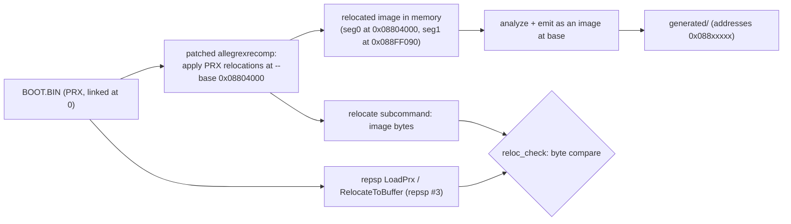
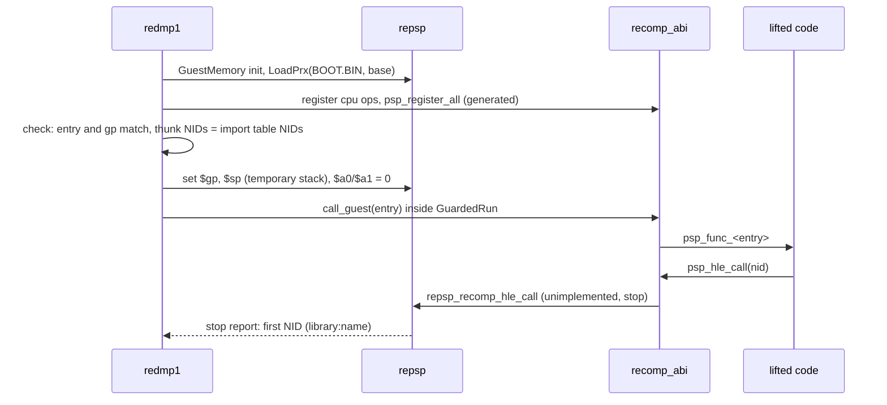

# 설계: Lift & link — 모듈을 0x08804000으로 재배치하고, psprecomp ABI 어댑터로 링크해 첫 게스트 호출까지 (issue #3)

## 1. 요구사항

* 생성 코드를 Win64에서 컴파일·링크하고, 모듈의 진입점(`module_start`)을 실행해 첫 펌웨어 호출까지 닿는다.
* 사용자 결정(issue #3): 모듈은 실제 펌웨어처럼 사용자 RAM `0x08804000`에 **재배치해서** 올린다. psprecomp의 방식(재배치 없이 링크 주소 0에 올림)은 쓰지 않는다.
* 사용자 결정(issue #3): 재배치에 필요한 allegrexrecomp 변경은 이 저장소에 로컬 패치로 준비한다. 업스트림(sp00nznet/psprecomp)에는 사용자가 허락할 때까지 PR·issue·fork를 만들지 않는다.
* repsp는 psprecomp에 의존하지 않는다(issue #1의 결정). psprecomp ABI 어댑터는 이 저장소의 `src/recomp_abi/`에 둔다.

## 2. 측정한 사실

모두 원본 `BOOT.BIN`에서 측정했다. `docs/analysis/executable.md`에 옮긴다.

* `e_type` `0xFFA0`(PRX). `PT_LOAD` 2개: 세그먼트 0은 `0x00000000` 1,028,240바이트, 세그먼트 1은 `0x000FB090` 파일 124,516 / 메모리 2,718,852바이트. 이미지 끝은 `0x003A0000` 부근이다.
* 재배치 섹션은 `SHT_PRXRELOC`(`0x700000A0`) 13개, 항목 37,010개이며 압축 형식(`0x700000A1`)은 없다. 유형별로는 `R_MIPS_26` 19,406개, `R_MIPS_HI16` 5,859개, `R_MIPS_LO16` 6,311개, `R_MIPS_32` 5,434개다.
* `(ofsbase, addrbase)` 분포는 (0,0) 30,578, (0,1) 6,111, (1,0) 56, (1,1) 265개다.
* **`addrbase` 1의 저장 값은 세그먼트 1 시작에서의 상대값이다**(**추정**, 근거: `R_MIPS_32` (1,1) 265개 중 264개, `HI16/LO16` (0,1) 2,845쌍 중 1,971쌍이 `0xFB090`보다 작다). 그러므로 재배치하지 않고 0번지에 올리면 `.data`/`.bss`를 가리키는 계산이 `0xFB090`만큼 어긋난다. 재배치는 선택이 아니라 정확성의 조건이다.
* 0번지 배치는 PSP scratchpad(`0x00010000`, 16 KiB)와도 겹친다(이미지가 `0x3A0000`까지 차지).
* allegrexrecomp(`5ca18fa`)는 재배치 표를 시드 수집에만 쓰고 적용하지 않는다. 시드 수집도 `ofsbase`·`addrbase`를 무시한다(`container.c`). 그래서 `R_MIPS_32` (1,1) 항목은 잘못된 위치를 읽고 잘못된 값을 쓴다. 데이터 속 함수 포인터 일부를 놓칠 수 있다.
* 생성 코드는 GCC `-O1`로 146개 파일이 오류 없이 25초에 컴파일되고 오브젝트는 약 21 MB다. 런타임에서 가져다 쓰는 심볼은 28개다(§5). 함수 wrapper 9,159개, import thunk 144개, `psp_register` 호출 26,348개가 있다.

## 3. 재배치한 lift (allegrexrecomp 패치)

* 패치 기능(기준안):
  * `emit`과 `funcs`에 `--base <addr>`를 더한다. 주어지면 PRX의 재배치를 적용한 이미지를 만들고, 그 이미지를 기준 주소에서 분석·생성한다. 시드도 재배치된 이미지에서 모은다.
  * 새 부명령 `relocate <file> <base> <out>`은 재배치된 이미지 바이트를 쓴다(교차 검사용; 출력은 게임 데이터이므로 `build/` 아래에만 둔다).
  * 재배치 규칙은 [repsp 설계 i003 §2](https://github.com/reexec/repsp/blob/i003-prx-loader/docs/design/20261113-i003-prx-loader.md)와 같다.
  * 두 번째 패치로 시드 수집의 `ofsbase`/`addrbase` 처리를 고친다(재배치를 쓰지 않는 기존 경로의 버그).
* 패치의 위치와 적용:
  * `patches/psprecomp/0001-*.patch`, `0002-*.patch`(`git format-patch` 형식)와 `patches/psprecomp/README.md`(목적, 대상 커밋 `5ca18fa`, 업스트림 PR 초안 문구, "업스트림 제출: 사용자 허락 대기")를 둔다.
  * CMake가 configure 때 `third_party/psprecomp/tools/allegrexrecomp`를 빌드 디렉터리로 복사하고 패치를 적용한 뒤 `allegrexrecomp`를 빌드한다. submodule 작업 트리는 건드리지 않는다. 패치 적용이 실패하면 configure가 실패한다.
* 업스트림 제출은 사용자가 허락하면 별도로 한다. 받아들여지면 submodule을 그 커밋으로 올리고 패치를 지운다.
* 기준 주소 `0x08804000`(**추정**: psprecomp의 기본 load base, PSP 펌웨어가 첫 사용자 모듈을 사용자 파티션 `0x08800000`의 앞 16 KiB 뒤에 놓는다는 공개 자료)은 `src/game/dmp1/recomp/lift.json`(새 파일; `base`, `prefix`)에 두고 `regenerate.py`와 앱이 같은 값을 읽는다.

## 4. 이미지 로드와 교차 검사

* 앱은 repsp의 `LoadPrx`로 `disc0:/PSP_GAME/SYSDIR/BOOT.BIN`을 같은 기준 주소에 올린다(repsp issue #3).
* `reloc_check`(CTest, `roms/`가 있을 때만 등록)는 repsp의 `RelocateToBuffer` 결과와 패치된 `allegrexrecomp relocate` 결과를 바이트 단위로 비교한다. 두 독립 구현이 같으면 재배치 규칙이 맞다고 본다. 다르면 첫 차이의 주소와 그 주소에 걸린 재배치 항목을 출력한다.

## 5. psprecomp ABI 어댑터 (`src/recomp_abi/`, 타깃 `redmp1_recomp_abi`)

생성 코드가 쓰는 심볼 28개를 정의한다(측정). 동작은 repsp에 두고, 어댑터는 이름을 잇기만 한다.

| 묶음 | 심볼 | 구현 |
|---|---|---|
| CPU 상태 | `psp_cpu` | psprecomp `cpu.h`의 `psp_cpu_state` 전역 하나 |
| 메모리 | `psp_read8/16/32`, `psp_read_f32`, `psp_write8/16/32`, `psp_write_f32` | `repsp_guest_base()`와 `repsp_guest_mask()`로 `base + (addr & mask)`, little-endian(`memcpy`). 기준 포인터와 마스크는 시작할 때 한 번 읽어 둔다 |
| 디스패치 | `psp_register`, `psp_register_label`, `psp_dispatch`, `psp_ra_is_jump` | 코드 범위(`base`부터 세그먼트 0 끝까지)를 4바이트 단위로 나눈 평면 배열의 함수 포인터 표. 범위 밖 등록은 오류. 미스는 주소와 호출 위치를 repsp 로그에 남기고 정지. `psp_ra_is_jump`와 프레임·unwind 의미는 psprecomp `dispatch.h`의 계약을 따르고 `src/dispatch.c`(MIT)에서 옮긴다 |
| 펌웨어·트랩 | `psp_hle_call`, `psp_syscall`, `psp_unimplemented` | `repsp_recomp_hle_call(nid)`, `repsp_recomp_syscall(code)`, 주소와 설명을 로그에 남기고 정지 |
| VFPU | `psp_lv_q`, `psp_lv_s`, `psp_sv_s`, `psp_vcmp`, `psp_vdet`, `psp_vdiv`, `psp_vhdp`, `psp_vmin`, `psp_vmul`, `psp_vscl`, `psp_vsge`, `psp_vtfm` | psprecomp `src/vfpu.c`(MIT)에서 이 12개와 그것이 쓰는 도우미만 옮긴다. 메모리 접근은 위의 어댑터 함수로 |

* repsp에 `repsp_guest_cpu_ops`를 등록한다. `save`/`restore`는 `psp_cpu` 전체 복사, `get_gpr`/`set_gpr`는 `psp_cpu.r[]`, `call_guest`는 psprecomp `psp_call_from_host`와 같은 의미(호스트 프레임을 쌓고 dispatch)다.
* 옮긴 코드는 파일 머리에 출처(psprecomp 커밋 `5ca18fa`, 원 파일)를 적고 `THIRD_PARTY_NOTICES.md`에 기록한다. 옮긴 코드에서 버그를 찾으면 업스트림 기여 후보로 작업 로그에 적는다(제출은 사용자 허락 후).
* 어댑터 probe(`recomp_abi_probe`, CI에서 실행): 손으로 쓴 작은 "생성 코드 모양" 함수 몇 개로 메모리 읽기·쓰기, 등록과 dispatch, dispatch 미스 보고, `psp_hle_call`이 repsp NID 레지스트리에 닿는지, `save`/`restore`, VFPU 몇 개(`vdiv`, `vtfm`, `lv_q`/`sv_s`)의 값을 검사한다. 게임 데이터 없이 돈다.

## 6. 생성 코드 빌드

* `redmp1_recomp`: `src/game/dmp1/recomp/generated/*.c`를 모은 정적 라이브러리. `generated/`가 없으면(CI) 이 타깃과 그것에 의존하는 실행 경로를 만들지 않고, 앱은 "생성 코드 없음"으로 빌드된다.
* 생성 코드는 스타일·경고 규칙 밖이다(`/W4 /WX`를 적용하지 않는다; MSVC는 `/W0`, GCC/Clang은 `-w`). 최적화 수준과 빌드 시간·크기를 Win64(MSVC)에서 측정해 작업 로그에 적는다. `/bigobj`가 필요한지도 측정으로 정한다.

## 7. 첫 게스트 호출 (`redmp1 roms --lift-check`)

* 실행 전 검사: `LoadPrx`의 진입점·`$gp`가 `lift.json`의 기준 주소로 생성된 코드의 진입점과 같은지 확인한다. 생성된 import thunk의 NID 집합이 `LoadPrx`의 import 표와 같은지도 확인한다.
* 스택은 임시로 사용자 RAM 끝 64 KiB를 쓴다(정식 스레드·스택은 커널 HLE task). `$gp`는 로더 값을 쓴다.
* 커널 HLE가 아직 없으므로 첫 펌웨어 호출에서 정지한다(`REPSP_STOP_ON_UNIMPLEMENTED`와 같은 경로). 결과(실행된 함수 수 또는 dispatch 수, 첫 NID와 이름)를 출력하고, 작업 로그와 `docs/analysis/executable.md`에 남긴다. 첫 NID 이름은 import 표의 라이브러리 이름과 NID로 적는다(함수 이름은 공개 NID 목록에서 찾을 수 있을 때만, 출처와 함께).

## 8. 이번 task의 검증

1. 패치를 적용한 `allegrexrecomp`가 `--base 0x08804000`으로 생성하고, 생성 코드가 Win64 Debug/Release에서 어댑터·repsp와 링크된다(경고 규칙은 생성 코드에 적용하지 않는다).
2. `reloc_check`(로컬): repsp와 allegrexrecomp의 재배치 결과가 바이트 단위로 같다.
3. `redmp1 roms --lift-check`(로컬): §7의 검사가 통과하고 첫 펌웨어 호출까지 닿아 그 NID를 보고한다.
4. CI(게임 데이터 없음): Win64 Debug/Release, Linux x64 Debug/Release 빌드와 CTest(`recomp_abi_probe` 포함)가 통과한다.
5. 로컬 Linux x64(WSL)에서도 1~3을 확인한다(가능하면).
6. 측정값(재배치 이전·이후 함수 수와 커버리지, MSVC 빌드 시간·크기, 첫 NID)을 작업 로그와 `docs/analysis/executable.md`에 남긴다. 시드 수정 패치 전후로 함수 수가 달라지면 그 차이도 적는다.

## 9. 미확정

* 재배치 기준 주소 `0x08804000`이 이 타이틀에서 실제 펌웨어가 쓰는 값과 같은지(**추정**). 다르더라도 재배치가 정확하면 동작은 같다. 게임이 자기 주소를 상수로 비교하는 코드가 나오면 다시 본다.
* psprecomp의 함수 단위 override 장치(디컴파일 교체). 이번에는 필요 없다. 디컴파일 파이프라인 task에서 설계하며, 업스트림 변경이 필요하면 사용자 허락 후 제출한다.

---

# Design: lift & link — relocating the module to 0x08804000 and linking it through the psprecomp ABI adapter up to the first guest call (issue #3)

## 1. Requirements

* Compile and link the generated code on Win64, and run the module's entry (`module_start`) up to its first firmware call.
* User decision (issue #3): the module is placed in user RAM at `0x08804000` **with relocation applied**, as the real firmware does. psprecomp's approach (placing it at link address 0 without relocation) is not used.
* User decision (issue #3): the allegrexrecomp change the relocation needs is prepared as a local patch in this repository. No pull request, issue or fork is made upstream (sp00nznet/psprecomp) until the user allows it.
* repsp does not depend on psprecomp (issue #1's decision); the psprecomp ABI adapter lives in this repository's `src/recomp_abi/`.

## 2. Measured facts

All measured on the original `BOOT.BIN`, and carried into `docs/analysis/executable.md`: `e_type` `0xFFA0` (PRX); two `PT_LOAD` segments (segment 0 at `0x00000000`, 1,028,240 bytes; segment 1 at `0x000FB090`, 124,516 bytes in the file and 2,718,852 in memory), the image ending near `0x003A0000`; 13 `SHT_PRXRELOC` (`0x700000A0`) sections with 37,010 entries and no compressed (`0x700000A1`) format, by type `R_MIPS_26` 19,406, `R_MIPS_HI16` 5,859, `R_MIPS_LO16` 6,311, `R_MIPS_32` 5,434; `(ofsbase, addrbase)` (0,0) 30,578, (0,1) 6,111, (1,0) 56, (1,1) 265. **Values with `addrbase` 1 are relative to segment 1's start** (**inferred**: 264 of 265 `R_MIPS_32` (1,1) entries and 1,971 of 2,845 `HI16/LO16` (0,1) pairs are below `0xFB090`), so placing the module at 0 without relocation misses `.data`/`.bss` addresses by `0xFB090`: relocation is a condition of correctness, not a choice. Placement at 0 also overlaps the PSP scratchpad (`0x00010000`, 16 KiB), the image reaching `0x3A0000`. allegrexrecomp (`5ca18fa`) uses the relocation tables only to harvest seeds and never applies them, and its harvesting ignores `ofsbase`/`addrbase` (`container.c`), so `R_MIPS_32` (1,1) entries are read at the wrong place with the wrong value and some function pointers in data may be missed. The generated code compiles with GCC `-O1` in 25 s (146 files, no errors, about 21 MB of objects) and needs 28 runtime symbols (§5); it holds 9,159 function wrappers, 144 import thunks and 26,348 `psp_register` calls.

## 3. Relocated lift (allegrexrecomp patch)

See the diagram above.

* Patch features (baseline): `emit` and `funcs` gain `--base <addr>`, which builds the image with the PRX relocations applied and analyzes and emits it at that base, seeds included; a new `relocate <file> <base> <out>` subcommand writes the relocated image bytes (for the cross-check; the output is game data and stays under `build/`); the relocation rules are those of [repsp design i003 §2](https://github.com/reexec/repsp/blob/i003-prx-loader/docs/design/20261113-i003-prx-loader.md); a second patch fixes the seed harvesting's `ofsbase`/`addrbase` handling (a bug in the existing, non-relocating path).
* Placement and application: `patches/psprecomp/0001-*.patch` and `0002-*.patch` (`git format-patch` form) with `patches/psprecomp/README.md` (purpose, target commit `5ca18fa`, the draft upstream pull request text, "upstream submission: awaiting the user's permission"). At configure time CMake copies `third_party/psprecomp/tools/allegrexrecomp` into the build directory, applies the patches and builds `allegrexrecomp` from the copy; the submodule's working tree is never touched, and a failed patch fails the configure.
* Upstream submission happens separately once the user allows it; when it is accepted, the submodule moves to that commit and the patches go.
* The base `0x08804000` (**inferred**: psprecomp's default load base and public material saying the firmware places the first user module 16 KiB into the user partition at `0x08800000`) lives in `src/game/dmp1/recomp/lift.json` (new; `base`, `prefix`), read by both `regenerate.py` and the app.

## 4. Image loading and the cross-check

* The app places `disc0:/PSP_GAME/SYSDIR/BOOT.BIN` at the same base with repsp's `LoadPrx` (repsp issue #3).
* `reloc_check` (CTest, registered only when `roms/` exists) compares repsp's `RelocateToBuffer` with the patched `allegrexrecomp relocate` byte for byte; two independent implementations agreeing means the relocation rules are right, and a difference prints the first differing address and the relocation entries on it.

## 5. psprecomp ABI adapter (`src/recomp_abi/`, target `redmp1_recomp_abi`)

It defines the 28 symbols the generated code uses (measured), per the table above; behavior stays in repsp and the adapter only connects names. It registers `repsp_guest_cpu_ops` with repsp: `save`/`restore` copy all of `psp_cpu`, `get_gpr`/`set_gpr` use `psp_cpu.r[]`, and `call_guest` has the meaning of psprecomp's `psp_call_from_host` (push a host frame and dispatch). Carried code names its source (psprecomp commit `5ca18fa`, the original file) at the top of the file and is listed in `THIRD_PARTY_NOTICES.md`; bugs found in it are recorded in the work log as upstream candidates (submitted only with the user's permission). The adapter probe `recomp_abi_probe` (run in CI, no game data) uses a few hand-written functions shaped like generated code to check memory reads and writes, registration and dispatch, the dispatch-miss report, `psp_hle_call` reaching repsp's NID registry, `save`/`restore`, and the values of a few VFPU operations (`vdiv`, `vtfm`, `lv_q`/`sv_s`).

## 6. Building the generated code

* `redmp1_recomp` is a static library over `src/game/dmp1/recomp/generated/*.c`. Without `generated/` (CI) this target and the run path depending on it are not created, and the app builds as "no generated code".
* Generated code is outside the style and warning rules (no `/W4 /WX`; `/W0` on MSVC, `-w` on GCC/Clang). The optimization level, build time and size are measured on Win64 (MSVC) and recorded in the work log, and whether `/bigobj` is needed is decided by measurement.

## 7. First guest call (`redmp1 roms --lift-check`)

See the sequence diagram above. Before running, the app checks that `LoadPrx`'s entry and `$gp` match the entry of the code generated at `lift.json`'s base, and that the generated import thunks' NID set equals `LoadPrx`'s import table. The stack is temporarily the last 64 KiB of user RAM (proper threads and stacks are the kernel HLE task), and `$gp` is the loader's value. With no kernel HLE yet, the run stops at the first firmware call (the same path as `REPSP_STOP_ON_UNIMPLEMENTED`), prints the result (functions run or dispatch count, the first NID and its name) and records it in the work log and `docs/analysis/executable.md`. The first NID is named by its import-table library and NID, with a function name only where a public NID list gives one, cited.

## 8. Verification for this task

1. The patched `allegrexrecomp` generates with `--base 0x08804000`, and the generated code links with the adapter and repsp on Win64 Debug/Release (the warning rules do not apply to generated code).
2. `reloc_check` (local): repsp's and allegrexrecomp's relocation results are identical byte for byte.
3. `redmp1 roms --lift-check` (local): the §7 checks pass and the run reaches the first firmware call and reports its NID.
4. CI (no game data): Win64 Debug/Release and Linux x64 Debug/Release builds and CTest (including `recomp_abi_probe`) pass.
5. Local Linux x64 (WSL) confirms 1-3 too, where possible.
6. Measurements (function count and coverage before and after relocation, MSVC build time and size, the first NID) go to the work log and `docs/analysis/executable.md`; if the seed-harvesting patch changes the function count, the difference is recorded.

## 9. Unresolved

* Whether `0x08804000` is the base the real firmware uses for this title (**inferred**). With correct relocation the behavior is the same either way; it is revisited if code that compares its own addresses as constants turns up.
* psprecomp's per-function override mechanism (decompilation replacement) is not needed now; it is designed in the decompilation pipeline task, and any upstream change is submitted only with the user's permission.
