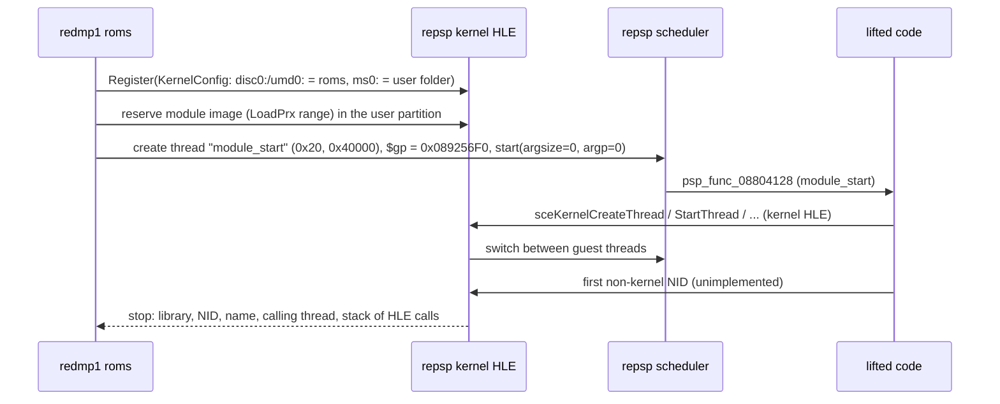

# 설계: 부팅 — 커널 HLE 위에서 module_start부터 첫 비커널 펌웨어 호출까지 (issue #5)

## 1. 요구사항

* 재배치한 모듈을 repsp의 커널 HLE와 스케줄러 위에서 `module_start`부터 실행한다([repsp issue #5](https://github.com/reexec/repsp/issues/5)). 아직 구현하지 않은 펌웨어 라이브러리를 처음 부를 때까지 간다. 그 라이브러리는 화면, GE, 오디오, utility 중 하나일 것으로 본다.
* 부팅 순서를 원본 게임의 사실로 `docs/analysis/boot.md`에 남긴다. 기록할 것은 만든 스레드, 연 파일, 메모리 할당, HLE 호출 순서다. 이 기록이 다음 task(화면·GE)의 입력이 된다.

## 2. 측정한 사실

* import는 서로 다른 NID 144개다. 그중 커널 쪽 59개와 `sceUmdUser` 6개의 이름은 SHA-1로 모두 확인했다(repsp 설계 i005 §1의 표). 이름과 NID 표를 `docs/analysis/executable.md`의 import 절에 옮긴다. 비커널 79개 중 19개도 이름이 확인됐다. 나머지는 해당 task에서 찾는다.
* 모듈 정보(**확인됨**): 이름 `djmax`, 속성 `0x0000`, 버전 `0x0101`, 재배치 후 `$gp` `0x089256F0`.
* export는 시스템 라이브러리 하나다. 함수 `module_start`(`0xD632ACDB`) → `0x08804128`, 변수 `module_info`(`0xF01D73A7`) → `0x088CD340`.
* `module_start_thread_parameter`와 `module_sdk_version`은 **없다**. 그러므로 펌웨어는 기본 매개변수로 `module_start` 스레드를 만든다. 기본값은 우선순위 `0x20`, 스택 `0x40000`, 속성 0이다(**추정**, uOFW modulemgr). 값을 `src/game/dmp1/recomp/lift.json`에 `start_thread`로 두고 출처를 적는다.

## 3. 실행 흐름

* 앱의 기본 실행(`redmp1 <game_dir>`)이 이 흐름이 된다. `--lift-check`(issue #3)는 그대로 둔다. 커널 없이 첫 호출에서 멈추는 검사다.
* 장치: `disc0:`과 `umd0:`은 게임 디렉터리(읽기 전용)다. `ms0:`은 사용자 설정 폴더 아래의 `ms0/`이고, repsp 경로 계약의 앱 이름 `redmp1`을 쓴다.
* 정지 조건은 세 가지다. (a) 구현되지 않은 비커널 NID: 목표에 닿은 것이다. (b) 구현되지 않은 커널 NID, 디스패치 미스, 미구현 명령, 교착: 이번 task의 결함이다. (c) `ExitGame`/self-unload. 앱은 `GuardedRunResult`의 정지 이유를 분류해서 출력한다. 종료 코드도 분류에 따라 다르게 낸다.
* 정지할 때 추적 요약을 출력한다. 내용은 함수별 호출 수, 스레드 목록(이름, 우선순위, 상태, 대기 대상), 열린 파일, 할당 블록이다.

## 4. 기록 (`docs/analysis/boot.md`)

* 첫 비커널 호출까지의 HLE 호출 순서를 적는다. 처음 몇백 개를 시간순으로 적고, 반복되는 부분은 묶는다.
* 만든 스레드(이름, 진입 주소, 우선순위, 스택 크기), 연 파일(디스크 안의 경로, 읽은 크기와 위치), 할당 블록(이름, 크기, 유형), 만든 sema·event flag·callback을 적는다.
* 이 기록은 원본 게임의 사실이다. 사용자 덤프의 위치나 이름은 적지 않는다. 호스트 경로가 아니라 `disc0:/...`로 적는다.
* 시간에 따라 달라지는 값(시스템 시각)은 적지 않는다.

## 5. 이번 task의 검증

1. 로컬(게임 데이터 있음): `redmp1 roms`가 (a)의 정지로 끝난다. 디스패치 미스, 미구현 커널 NID, 교착이 없다. 정지 NID와 이름을 작업 로그와 `boot.md`에 적는다.
2. 로컬: 같은 실행을 세 번 했을 때 HLE 호출 순서가 같다(스레드 전환이 결정적인지 확인). 다르면 차이를 분석해 기록한다. 시간 제한이 걸린 대기나 시각 값에 따른 분기라면 이유와 함께 허용한다.
3. CTest `app_boot`(roms가 있을 때만): 정지 분류가 (a)인지 확인한다.
4. Win64 Debug/Release와 Linux x64 빌드·CTest, CI(게임 데이터 없음) 통과.
5. 부팅 중 만난 커널 동작의 차이(예: 인자 의미가 설계의 추정과 다른 것)는 repsp issue #5에 되돌려 고친다. 이 저장소의 작업 로그에 그 repsp 커밋을 적는다.

---

# Design: boot — from module_start on the kernel HLE to the first non-kernel firmware call (issue #5)

## 1. Requirements

* Run the relocated module from `module_start` on repsp's kernel HLE and scheduler ([repsp issue #5](https://github.com/reexec/repsp/issues/5)) until it first calls a firmware library that is not implemented yet (expected: display, GE, audio or utility).
* Record the boot sequence — threads created, files opened, memory allocated, the order of HLE calls — as facts about the original game in `docs/analysis/boot.md`, the input of the next task (display and GE).

## 2. Measured facts

* Of the 144 distinct imported NIDs, the 59 kernel-side and 6 `sceUmdUser` names are all confirmed by SHA-1 (repsp design i005 §1); the name/NID table moves into the import section of `docs/analysis/executable.md`. 19 of the 79 non-kernel names are confirmed too; the rest are found in their tasks.
* Module info (**confirmed**): name `djmax`, attribute `0x0000`, version `0x0101`, `$gp` after relocation `0x089256F0`.
* The exports are one system library: function `module_start` (`0xD632ACDB`) → `0x08804128` and variable `module_info` (`0xF01D73A7`) → `0x088CD340`.
* There is **no** `module_start_thread_parameter` and no `module_sdk_version`, so the firmware creates the `module_start` thread with its defaults: priority `0x20`, stack `0x40000`, attribute 0 (**inferred**, uOFW modulemgr). The values go to `src/game/dmp1/recomp/lift.json` as `start_thread`, with their source.

## 3. Execution flow

See the sequence diagram above. The app's default run (`redmp1 <game_dir>`) becomes this flow; `--lift-check` (issue #3) stays as the kernel-less stop at the first call. Devices: `disc0:` and `umd0:` are the game directory (read-only); `ms0:` is `ms0/` under the user settings folder (the repsp paths contract with the app name `redmp1`). Stops fall into three classes: (a) an unimplemented non-kernel NID — the goal is reached; (b) an unimplemented kernel NID, a dispatch miss, an unimplemented instruction or a deadlock — a defect of this task; (c) `ExitGame`/self-unload. The app classifies `GuardedRunResult`'s stop reason, prints it and returns an exit code per class. On stop it prints a trace summary: calls per function, the thread list (name, priority, state, what it waits on), open files and allocated blocks.

## 4. Record (`docs/analysis/boot.md`)

The order of HLE calls up to the first non-kernel call (the first few hundred in time order, repetitive stretches grouped); threads created (name, entry address, priority, stack size), files opened (path on the disc, sizes and offsets read), blocks allocated (name, size, type), and the semas, event flags and callbacks created. These are facts about the original game: no location or name of the user's dump, `disc0:/...` paths rather than host paths, and no time-dependent values (system time).

## 5. Verification for this task

1. Local (with game data): `redmp1 roms` ends with an (a) stop, with no dispatch miss, unimplemented kernel NID or deadlock; the stop NID and name go to the work log and `boot.md`.
2. Local: three runs give the same HLE call order (thread switching is deterministic); any difference is analyzed and recorded, and allowed with its reason when it comes from a timed wait or a branch on the time value.
3. CTest `app_boot` (only with roms): the stop class is (a).
4. Win64 Debug/Release and Linux x64 builds and CTest, and CI (no game data), pass.
5. Kernel behavior met during boot that differs from the design's inferences (for example an argument's meaning) is fixed back in repsp issue #5, and this repository's work log records that repsp commit.
