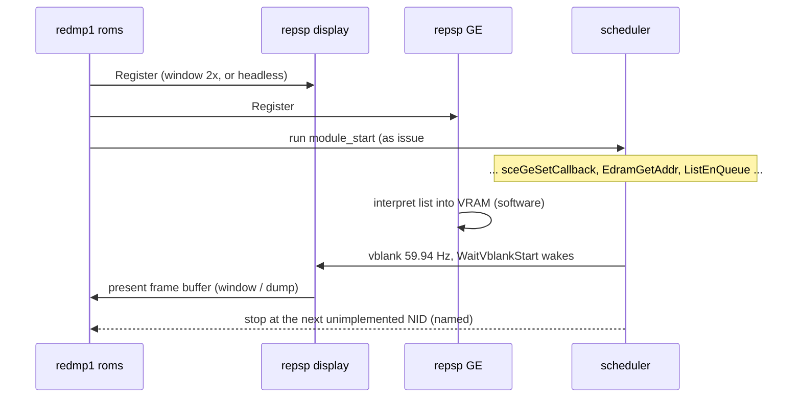

# 설계: 첫 프레임 — GE·display HLE를 앱에 연결하고 다음 미구현 호출까지 (issue #7)

## 1. 요구사항

* repsp의 GE·display HLE([repsp issue #7](https://github.com/reexec/repsp/issues/7))를 앱에 연결한다. 창을 열고, 부팅이 멈추던 `sceGeSetCallback` 너머로 진행해 다음 미구현 펌웨어 호출까지 간다.
* 게임이 처음 그리는 것을 원본 게임의 사실로 `docs/analysis/`에 기록한다. 기록할 것은 GE 리스트 통계, 프레임버퍼 주소·형식, 첫 표시 시점, 화면 내용의 서술이다. 이 기록이 다음 task(입력·오디오·파일)의 입력이 된다.
* 앱의 손으로 쓴 NID 이름 표(`LookupPublicNidName`, `ThreadManForUser` 2개)를 지우고 repsp의 이름 표를 쓴다. 이 표가 틀린 이름을 문서에 남기는 원인이었다(issue #5의 `sceGeEdramGetAddr` 오기).
* 사용자 결정(issue #7): 소프트웨어 렌더러 먼저.

## 2. 실행

* 기본은 창을 띄운다. `--headless`는 창 없이 돈다(CTest, CI). `REPSP_FRAME_DUMP=<dir>`는 표시된 프레임을 BMP로 남긴다(로컬 분석용; 커밋하지 않음).
* 정지 분류는 issue #5와 같다. 창을 닫으면 정상 종료다.
* 정지 보고에 GE 통계를 더한다. 항목은 실행한 리스트 수, 명령 수, primitive 수(종류별), signal/finish 인터럽트 수, 표시한 프레임 수다.

## 3. 기록 (`docs/analysis/first-frame.md`)

* 부팅에서 첫 표시까지의 HLE 순서를 적는다. issue #5의 `boot.md`에 이어 쓴다.
* `SetMode` 인자, 프레임버퍼 주소·폭·형식, 더블 버퍼링 여부, 깊이 버퍼 주소를 적는다.
* 첫 리스트와 이후 리스트의 통계, 쓴 GE 명령의 종류(명령 번호 목록)와 처음 보는 명령, `SIGNAL`의 동작 종류를 적는다.
* 화면 내용을 글로 서술한다(예: 경고문, 제작사 로고). 이미지는 저장소에 넣지 않는다.
* 다음 정지 NID와 이름을 적는다.
* 원본 게임의 사실만 적는다. 사용자 덤프의 위치나 이름은 적지 않는다.

## 4. 이번 task의 검증

1. 로컬: `redmp1 roms`가 창에 게임의 첫 화면을 띄우고, 이름이 붙은 다음 미구현 NID에서 정지 분류 (a)로 멈춘다. 디스패치 미스, 미구현 커널 NID, 미구현 GE 명령 보고, 교착이 없다.
2. 로컬: 프레임 덤프로 첫 화면이 사람이 알아볼 수 있게 그려졌는지 리뷰어가 확인한다(덤프 위치를 작업 로그에 적는다; 덤프 자체는 커밋하지 않는다).
3. 로컬: 3회 실행의 HLE 추적이 같다. vblank가 호스트 시각에 묶여 있으므로 다르면 원인(vblank 대기 횟수, 시각 의존 분기)을 분석해 기록한다.
4. CTest `app_boot`(roms가 있을 때)를 새 정지 지점과 headless로 갱신한다.
5. Win64 Debug/Release와 Linux x64 빌드·CTest, CI 통과.

---

# Design: first frame — wiring GE and display HLE into the app, up to the next unimplemented call (issue #7)

## 1. Requirements

* Wire repsp's GE and display HLE ([repsp issue #7](https://github.com/reexec/repsp/issues/7)) into the app, open a window, and run past `sceGeSetCallback`, where the boot stopped, up to the next unimplemented firmware call.
* Record what the game draws first — GE list statistics, frame-buffer addresses and formats, when the first frame is shown, a description of the picture — as facts about the original game in `docs/analysis/`, the input of the next task (input, audio, files).
* Remove the app's hand-written NID name table (`LookupPublicNidName`, two `ThreadManForUser` entries) in favor of repsp's name table; that table is what let a wrong name into the documents (issue #5's `sceGeEdramGetAddr` mistake).
* User decision (issue #7): the software renderer first.

## 2. Running

See the sequence diagram above. A window opens by default; `--headless` runs without one (CTest, CI); `REPSP_FRAME_DUMP=<dir>` keeps the presented frames as BMP (local analysis only, never committed). Stop classes are those of issue #5, and closing the window is a normal end. The stop report gains GE statistics: lists run, commands, primitives (per kind), signal/finish interrupts and frames presented.

## 3. Record (`docs/analysis/first-frame.md`)

The HLE order from boot to the first frame (continuing issue #5's `boot.md`); `SetMode`'s arguments, the frame-buffer addresses, widths and formats, whether it double-buffers, and the depth-buffer address; statistics of the first and later lists, the GE commands used (the list of command numbers) with any seen for the first time, and the `SIGNAL` behavior kinds; a written description of the picture (for example a warning text or a publisher logo) with no image in the repository; the next stop NID and its name. Facts about the original game only — no location or name of the user's dump.

## 4. Verification for this task

1. Local: `redmp1 roms` shows the game's first picture in the window and stops, class (a), at the next unimplemented NID with its name; no dispatch miss, unimplemented kernel NID, unimplemented-GE-command report or deadlock.
2. Local: the reviewer checks with a frame dump that the first picture is recognizably drawn (the dump's location goes to the work log; the dump itself is never committed).
3. Local: three runs give the same HLE trace; since vblank follows host time, any difference is analyzed (the number of vblank waits, branches on time) and recorded.
4. CTest `app_boot` (with roms) is updated to the new stop point and headless.
5. Win64 Debug/Release and Linux x64 builds and CTest, and CI, pass.
