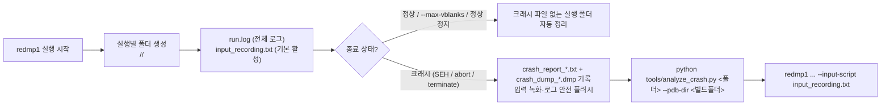

# 크래시 보고 및 덤프 분석 가이드

이 문서는 `redmp1` 실행 중 비정상 종료가 발생했을 때 크래시 보고서·미니덤프·실행 로그·입력 녹화를 수집하고, `tools/analyze_crash.py`로 원인을 분석한 뒤 `--input-script`로 재현하는 절차를 설명한다.

* 관련 설계: [20261115-i031-crash-analysis.md](../design/20261115-i031-crash-analysis.md)
* 관련 작업 로그: [20261115-i031-crash-analysis.md](../work-logs/20261115-i031-crash-analysis.md)

---

## 1. 실행 중 자동 기록 항목



* `--crash-dir <경로>`: 크래시 기록 기본 루트를 지정한다. 생략하면 OS 사용자 데이터 디렉터리(`SDL_GetPrefPath` 기반 `redmp1`) 아래 `crashes/`를 사용한다.
* 실행마다 `<crash-dir>/<YYYYMMDD-HHMMSS>/` 폴더가 만들어지며 다음 파일을 남긴다.
  * `run.log`: 실행 로그(`SetLogFile`)
  * `input_recording.txt`: VBlank 단위 컨트롤러 입력 변화(`StartInputRecording`, `--no-input-record`로 비활성화 가능)
  * `crash_report_*.txt`: 비정상 종료 시 생성(`stop_reason`, `scheduler_mutex_owner_*`, `crashing_guest_thread`, 최근 게스트 진입·HLE 호출 이력, 앱 버전·렌더러·배율·코덱·게임 ID 등 포함, 사용자 계정 경로 제외)
  * `crash_dump_*.dmp`: Windows 미니덤프(`MiniDumpWriteDump`)
* 크래시 보고서나 `.dmp`가 없는 정상 종료 실행 폴더는 종료 시 자동으로 정리된다.

---

## 2. 테스트 크래시 유발 (`--debug-crash`)

크래시 포착과 분석 파이프라인이 정상 동작하는지 확인하려면 `--debug-crash <kind>`를 사용한다.

* 지원 `<kind>`: `access_violation`, `abort`, `cpp_exception`, `unjoined_thread`, `mutex_held_stop`

```powershell
.\build\win64-release\Release\redmp1.exe roms --headless --crash-dir .\tmp-crashes --debug-crash access_violation
```

---

## 3. 덤프·보고서 분석 (`tools/analyze_crash.py`)

Release 빌드도 `/Zi` 및 `/DEBUG:FULL /OPT:REF /OPT:ICF`로 PDB(`redmp1.pdb`)를 함께 생성한다.

```powershell
python tools\analyze_crash.py .\tmp-crashes\<YYYYMMDD-HHMMSS> --pdb-dir .\build\win64-release\Release
```

* `tools/analyze_crash.py`는 Python 표준 라이브러리와 Windows `dbghelp.dll`(`ctypes`)만 사용하며 추가 패키지가 필요 없다.
* 실행 폴더, `crash_report_*.txt`, 또는 단일 `.dmp` 파일(예: Windows `%LOCALAPPDATA%\CrashDumps\redmp1.exe.*.dmp`)을 바로 인자로 넘길 수 있다.
* 보고서 본문, 예외 코드·주소의 PDB 심볼/소스 줄 번호, `RIP`/`RSP`/`RBP`, 스택 반환 주소 스캔, C++ 예외(`0xE06D7363`) RTTI/`what()` 복원 결과, `run.log` 마지막 줄과 `input_recording.txt` 요약을 출력한다.

---

## 4. 녹화 입력 재현 (`--input-script`)

크래시 폴더에 남은 `input_recording.txt`는 `--input-script`에 그대로 넣어 같은 입력 시퀀스를 재현할 수 있다.

```powershell
.\build\win64-release\Release\redmp1.exe roms --input-script .\tmp-crashes\<YYYYMMDD-HHMMSS>\input_recording.txt --no-input-record
```

---

# Crash Reporting and Dump Analysis Guide (English)

This guide explains how `redmp1` captures crash reports, minidumps, run logs, and input recordings, how to analyze them with `tools/analyze_crash.py`, and how to replay inputs with `--input-script`.

* Related design: [20261115-i031-crash-analysis.md](../design/20261115-i031-crash-analysis.md)
* Related work log: [20261115-i031-crash-analysis.md](../work-logs/20261115-i031-crash-analysis.md)

## 1. Per-Run Recording

* `--crash-dir <path>`: Sets the root directory for crash runs (defaults to `crashes/` under the OS user data directory).
* Each run creates `<crash-dir>/<YYYYMMDD-HHMMSS>/` containing `run.log`, `input_recording.txt` (enabled by default; disable with `--no-input-record`), and on abnormal termination `crash_report_*.txt` + `crash_dump_*.dmp` (including `stop_reason`, `scheduler_mutex_owner_*`, thread history, and sanitized app/game metadata without user paths).
* Clean runs without crash files are pruned automatically on exit.

## 2. Triggering Test Crashes (`--debug-crash`)

Supported `<kind>` values: `access_violation`, `abort`, `cpp_exception`, `unjoined_thread`, `mutex_held_stop`.

```powershell
.\build\win64-release\Release\redmp1.exe roms --headless --crash-dir .\tmp-crashes --debug-crash access_violation
```

## 3. Analyzing Reports and Minidumps (`tools/analyze_crash.py`)

Release builds generate `redmp1.pdb` via `/Zi` and `/DEBUG:FULL /OPT:REF /OPT:ICF`. Run:

```powershell
python tools\analyze_crash.py .\tmp-crashes\<YYYYMMDD-HHMMSS> --pdb-dir .\build\win64-release\Release
```

`tools/analyze_crash.py` uses Python stdlib + `dbghelp.dll` via `ctypes` (zero external dependencies) and accepts a run directory, `crash_report_*.txt`, or any `.dmp` file (including `%LOCALAPPDATA%\CrashDumps\*.dmp`).

## 4. Replaying Recorded Input (`--input-script`)

Pass the captured `input_recording.txt` directly to `--input-script`:

```powershell
.\build\win64-release\Release\redmp1.exe roms --input-script .\tmp-crashes\<YYYYMMDD-HHMMSS>\input_recording.txt --no-input-record
```
