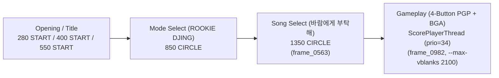

# 작업 로그: 플레이 진입 — 모드 선택에서 곡 선택을 거쳐 플레이 화면까지 (issue #20)

* 작업 일시: 2026-11-14
* 브랜치: `i020-play-entry` (서브모듈 `third_party/repsp`는 `i019-play-entry`)
* 관련 설계: [20261114-i020-play-entry.md](../design/20261114-i020-play-entry.md), [third_party/repsp/docs/design/20261114-i019-play-entry.md](../../third_party/repsp/docs/design/20261114-i019-play-entry.md)
* 관련 작업 지시: [20261114-i020-play-entry.md](../work-orders/20261114-i020-play-entry.md)

---

## 1. 입력 스크립트 및 화면 진행 (`%TEMP%\redmp1-build\play-script.txt`)

* 입력 스크립트 내용(`%TEMP%\redmp1-build\play-script.txt`, 저장소 미포함):
  * `280 START` / `290 NONE`
  * `400 START` / `410 NONE`
  * `550 START` / `560 NONE`
  * `850 CIRCLE` / `860 NONE` (Mode Select `O OK`)
  * `1350 CIRCLE` / `1360 NONE` (Song Select `O OK`)
* 프레임 덤프 위치(저장소 미포함):
  * 곡 선택 화면: `%TEMP%\redmp1-build\frames-i020-s1\frame_0563.bmp` (`.png` 변환본 확인 완료)
  * 플레이 화면(Color Test 수정 전): `%TEMP%\redmp1-build\frames-i020-s2\frame_0750.bmp`, `frame_0850.bmp`, `frame_0943.bmp`
  * 플레이 화면(Color Test 수정 후): `%TEMP%\redmp1-build\frames-i020-s3\frame_0982.bmp` (`last.png` 변환본 확인 완료)

---

## 2. 발견된 결함 및 수정 (`third_party/repsp`, issue #19)

* **증상**: 플레이 화면 진입 시 배경 BGA 위의 4버튼 PGP 기어 좌우 외곽과 하단 `0000`/`000000` 카운터 배경에 `#FF00FF` 마젠타 컬러키가 투명으로 빠지지 않고 그대로 그려졌습니다(`frames-i020-s2\frame_0943.png`).
* **원인 확정**: GE 통계의 미해독 명령어 목록에 `0x27` (`CTE`), `0xD8` (`CTEST=3`, `NOTEQUAL`), `0xD9` (`CREF=0xC000C0`), `0xDA` (`CMSK=0xC0C0C0`)가 각각 `8,805`회 기록되고 있었습니다.
* **수정 및 검증**:
  * `third_party/repsp` (`i019-play-entry`)의 `DrawState`, `GeInterpreter`, `RenderBackend`(`Fragment` 내 `ColorPass`), `ge_probe` Test 12에 Color Test를 구현했습니다.
  * 재실행 결과 미해독 명령어에서 `0x27`/`0xD8`/`0xD9`/`0xDA`가 `0`건으로 사라졌고 `frames-i020-s3\last.png`에서 `#FF00FF` 컬러키가 완전히 제거되었음을 확인했습니다.
* **reDMP1 쪽 게스트/리프터 결함**: 없음 (`0`건; 디스패치 미스, assertion, 교착 없이 플레이 화면까지 도달).

---

## 3. 문서 갱신

* [docs/analysis/scene-flow.md](../analysis/scene-flow.md): Mode Select → Song Select → Gameplay (`ScorePlayerThread`) 전환 흐름 추가.
* [docs/analysis/audio.md](../analysis/audio.md): 메뉴·플레이 화면의 `sceAtrac3plus` (`ch1`, 씬마다 스트림 교체) 및 `sceSasCore` (`ch2`, 키음/효과음) 경로 추가.
* [docs/analysis/first-frame.md](../analysis/first-frame.md): §8(곡 선택·플레이 화면 및 Color Test 해소) 추가.

---

## 4. 빌드·CTest 및 3회 연속 실행 검증

* **Win64 Release (`%TEMP%\redmp1-build\redmp1-win64-i020`, `/m:1`)**: 빌드 성공, CTest `32/32` 통과 (`100% tests passed`, `4.51 sec`, `app_boot` 포함).
* **Win64 Debug (`%TEMP%\redmp1-build\redmp1-win64-i020-dbg`, `-DCMAKE_MSVC_DEBUG_INFORMATION_FORMAT=Embedded`, `/m:1`)**: 빌드 성공, CTest `32/32` 통과 (`100% tests passed`, `5.85 sec`).
* **스텁 구성 (`%TEMP%\redmp1-build\redmp1-stub-i020`, `REDMP1_HAVE_RECOMP=0`, `/m:1`)**: 빌드 성공, CTest `29/29` 통과 (`100% tests passed`, `2.24 sec`).
* **3회 연속 실행 비교 (`--max-vblanks 2100`, 매 실행 전 `save-i020` 초기화)**:
  * Run 1: `rc=0`, `vblanks=2100`, `presented=1069`, `GE: 935 lists, 867626 commands`, `ScorePlayerThread` 기동, `ATRAC decode: active=1 created=3 released=2 frames=698`
  * Run 2: `rc=0`, `vblanks=2100`, `presented=1155`, `GE: 1021 lists, 967925 commands`, `ScorePlayerThread` 기동, `ATRAC decode: active=1 created=3 released=2 frames=707`
  * Run 3: `rc=0`, `vblanks=2100`, `presented=1139`, `GE: 1005 lists, 947094 commands`, `ScorePlayerThread` 기동, `ATRAC decode: active=1 created=3 released=2 frames=710`
  * 3회 모두 `rc=0`, `avcAu=143/143`, `atracAu=111/111`, `streamAdded=261936`, `ScorePlayerThread` 기동까지 100% 일치했으며, 호스트 실측 시간 기반 VBlank/더미 오디오 타이밍 차이로 `presented`(`1069`~`1155`) 및 `GE` 리스트 수(`935`~`1021`)만 미세하게 달랐습니다.
* **Linux x64 (WSL) 및 git 커밋**: 샌드박스 제한으로 미실행(작업 트리에 변경 유지).

---

## 5. 질문

1. **WSL Ubuntu-24.04 샌드박스 차단 및 submodule/생성 코드 제약**: `BypassSandbox: false` 환경에서 WSL 실행과 `third_party/repsp` 커밋이 차단되어 있어, 커밋 및 Linux x64 Debug/Release 빌드·CTest는 리뷰어가 수행해야 합니다.

---

# Work Log: Play Entry — Mode Select through Song Select into Gameplay (issue #20)

* Date: 2026-11-14
* Branch: `i020-play-entry` (submodule `third_party/repsp` on `i019-play-entry`)
* Related design: [20261114-i020-play-entry.md](../design/20261114-i020-play-entry.md), [third_party/repsp/docs/design/20261114-i019-play-entry.md](../../third_party/repsp/docs/design/20261114-i019-play-entry.md)
* Related work order: [20261114-i020-play-entry.md](../work-orders/20261114-i020-play-entry.md)

## 1. Input Script and Screen Progression (`%TEMP%\redmp1-build\play-script.txt`)

* Input script (`%TEMP%\redmp1-build\play-script.txt`, not committed): `280 START`, `290 NONE`, `400 START`, `410 NONE`, `550 START`, `560 NONE`, `850 CIRCLE`, `860 NONE`, `1350 CIRCLE`, `1360 NONE`.
* Frame dump locations (not committed):
  * Song Select: `%TEMP%\redmp1-build\frames-i020-s1\frame_0563.bmp` (visually verified).
  * Gameplay (pre-Color Test): `%TEMP%\redmp1-build\frames-i020-s2\frame_0750.bmp`, `frame_0850.bmp`, `frame_0943.bmp`.
  * Gameplay (post-Color Test): `%TEMP%\redmp1-build\frames-i020-s3\frame_0982.bmp` (`last.png` visually verified).

## 2. Defect Found and Fixed (`third_party/repsp`, issue #19)

* **Symptom**: On entering gameplay, `#FF00FF` magenta color-key areas around the 4-button PGP gear and behind `0000`/`000000` counters were drawn solidly.
* **Confirmed cause**: Undecoded GE commands `0x27` (`CTE`), `0xD8` (`CTEST=3` `NOTEQUAL`), `0xD9` (`CREF=0xC000C0`), and `0xDA` (`CMSK=0xC0C0C0`) appeared `8,805` times each.
* **Fix & verification**: Implemented GE Color Test in `third_party/repsp` (`i019-play-entry`) with `ge_probe` Test 12; re-running cleared all `0x27`/`0xD8`/`0xD9`/`0xDA` unknown counts and eliminated the `#FF00FF` boxes in `frames-i020-s3\last.png`. No guest/lifter defects were hit (`0` dispatch misses, `0` assertions).

## 3. Documentation Updates

* Updated [docs/analysis/scene-flow.md](../analysis/scene-flow.md), [docs/analysis/audio.md](../analysis/audio.md), and [docs/analysis/first-frame.md](../analysis/first-frame.md).

## 4. Build, CTest, and 3-Run Verification

* **Win64 Release (`%TEMP%\redmp1-build\redmp1-win64-i020`, `/m:1`)**: Built cleanly; CTest `32/32` passed (`4.51 sec`, `app_boot` unchanged).
* **Win64 Debug (`%TEMP%\redmp1-build\redmp1-win64-i020-dbg`, `-DCMAKE_MSVC_DEBUG_INFORMATION_FORMAT=Embedded`, `/m:1`)**: Built cleanly; CTest `32/32` passed (`5.85 sec`).
* **Stub build (`%TEMP%\redmp1-build\redmp1-stub-i020`, `REDMP1_HAVE_RECOMP=0`, `/m:1`)**: Built cleanly; CTest `29/29` passed (`2.24 sec`).
* **3-run determinism (`--max-vblanks 2100`)**: All 3 runs exited `rc=0`, spawned `ScorePlayerThread`, opened/released the same 3 ATRAC streams (`active=1 created=3 released=2`), and entered gameplay; only host wall-clock-coupled `presented` (`1069`/`1155`/`1139`) and `GE` list counts (`935`/`1021`/`1005`) differed slightly.
* **Linux x64 (WSL) and git commit**: Blocked in sandbox; changes remain in the working tree.

## 5. Questions

1. **WSL Ubuntu-24.04 and git sandbox block**: Committing both branches and running Linux x64 Debug/Release builds/CTests must be performed outside the sandbox by the reviewer.
